# Larekmart

<div align="center">

[](LICENSE)
[](packages/typescript-config)
[](https://turbo.build)
[-black.svg>)](https://nextjs.org)
[](docs/DOCKER.md)
[](infrastructure/kubernetes)
[](CONTRIBUTING.md)

**A production-grade, distributed microservices e-commerce platform built for high-throughput marketplace scale (like Amazon, AliExpress, and Daraz).**

[Features](#system-architecture) • [Storefront Tour](#-storefront-visual-showcase) • [Quick Start](#quick-start) • [Architecture](#system-architecture) • [Documentation](#documentation-index) • [Contributing](CONTRIBUTING.md)

</div>

---

**Larekmart** is a production-grade microservices e-commerce platform designed for multi-tenant marketplace scale (Amazon, AliExpress, and Daraz). It pairs a customer storefront and an admin management dashboard with a **centralized Fastify API Gateway** and **twenty-three backend services** communicating **asynchronously over Apache Kafka** and persisting data via a **polyglot architecture** (PostgreSQL for products, inventory, catalog, shipping, users, media, analytics, notifications, reviews, wishlists, promotions, pricing, vendors, and sellers; MongoDB for orders and carts; MySQL 8.0 with dedicated, isolated instances for tax compliance on port 3306 and returns management on port 3307).

Engineered to endure massive high-concurrency shopping festivals (e.g., 11.11 flash sales with 5,000+ req/sec on hot items), the platform features a **Distributed Multi-DB Checkout Saga (Dual-ACK)**, **Transactional Outbox** event publishing, **Distributed Leader Election for Outbox Sweepers**, **API Gateway Thundering-Herd Protection (`SingleFlight`)**, **In-Flight Concurrency Bulkheads & Adaptive Rate Limiting**, **PostgreSQL Read-Replica Projections**, **MongoDB Orders Horizontal Sharding**, **High-Velocity Redis Stock Gatekeeper**, **Kafka Dead-Letter Queue (DLQ) Resilience**, **PgBouncer Transaction Pooling (Port 6432)**, **Declarative Chaos Mesh Engineering**, and **Telemetry Ring Buffer Micro-Batching** (reducing DB write queries by 99.8%).

The repository is organized as a **pnpm 9 + Turborepo** monorepo: Next.js frontends, polyglot Node, Go, and Python services, and shared internal packages managed with unified tooling, strict TypeScript typing, declarative Kustomize Kubernetes deployments (`infrastructure/kubernetes`), and CNCF Chaos Mesh simulations (`infrastructure/chaos`).

---

## 🖼️ Storefront Visual Showcase

<div align="center">

> **A modern, responsive, high-converting customer shopping experience built with Next.js 16 (App Router), Tailwind CSS v4, Zustand, Framer Motion, and Stripe.**

| [🏠 Homepage Tour](#-1-storefront-homepage-walkthrough-8-slides) | [🛍️ Product Detail](#-2-product-discovery--shopping-cart) | [🛒 Smart Cart](#-2-product-discovery--shopping-cart) | [💳 4-Step Checkout Flow](#-3-streamlined-4-step-checkout-flow) | [🚚 Order Tracking](#-4-post-purchase--real-time-order-tracking) |
| :--------------------------------------------------------------: | :-------------------------------------------------------: | :---------------------------------------------------: | :-------------------------------------------------------------: | :--------------------------------------------------------------: |

<br/>

<p align="center">
  <a href="./public/images/client/home/home-01.png">
    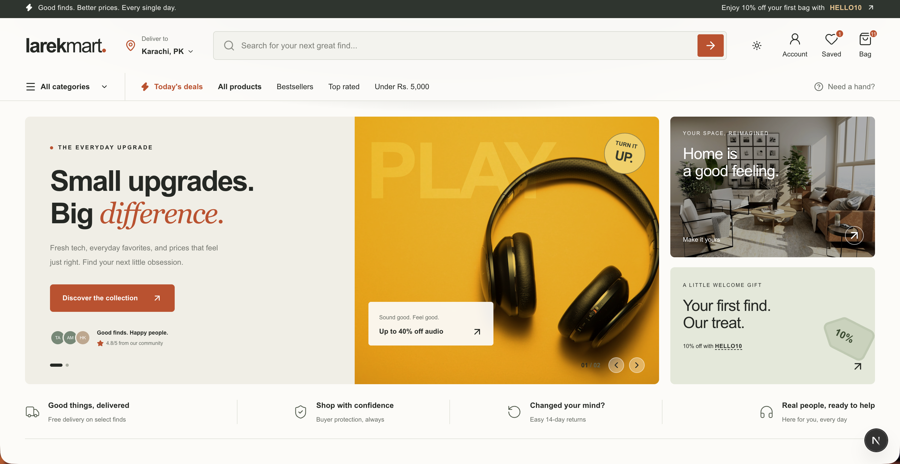
  </a>
  <br/>
  <em>✨ High-converting customer storefront featuring responsive category discovery, dynamic hero carousels, and flash deals.</em>
</p>

</div>

<br/>

### 🏠 1. Storefront Homepage Walkthrough (8 Slides)

<details open>
<summary><b>▶ Click to expand / collapse the Homepage Walkthrough (8 sections)</b></summary>
<br/>

<table>
  <tr>
    <td align="center" width="50%">
      <b>Slide 1/8: Hero Showcase & Dynamic Categories</b><br/>
      <sub>Interactive hero banner with promotional carousels, instant search bar, and marketplace navigation.</sub><br/><br/>
      <a href="./public/images/client/home/home-01.png">
        
      </a>
    </td>
    <td align="center" width="50%">
      <b>Slide 2/8: Flash Deals & Limited-Time Offers</b><br/>
      <sub>Real-time countdown counters, dynamic percentage-off badges, and quick-add actions.</sub><br/><br/>
      <a href="./public/images/client/home/home-02.png">
        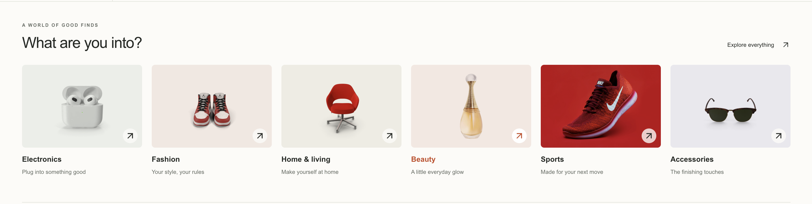
      </a>
    </td>
  </tr>
  <tr>
    <td align="center" width="50%">
      <b>Slide 3/8: Popular Categories & Trending Grid</b><br/>
      <sub>Curated category tiles, trending product grids, and catalog discovery entrypoints.</sub><br/><br/>
      <a href="./public/images/client/home/home-03.png">
        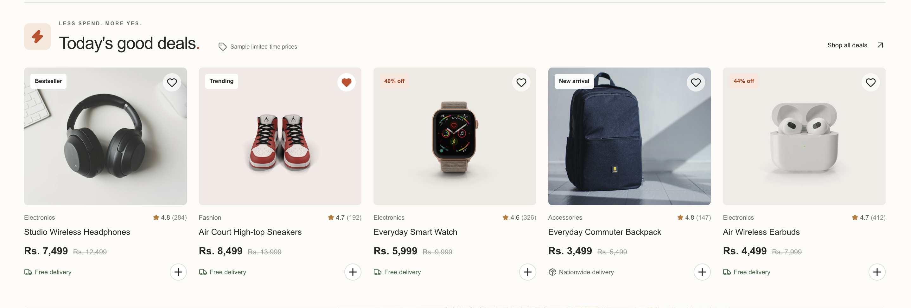
      </a>
    </td>
    <td align="center" width="50%">
      <b>Slide 4/8: Promotional Campaigns & Spotlight Banners</b><br/>
      <sub>Seasonal promotional highlights, coupon announcements, and partner campaigns.</sub><br/><br/>
      <a href="./public/images/client/home/home-04.png">
        
      </a>
    </td>
  </tr>
  <tr>
    <td align="center" width="50%">
      <b>Slide 5/8: Personalized Recommendations & Best Sellers</b><br/>
      <sub>Recommendation engine suggestions, verified customer review ratings, and price tags.</sub><br/><br/>
      <a href="./public/images/client/home/home-05.png">
        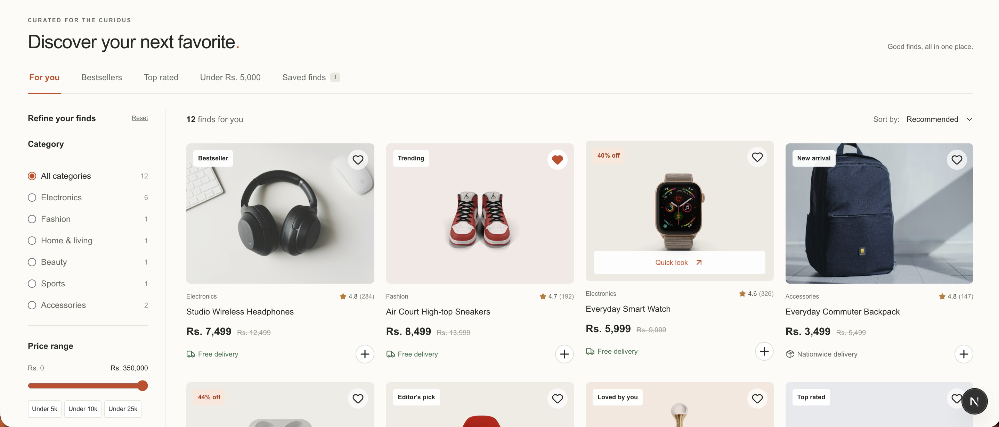
      </a>
    </td>
    <td align="center" width="50%">
      <b>Slide 6/8: Official Brands & Curated Stores</b><br/>
      <sub>Marketplace brand spotlights, seller storefront links, and seasonal lookbooks.</sub><br/><br/>
      <a href="./public/images/client/home/home-06.png">
        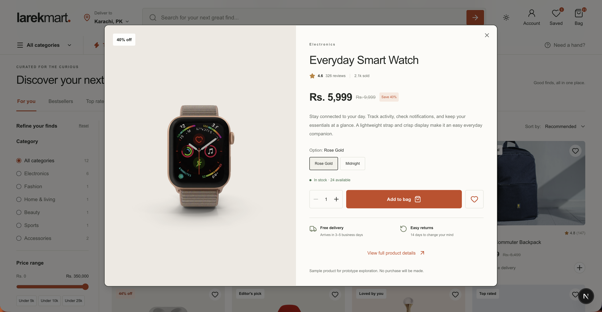
      </a>
    </td>
  </tr>
  <tr>
    <td align="center" width="50%">
      <b>Slide 7/8: Value Propositions & Newsletter</b><br/>
      <sub>Buyer protection guarantees, global shipping terms, 24/7 support & VIP membership signup.</sub><br/><br/>
      <a href="./public/images/client/home/home-07.png">
        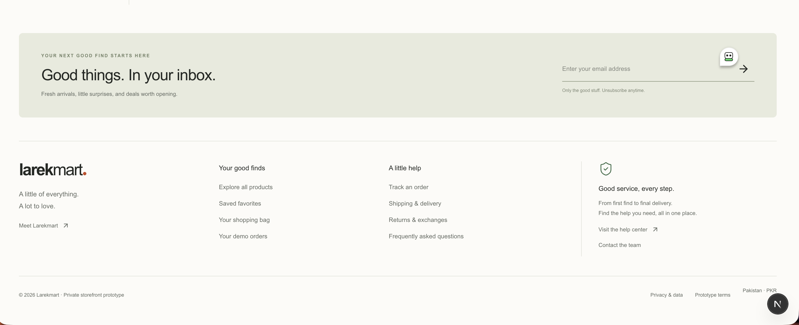
      </a>
    </td>
    <td align="center" width="50%">
      <b>Slide 8/8: Global Footer & Marketplace Directory</b><br/>
      <sub>Payment provider badges, legal/security policies, currency selector, and site navigation.</sub><br/><br/>
      <a href="./public/images/client/home/home-08.png">
        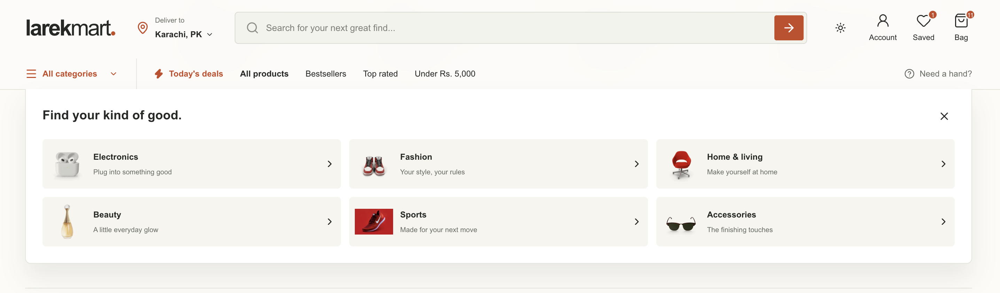
      </a>
    </td>
  </tr>
</table>

</details>

<br/>

### 🛍️ 2. Product Discovery & Shopping Cart

<table>
  <tr>
    <td align="center" width="50%">
      <b>📦 Rich Product Detail Experience</b><br/>
      <sub>Multi-angle image gallery, color/variant selectors, real-time inventory checks, verified purchase reviews, and wishlist alerts.</sub><br/><br/>
      <a href="./public/images/client/product-detail.png">
        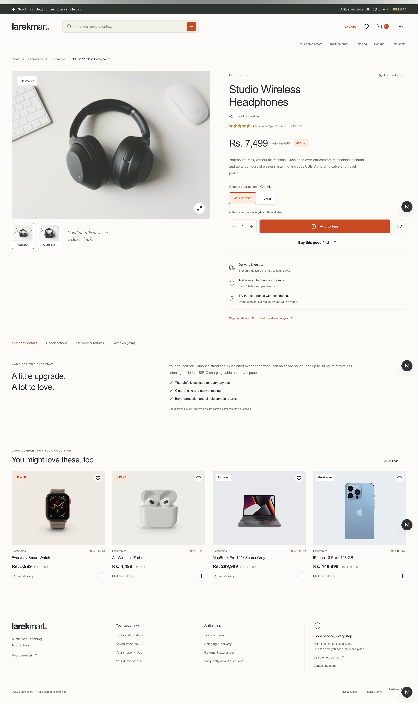
      </a>
    </td>
    <td align="center" width="50%">
      <b>🛒 Authoritative Cart & Real-Time Estimates</b><br/>
      <sub>MongoDB-backed persistent cart, promotional coupon discounts, real-time tax estimation, and estimated shipping fees.</sub><br/><br/>
      <a href="./public/images/client/cart.png">
        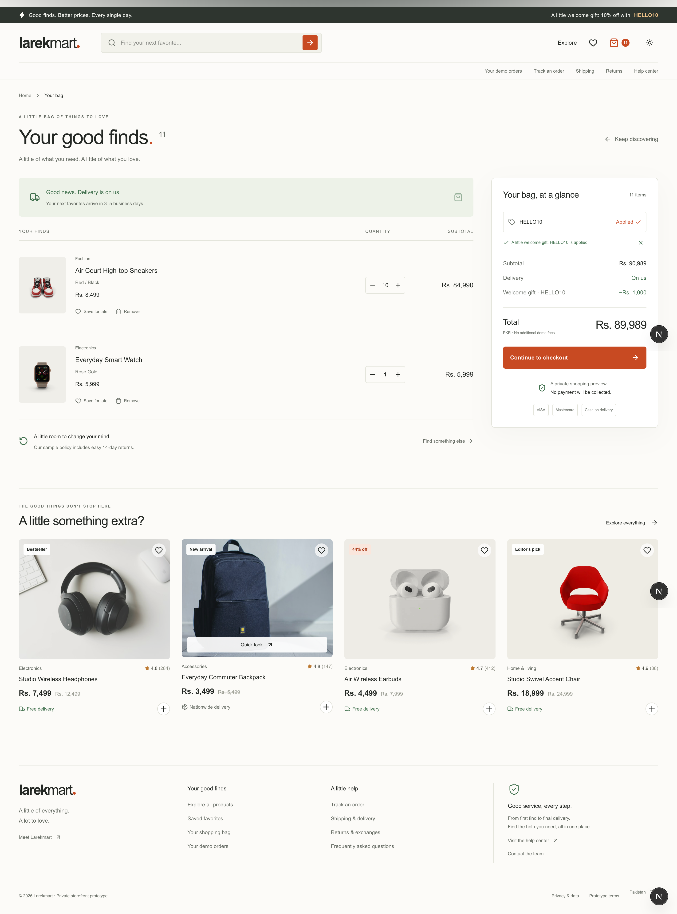
      </a>
    </td>
  </tr>
</table>

<br/>

### 💳 3. Streamlined 4-Step Checkout Flow

<details open>
<summary><b>▶ Click to expand / collapse the 4-Step Checkout Flow</b></summary>
<br/>

<table>
  <tr>
    <td align="center" width="50%">
      <b>Step 1: Shipping Address & Recipient Details</b><br/>
      <sub>Saved user addresses, interactive address validation, and delivery instructions.</sub><br/><br/>
      <a href="./public/images/client/checkout-01.png">
        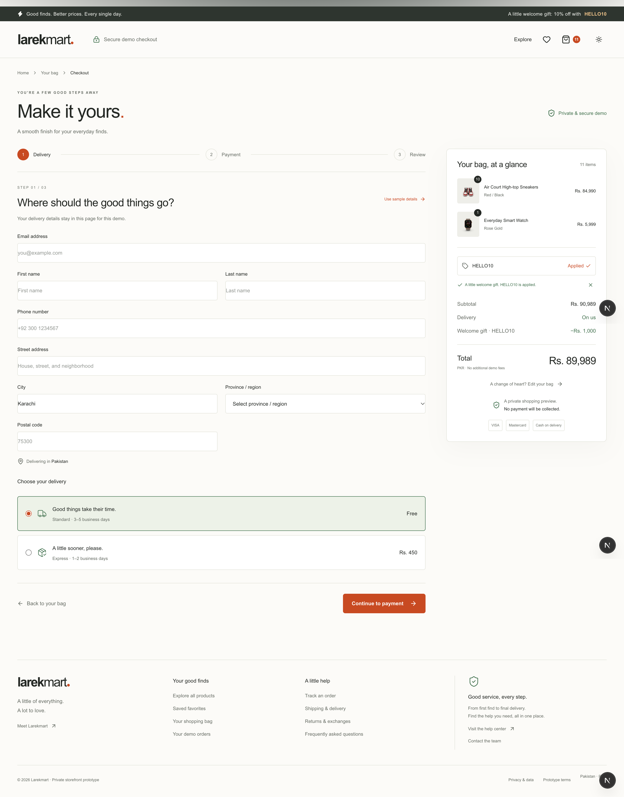
      </a>
    </td>
    <td align="center" width="50%">
      <b>Step 2: Shipping Methods & Live Carrier Rates</b><br/>
      <sub>Multi-carrier delivery estimates (Standard, Express, Overnight) and carrier selection.</sub><br/><br/>
      <a href="./public/images/client/checkout-02.png">
        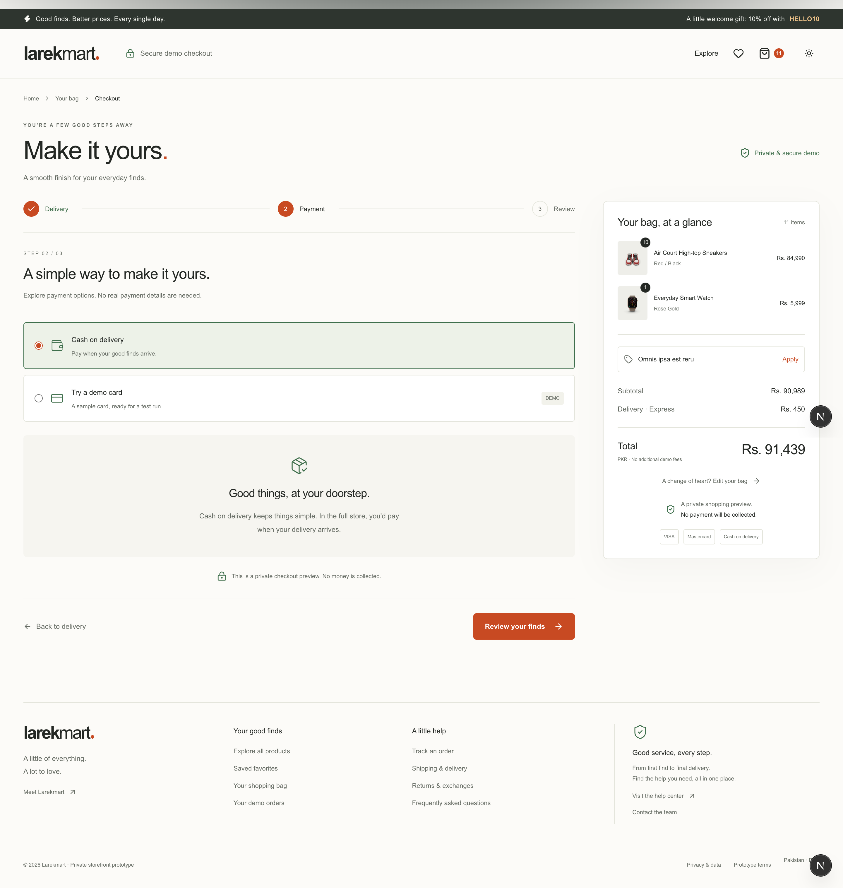
      </a>
    </td>
  </tr>
  <tr>
    <td align="center" width="50%">
      <b>Step 3: Secure Payment Methods</b><br/>
      <sub>Stripe payment elements, credit/debit card processing, Klarna installments, and Cash on Delivery (COD).</sub><br/><br/>
      <a href="./public/images/client/checkout-03.png">
        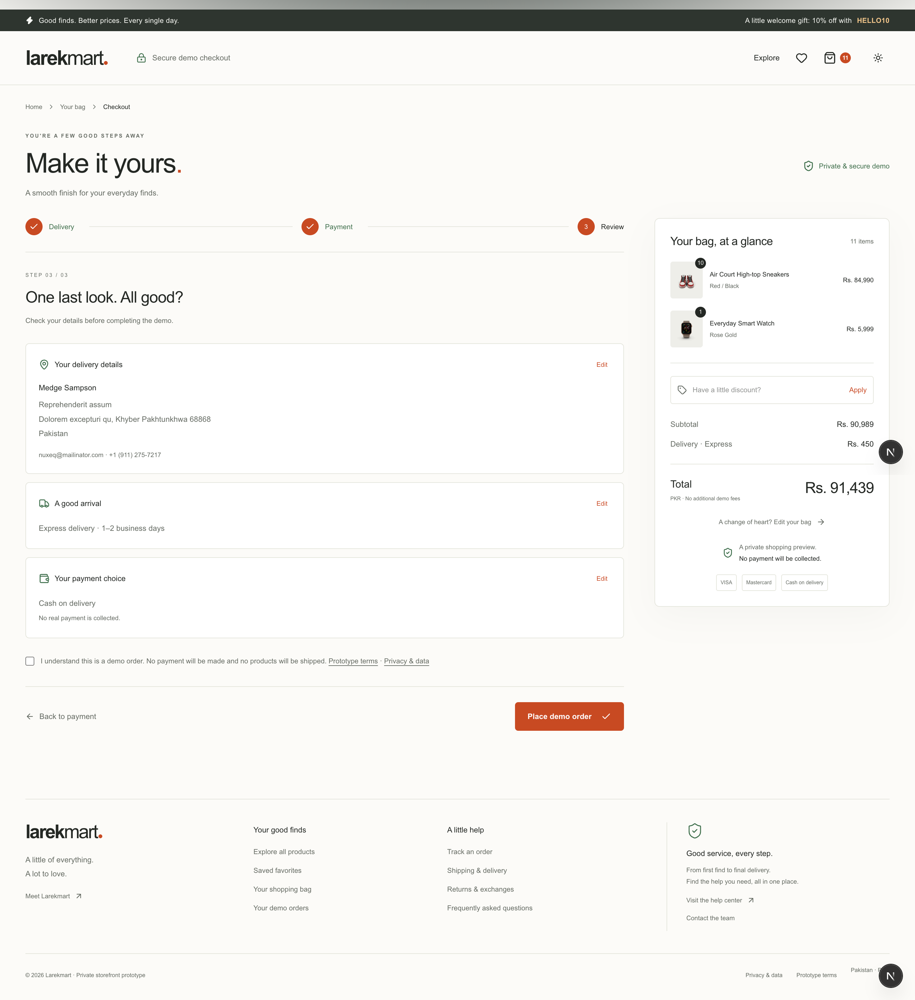
      </a>
    </td>
    <td align="center" width="50%">
      <b>Step 4: Final Review & Order Placement</b><br/>
      <sub>Transparent itemized totals, tax audit quotes, shipping insurance options, and one-click order confirmation.</sub><br/><br/>
      <a href="./public/images/client/checkout-04.png">
        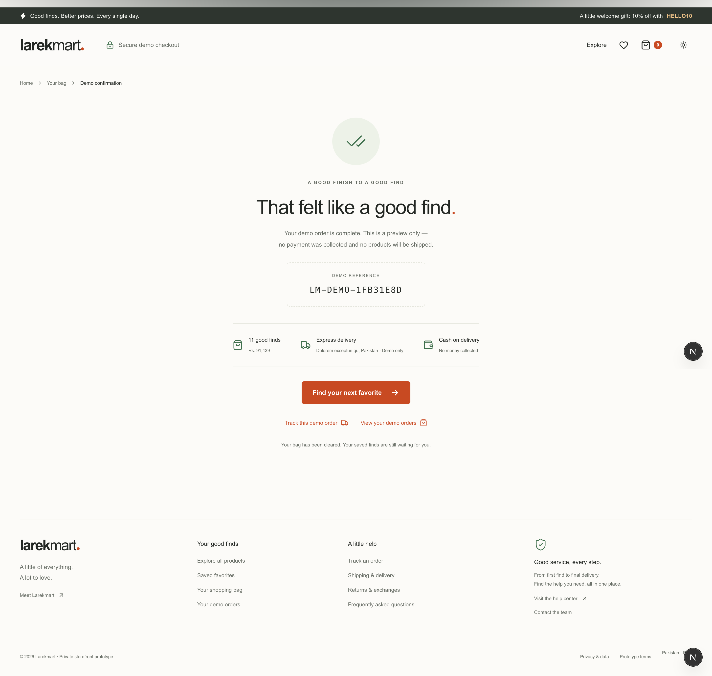
      </a>
    </td>
  </tr>
</table>

</details>

<br/>

### 🚚 4. Post-Purchase & Real-Time Order Tracking

<table>
  <tr>
    <td align="center" width="100%">
      <b>📋 Order Confirmation & Live Checkpoint Tracking</b><br/>
      <sub>Instant invoice generation, order lifecycle states (Created ➔ Confirmed ➔ Dispatched ➔ Delivered), carrier tracking checkpoint timeline, and self-service return request initiator.</sub><br/><br/>
      <a href="./public/images/client/order.png">
        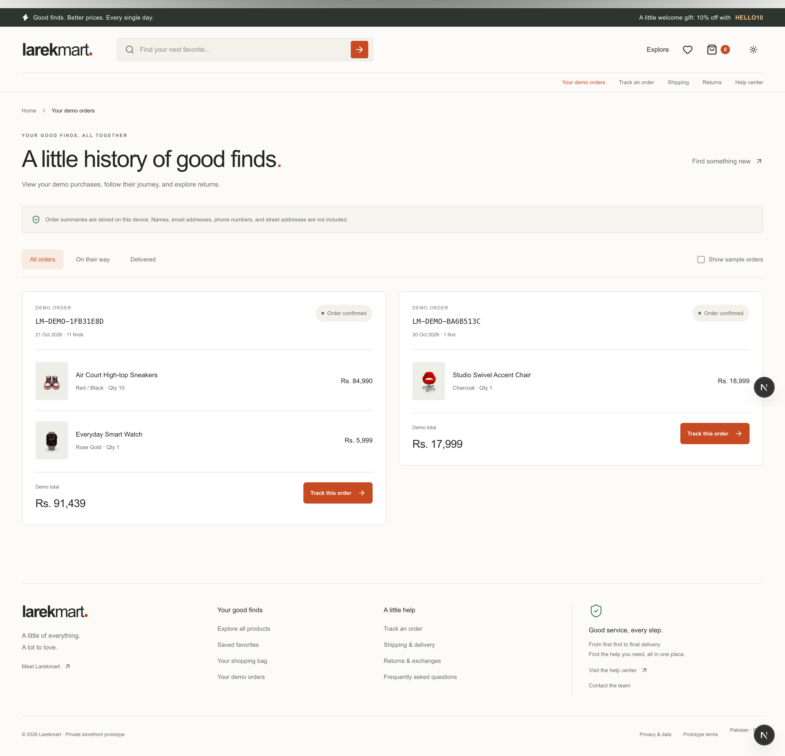
      </a>
    </td>
  </tr>
</table>

---

## System Architecture

```
                         ┌───────────────────────┐
                         │        Clerk          │  auth + session claims (role: user|admin)
                         └───────────┬───────────┘
                                     │ Bearer JWT
          ┌──────────────────────────┴──────────────────────────┐
          │                                                     │
   ┌──────▼───────┐                                      ┌──────▼───────┐
   │   client     │                                      │    admin     │
   │  Next.js 16  │                                      │  Next.js 15  │
   │   :3002      │                                      │   :3003      │
   └──────┬───────┘                                      └──────┬───────┘
          │                                                     │
          │                   HTTPS / REST                      │
          └──────────────────────────┬──────────────────────────┘
                                     │
                                     ▼
                      ┌─────────────────────────────┐
                      │         api-gateway         │  Fastify 5 (:8080 / :8090)
                      │ • Clerk session & headers   │  Reverse proxy, rate limiting,
                      │ • Internal secret signing   │  circuit breaker, retries,
                      │ • Home agg (/api/v1/home)   │  and request correlation
                      └──────────────┬──────────────┘
                                     │ x-user-id, x-user-role, x-internal-secret
      ┌──────────────────────────────┼──────────────────────────────┬──────────────────────────────┐
      │                              │                              │                              │
┌─────▼──────────┐            ┌──────▼───────┐               ┌──────▼───────┐               ┌──────▼───────┐
│ product-service│            │ auth-service │               │notification- │               │payment-service│
│ Express :8000  │            │ Express :8003│               │   service    │               │  Hono :8002  │
│ Prisma/Postgres│            │ Clerk proxy  │               │ Go (Chi)     │               │  Stripe      │
└─────┬──────────┘            └──────┬───────┘               │ :8005        │               └──────┬───────┘
      │ product.*                    │ user.created          └──────▲───────┘                      │ payment.*
      │                              │                              │                              │
      ▼                              ▼                              │                              ▼
┌───────────────┐             ┌──────────────┐                      │                       ┌──────────────┐
│ Kafka cluster │◄────────────┤email-service │◄─────────────────────┼───────────────────────┤order-service │
│  (3 brokers)  │             │ (worker)     │                      │                       │Fastify :8001 │
└───────┬───────┘             └──────────────┘                      │                       │MongoDB       │
        │                                                           │                       └──────────────┘
        │ all domain event streams                                  │
        ▼                                                           │
┌───────────────────────┐                                           │
│   analytic-service    │                                           │
│   Go (Chi) :8004      │                                           │
│   PostgreSQL (pgx)    │                                           │
└───────────────────────┘                                           │
        ▲                                                           │
        └───────────────────────────────────────────────────────────┘
```

> **Edge Ingress & Unified Gateway Routing**: Public internet traffic terminates TLS at **Traefik v3** (`docker-compose.traefik.yml`), which enforces strict router priorities (`priority=100` on API gateway vs `priority=50` on storefront) so Next.js catch-all routes never shadow API endpoints or WebSockets. Both frontends compile against a unified gateway variable (`NEXT_PUBLIC_API_GATEWAY_URL: http://localhost:8090`), treating individual microservice URLs as optional overrides to eliminate static build redeployments on routing changes.

> **Zero Trust Perimeter & Event-Driven Core**: Cross-service communication is strictly asynchronous through Kafka events; backend services never make synchronous HTTP calls to one another. All public traffic enters through `api-gateway`, which enforces rate limits, validates Clerk sessions, scrubs spoofed headers, and injects verified identity claims signed with `x-internal-secret`. The gateway boots independently of downstream services, leveraging Opossum circuit breakers for graceful degradation (returning degraded stub payloads for non-critical reads such as reviews, wishlists, and recommendations during outages) while strictly failing closed with structured 503 responses on transactional endpoints. Downstream services verify transport authenticity in constant time and strictly decouple gateway transport secrets from administrative end-user privileges. For deep architectural specifications, see [`docs/EVENT-DRIVEN-ARCHITECTURE.md`](docs/EVENT-DRIVEN-ARCHITECTURE.md) (event schemas), [`SECURITY.md`](SECURITY.md) (perimeter & cryptographic standards), and [`docs/SECURITY-AUDIT-REPORT.md`](docs/SECURITY-AUDIT-REPORT.md) (vulnerability analysis & remediation log).

> **Deterministic Anti-Starvation Resource Boundaries**: All 41 service containers in `docker-compose.yml` (23 microservices, 3 Kafka KRaft brokers, OpenSearch, PostgreSQL, and MySQL) enforce granular CPU and RAM limits and reservations (`deploy.resources.limits` & `reservations`) using 6 standardized profiles, preventing host memory starvation and Linux OOM killer termination under peak marketplace loads.

### ⚡ Daraz-Scale High-Concurrency Architecture & Resilience Engineering

To sustain **tens of thousands of concurrent users** and prevent cascading system failures during 11.11 shopping festivals and high-velocity flash sales (5,000+ req/sec on hot items), Larekmart incorporates twelve enterprise distributed systems patterns:

1. **Distributed Multi-DB Checkout Saga (Dual-ACK & Automated Refunds)**:
   - When a payment completes, three physically distinct database engines must achieve consistency without 2PC locking: `order-db` (MongoDB), `inventory-db` (PostgreSQL), and `tax_db` (MySQL).
   - Order confirmation requires a **Dual-ACK**: `inventory.stock.sold` (inventory settlement) + `tax.calculation.completed` (tax snapshot & liability).
   - If either stock or tax calculation fails, `order-service` aborts confirmation, trips the compensation flow, emits `payment.refund.requested` (triggering automated Stripe refunds in `payment-service`), and cancels reservations.
   - An active background sweeper runs every 30s to cancel any order trapped in `pending_confirmation` longer than 60s.
2. **Transactional Outbox Pattern (`order-service`)**:
   - Eliminates dual-write inconsistencies between MongoDB and Kafka.
   - Orders and `OutboxEvent` documents (status `PENDING`) are written within the same atomic database transaction.
   - Optimistic non-blocking fast-path dispatch publishes immediately, marking the outbox event `PUBLISHED`.
   - A resilient 5-second lease-locked background sweeper (`lockedUntil < NOW`) recovers any unpublished events caused by transient network blips or broker restarts.
   - Native MongoDB TTL indexes automatically purge published events after 7 days, maintaining an immutable audit log without unbounded storage growth.
3. **API Gateway Thundering-Herd Protection (`SingleFlightGroup`)**:
   - High-velocity read routes (e.g. `GET /api/v1/inventory/:productId/availability` and home aggregation `GET /api/v1/home`) coalesce concurrent requests for identical cache keys onto a single in-flight Promise.
   - When 5,000 concurrent shoppers request product stock on a cache miss, **exactly 1 request** hits downstream PostgreSQL/Redis, with the result broadcast to all waiting callers, completely shielding backends from cache stampedes.
4. **Distributed Mutation Idempotency Key Engine (`@repo/redis`)**:
   - State-mutating routes (e.g., `POST /orders/cod`) enforce IETF-standard `Idempotency-Key` headers.
   - Redis atomic leases (`acquireIdempotencyLock`) grant mutual exclusion:
     - First attempt: acquires lock and processes order.
     - Concurrent attempt: returns `409 Conflict` ("Mutation currently in-flight").
     - Replayed attempt: transparently serves cached response with header `Idempotent-Replayed: true` with 0 database or Kafka interaction.
5. **High-Velocity Redis Stock Gatekeeper (Flash Sale Engine)**:
   - Evaluates stock availability directly in Redis using atomic Lua decrement scripts (`stock:available:{tenant_id:warehouse_id}:productId:variantId`).
   - Strictly enforces dual-token `{tenant_id:warehouse_id}` CRC16 slot-tagging conventions to prevent multi-key `CROSSSLOT` exceptions across distributed Redis clusters.
   - Fast-fails requests under 0 stock in <1ms without touching PostgreSQL connection pools or acquiring table row locks.
   - In-memory claim tokens (`stock:claim:{tenant_id:warehouse_id}:referenceId`) hold reservations during checkout; failures automatically invoke compensation rollbacks (`INCRBY`).
6. **Kafka Consumer Poison-Pill Isolation & Dead-Letter Queue (DLQ)**:
   - Malformed payloads, corrupted bytes, and schema violations (`SyntaxError`, `ZodError`) fast-fail immediately to `<topic>.dlq` on attempt 1 without retry delays.
   - Transient errors (DB connection blips, lock contention) retry with exponential backoff (1s, 2s, 4s) before routing to DLQ with comprehensive audit headers (`x-original-topic`, `x-error-message`, `x-is-poison-pill`, `x-attempt-count`).
   - Consumer partitions commit offsets cleanly and never stall.
7. **PostgreSQL Connection Isolation & PgBouncer Pooling (Port 6432)**:
   - Multiplexes up to 1,000 incoming client connections into dedicated physical pools (`pool_mode = transaction`).
   - Guaranteed pool quotas prevent non-critical background traffic from starving Tier-1 commerce databases (`product_db`, `inventory_db`, `catalog_db`, `pricing_db`).
   - Prisma packages configure `directUrl` for zero-overhead direct migrations on port 5432 while routing runtime traffic through PgBouncer.
8. **Decoupled Telemetry Pipeline & Go Ingestion Engine (`analytic-service`)**:
   - High-throughput **Go 1.22 (Chi)** microservice consuming 60+ platform Kafka event streams across all 23 microservices with dedicated goroutines, fully decoupling Kafka message reading from database persistence to eliminate event-loop starvation and prevent Kafka heartbeat timeouts (`session.timeout.ms`).
   - Micro-batches events (1,000 events / 500ms window) directly into monthly partitioned PostgreSQL tables (`PARTITION BY RANGE (created_at)`) with BRIN indexing using native binary COPY protocol (`pgx.CopyFrom`), reducing database write overhead by over **99.8%** compared to single-row inserts.
   - Lock-free atomic counters (`sync/atomic` with CAS bit casting for float64 metrics) provide `<1ms` KPI snapshot queries, backed by Redis TTL read-through caching.
   - Graceful shutdown drains in-flight channels and flushes pending micro-batches on `SIGTERM`/`SIGINT` to guarantee zero event loss.
9. **Distributed Leader Election & Sweeper Cluster Isolation (`@repo/redis`)**:
   - `DistributedLeaderElector` coordinates continuous leader ownership via lightweight Redis heartbeats (3s interval, 10s lease TTL) with automatic follower promotion upon termination.
   - Guarantees that when `order-service` scales horizontally to handle peak checkout traffic, exactly **one replica** executes background outbox sweeping, preventing duplicate Kafka message dispatches and redundant MongoDB queries.
   - Higher-order lock wrappers (`withClusterLock` and `withRedlockConsensus`) isolate checkout saga timeouts, cart expiration workers, and inventory reservation reapers.
10. **PostgreSQL Read-Replicas & PgBouncer Connection Topology (`@repo/catalog-db`)**:
    - Separates operational write transactions from high-volume storefront browsing reads: `readPrisma` routes read-heavy traffic (`catalog`, `category`, `brand`, `collection`) through PgBouncer read-replica pools (`catalog_db_replica` on port 6432), while `prisma` routes Kafka projection writes to the primary writer (`catalog_db`).
    - Provides seamless fallback to primary when replica URLs are omitted.
11. **MongoDB Orders Horizontal Sharding & Storage I/O Rules (`@repo/order-db`)**:
    - Distributes high-velocity order history across MongoDB cluster shards using an MD5-hashed shard key (`{ userId: "hashed" }`), eliminating monotonic insertion bottlenecks.
    - Single-shard targeted routing for customer queries (`GET /user-orders`) and compound scatter-gather mitigation indexes (`{ sellerId: 1, createdAt: -1 }`, `{ "products.sellerId": 1, createdAt: -1 }`, `{ status: 1, createdAt: -1 }`) for sub-millisecond cross-shard range scans.
12. **Chaos Engineering & In-Flight Concurrency Bulkheads (`infrastructure/chaos`, `api-gateway`)**:
    - Declarative CNCF Chaos Mesh experiments (`NetworkChaos`, `PodChaos`, `Workflow`) systematically simulate MySQL tax latency (3500ms), MongoDB network partitions, Kafka broker kills, and PG packet loss.
    - API Gateway enforces **In-Flight Concurrency Bulkheads** (clamping concurrent checkout requests from 50 to 5) and adaptive rate limiting (clamping from 30 to 5 req/min) during downstream degradation, fast-rejecting with **HTTP 503** and `Retry-After: 15` to protect database pools.

For in-depth architectural specifications and diagrams, see [`docs/plans/README.md`](docs/plans/README.md).

---

## Monorepo Layout

```text
.
├── apps/
│   ├── admin/                # Next.js 15 admin dashboard (:3003)
│   ├── client/               # Next.js 16 customer storefront (:3002)
│   ├── api-gateway/          # Fastify 5 API Gateway reverse proxy & aggregator (:8080 / :8090)
│   ├── auth-service/         # Express 5 + Clerk user management (:8003)
│   ├── order-service/        # Fastify 5 + MongoDB orders & analytics (:8001)
│   ├── payment-service/      # Hono + Stripe custom checkout & webhooks (:8002)
│   ├── product-service/      # Express 5 + Prisma catalog (:8000)
│   ├── email-service/        # Headless Kafka worker -> transactional email
│   ├── analytic-service/     # Go 1.22 (Chi) + PostgreSQL pgx.CopyFrom analytics API & Kafka worker (:8004)
│   ├── notification-service/ # Go (Chi) + PostgreSQL + Redis + WebSockets notification orchestration (:8005)
│   ├── search-service/       # Fastify + OpenSearch + Redis + Kafka search and indexing (:8006)
│   ├── inventory-service/    # Hono + PostgreSQL + Redis + Kafka inventory API (:8007)
│   ├── recommendation-service/ # Python 3.12+ (FastAPI) + pgvector + Redis + Celery recommendation engine (:8008)
│   ├── cart-service/          # Express 5 + MongoDB + Redis + Kafka cart management & pricing estimates (:8009)
│   ├── catalog-service/       # Fastify 5 + Prisma read-model catalog discovery, brands & collections (:8010)
│   ├── shipping-service/      # Koa + PostgreSQL + carrier adapters shipment lifecycle & tracking (:8011)
│   ├── user-service/          # Fastify 5 + Prisma customer profiles, addresses & preferences (:8012)
│   ├── media-service/         # Hono + S3/MinIO + Drizzle media uploads, variants & workers (:8013)
│   ├── review-service/        # Fastify 5 + PostgreSQL + Drizzle + Redis reviews, ratings, moderation & reputation (:8014)
│   ├── wishlist-service/      # Fastify 5 + PostgreSQL + Drizzle + Redis wishlists, guest migration & price/stock alerts (:8015)
│   ├── promotion-service/     # Hono 4 + PostgreSQL + Drizzle + Redis promotions, coupons, budget holds & discounts (:8016)
│   ├── tax-service/           # Fastify 5 + MySQL (tax_db :3306) + Drizzle + Redis tax rules, calculations, exemptions & quotes (:8017)
│   ├── return-service/        # Koa 2 + MySQL (return_db :3307) + Drizzle + Redis return requests, eligibility, inspection & refund coordination (:8018)
│   ├── pricing-service/       # Fastify 5 + PostgreSQL + Drizzle + Redis authoritative merchandise pricing, multi-currency conversion, tiered rules & quotes (:8019)
│   ├── vendor-service/        # NestJS 10 (Fastify) + PostgreSQL + Prisma + Redis vendor onboarding, KYB verification & documents (:8020)
│   └── seller-service/        # Fastify 5 + PostgreSQL + Drizzle + Redis storefront configuration, staff, policies & performance (:8021)
├── packages/
│   ├── kafka/                # @repo/kafka    — kafkajs client wrapper + docker-compose
│   ├── redis/                # @repo/redis    — ioredis client, cache helpers, rate limiter + docker-compose
│   ├── opensearch/           # @repo/opensearch — OpenSearch client, mappings, query and indexing helpers
│   ├── types/                # @repo/types    — shared types, Zod schemas, event contracts
│   ├── monitoring/           # @repo/monitoring — structured logging, health checks, metrics & telemetry
│   ├── product-db/           # @repo/product-db — Prisma client & schema (PostgreSQL)
│   ├── inventory-db/         # @repo/inventory-db — Prisma inventory schema, reservations & ledger (PostgreSQL)
│   ├── order-db/             # @repo/order-db  — Mongoose connection & Order model (MongoDB)
│   ├── cart-db/              # @repo/cart-db   — Mongoose connection & Cart models (MongoDB)
│   ├── catalog-db/           # @repo/catalog-db — Prisma catalog read-model schema (PostgreSQL)
│   ├── shipping-db/          # @repo/shipping-db — Prisma shipments, tracking events & labels (PostgreSQL)
│   ├── user-db/              # @repo/user-db   — Prisma profiles, addresses & preferences (PostgreSQL)
│   ├── vendor-db/            # @repo/vendor-db — Prisma vendor schema, business profiles & KYB documents (PostgreSQL)
│   ├── eslint-config/        # @repo/eslint-config — shared ESLint flat configs
│   └── typescript-config/    # @repo/typescript-config — shared tsconfig bases
├── docs/                     # Architecture, dependencies, conventions, testing, ADRs
├── .agents/skills/           # AI coding agent root skills
├── turbo.json                # Turborepo task pipeline
└── pnpm-workspace.yaml       # Workspace package definitions
```

---

## Applications

| Application           | Technology Stack                                                                      | Port   | Purpose & Responsibilities                                                                                                                                                                                                                                                            |
| --------------------- | ------------------------------------------------------------------------------------- | ------ | ------------------------------------------------------------------------------------------------------------------------------------------------------------------------------------------------------------------------------------------------------------------------------------- |
| **`client`**          | Next.js 16, React 19, Tailwind v4, Zustand, Framer Motion, GSAP, Stripe, Clerk        | `3002` | Customer storefront: catalog search/filter, persistent cart, Framer Motion drawers/modals, GSAP banners, Stripe checkout, order history.                                                                                                                                              |
| **`admin`**           | Next.js 15, React 19, Tailwind v4, shadcn/ui, TanStack Table & Query, Recharts, Clerk | `3003` | Admin dashboard: catalog management, user administration proxy, order trends, and real-time KPI cards & charts from `analytic-service`.                                                                                                                                               |
| **`api-gateway`**     | Fastify 5, `@fastify/http-proxy`, Opossum, Redis, Clerk                               | `8080` | Unified public reverse proxy, header sanitization, Clerk JWT validation, SingleFlight thundering-herd protection, In-Flight Concurrency Bulkheads (50 normal / 5 degraded), dynamic adaptive rate-limiting guardrails, edge stock availability cache, and `/api/v1/home` aggregation. |
| **`product-service`** | Express 5, Prisma, PostgreSQL, Kafka                                                  | `8000` | Product and category catalog CRUD; publishes `product.created` and `product.deleted`.                                                                                                                                                                                                 |
| **`order-service`**   | Fastify 5, Mongoose, MongoDB, Kafka                                                   | `8001` | Multi-DB Dual-ACK Saga orchestrator, `DistributedLeaderElector` Transactional Outbox worker, saga timeout cluster locking, MongoDB horizontal hashed sharding, distributed idempotency, and 6-month sales analytics.                                                                  |

| **`payment-service`** | Hono, Stripe SDK, Kafka | `8002` | Creates Stripe checkout sessions, verifies Stripe webhooks, mirrors catalog products to Stripe, and processes automated Saga refunds; publishes `payment.successful`. |
| **`auth-service`** | Express 5, Clerk Backend SDK, Kafka | `8003` | Admin user management proxying Clerk backend; publishes `user.created`. |
| **`email-service`** | Node.js (ESM), Nodemailer (Gmail OAuth2), Kafka | — | Headless worker consuming `user.created` (welcome) and `order.created` (order receipts). |
| **`analytic-service`** | Go 1.22 (Chi), PostgreSQL (`pgx/v5`), Redis, Kafka, Prometheus | `8004` | Decoupled multithreaded Kafka ingestion, binary `pgx.CopyFrom` batching, partitioned storage with BRIN indexes, lock-free atomic KPI counters, and REST analytics. |
| **`notification-service`** | Go 1.22 (Chi), PostgreSQL, Redis, WebSockets, Kafka, OpenTelemetry | `8005` | Multi-channel notification orchestration (Email, SMS, Push, In-App), worker pools, Redis deduplication, and real-time WebSocket hub. |
| **`search-service`** | Fastify 5, OpenSearch, Redis, Kafka, Clerk | `8006` | Product search, autocomplete, faceting, rate limiting, Kafka-driven indexing, and zero-downtime reindexing. |
| **`inventory-service`** | Hono 4, Prisma, PostgreSQL, Redis, Kafka, Clerk | `8007` | Stock availability, High-Velocity Redis Stock Gatekeeper (Lua decrement), centralized stock counters, reservations, and inventory events. |
| **`recommendation-service`** | Python 3.12+ (FastAPI), SQLAlchemy async, PostgreSQL, pgvector, Redis, Celery, Kafka | `8008` | Hybrid candidate generation (collaborative & content filtering, embeddings, trending velocity), interactive tester, and behavioral telemetry. |
| **`cart-service`** | Express 5, Mongoose, MongoDB, Redis, Kafka, Clerk | `8009` | Authoritative cart persistence, zero-hop Redis stock validation, guest-to-user merge, coupon management, and TTL expiration worker. |
| **`catalog-service`** | Fastify 5, Prisma, PostgreSQL, Redis, Kafka, Clerk | `8010` | Read-optimized product discovery: categories, brands, collections, and storefront listing projections with PostgreSQL read-replica connection routing (`readPrisma` via PgBouncer port 6432). |

| **`shipping-service`** | Koa (Node.js), Prisma, PostgreSQL, Redis, Kafka, Clerk | `8011` | Shipment lifecycle, rate quotes, carrier adapters (TCS/Leopards/DHL/FedEx), tracking, and labels. |
| **`user-service`** | Fastify 5, Prisma, PostgreSQL, Redis, Kafka, Clerk | `8012` | Customer profiles, saved addresses, preferences, and account-domain events. |
| **`media-service`** | Hono 4, Drizzle, PostgreSQL, S3/MinIO, Redis, Kafka, Clerk, Sharp | `8013` | Presigned direct uploads, media metadata, image variants, lifecycle events, and processing/cleanup workers. |
| **`review-service`** | Fastify 5, Drizzle, PostgreSQL, Redis, Kafka, Clerk | `8014` | Customer reviews, ratings, verified purchase gating, moderation queue, helpful voting, seller replies, and rating summary projections. |
| **`wishlist-service`** | Fastify 5, Drizzle, PostgreSQL, Redis, Kafka, Clerk | `8015` | Customer wishlists, multiple lists, guest-to-user migration, unguessable sharing tokens, price-drop and restock notification alerts. |
| **`promotion-service`** | Hono 4, Drizzle, PostgreSQL, Redis, Kafka, Clerk | `8016` | Centralized promotions, campaigns, coupons, discount eligibility, budgets, checkout reservations, and redemptions. |
| **`tax-service`** | Fastify 5, Drizzle, MySQL, Redis, Kafka, Clerk | `8017` | Jurisdiction-aware tax calculations, versioned tax rules, customer exemptions, checkout quotes, auditable snapshots, and provider adapters. |
| **`return-service`** | Koa 2, Drizzle, MySQL, Redis, Kafka, Clerk | `8018` | Complete return & refund lifecycle: eligibility checks, partial-quantity returns, evidence attachments, inspection dispositions, return-shipment tracking, and Stripe refund SAGA coordination. |
| **`pricing-service`** | Fastify 5, Drizzle, PostgreSQL, Redis, Kafka, Clerk, Decimal.js | `8019` | Authoritative merchandise pricing, seller price lists (B2B & B2C), multi-currency conversion, tiered volume rules, promotional discount composition, immutable quote snapshots, and audit history. |
| **`vendor-service`** | NestJS 10 (Fastify), Prisma, PostgreSQL, Redis, Kafka, Clerk, Zod | `8020` | Marketplace vendor registration, legal entities, KYB verification workflows, verification documents, authorized representatives & lifecycle states. |
| **`seller-service`** | Fastify 5, Drizzle, PostgreSQL, Redis, Kafka, Clerk, Zod | `8021` | Marketplace storefront configuration, custom slugs & branding, seller staff & permissions, marketplace operational settings, policies, performance snapshots & seller events. |

---

## Shared Packages

| Package                  | Purpose & Exports                                                                                                                                                                                                         | Primary Consumers                                   |
| ------------------------ | ------------------------------------------------------------------------------------------------------------------------------------------------------------------------------------------------------------------------- | --------------------------------------------------- |
| **`@repo/kafka`**        | Kafka client wrapper, Dead-Letter Queue (DLQ), poison-pill fast-failing, exponential backoff retries, and local 3-broker compose.                                                                                         | All backend services                                |
| **`@repo/types`**        | Central contract package: API domain types, Kafka payload interfaces, and shared Zod form schemas.                                                                                                                        | All applications & packages                         |
| **`@repo/monitoring`**   | Framework-agnostic structured logging, health checks, metrics, and performance telemetry.                                                                                                                                 | All applications & packages                         |
| **`@repo/redis`**        | Redis client factory, `DistributedLeaderElector` consensus, `withClusterLock` & `withRedlockConsensus` wrappers, distributed mutation idempotency primitives, CRC16 slot pinning, typed cache helpers, and rate limiters. | Product, order, search, analytic, and cart services |
| **`@repo/opensearch`**   | OpenSearch client factory, product mappings, query builders, indexing, search, and reindex helpers.                                                                                                                       | Product and search services                         |
| **`@repo/product-db`**   | PostgreSQL catalog persistence via Prisma schema and generated `prisma` client singleton with PgBouncer `directUrl`.                                                                                                      | `product-service`, `@repo/types` (type-only)        |
| **`@repo/inventory-db`** | PostgreSQL inventory persistence via Prisma, atomic reservations, movement ledger, and PgBouncer `directUrl`.                                                                                                             | `inventory-service`                                 |
| **`@repo/order-db`**     | MongoDB persistence via Mongoose `Order` (hashed sharding key `{ userId: "hashed" }` + scatter-gather mitigation indexes) and `OutboxEvent` (transactional outbox with 7-day TTL).                                        | `order-service`, `@repo/types` (type-only)          |
| **`@repo/cart-db`**      | MongoDB persistence via Mongoose `Cart` and `ProcessedEvent` models and connection helper.                                                                                                                                | `cart-service`, `@repo/types` (type-only)           |
| **`@repo/catalog-db`**   | PostgreSQL catalog read-model persistence via Prisma schema with dual client exports (`readPrisma` for read-replicas & `prisma` for primary writes).                                                                      | `catalog-service`                                   |

| **`@repo/shipping-db`** | PostgreSQL shipping persistence via Prisma: shipments, packages, tracking events, labels. | `shipping-service` |
| **`@repo/user-db`** | PostgreSQL user-domain persistence via Prisma: profiles, addresses, preferences, settings. | `user-service` |
| **`@repo/vendor-db`** | PostgreSQL vendor-domain persistence via Prisma: legal entities, business profiles, KYB documents & history. | `vendor-service` |
| **`@repo/eslint-config`** | Shared ESLint flat configurations (`base`, `next-js`, `react-internal`). | `admin`, `client` |
| **`@repo/typescript-config`** | Shared strict TypeScript compiler configurations (`base.json`, `nextjs.json`, `react-library.json`). | All 39 workspaces |

---

## Technology Stack

- **Runtime & Language**: Node.js ≥ 18, TypeScript 5.9 (Strict mode enabled across all packages), ESM (`"type": "module"`)
- **Monorepo Tooling**: pnpm 9 workspaces, Turborepo 2
- **Frontend Frameworks**: Next.js 15 (App Router, Turbopack, React Server Components), React 19
- **UI & Design System**: Tailwind CSS v4, shadcn/ui, Radix UI primitives, Lucide React, Recharts
- **State Management & Forms**: Zustand (persisted), TanStack React Query v5, TanStack Table v8, React Hook Form + Zod
- **Backend & Gateway Frameworks**: Fastify 5 (`@fastify/http-proxy`, `@fastify/helmet`, Opossum circuit breaker with graceful degradation for non-critical paths), Express 5, Hono 4, Koa, Go 1.22 (Chi), Python 3.12+ (FastAPI)
- **Databases & Persistence**: PostgreSQL (via Prisma ORM, Drizzle ORM & pg), MongoDB (via Mongoose), MySQL 8.0 (physically isolated instances: `tax_db` on port 3306 and `return_db` on port 3307 via Drizzle ORM)
- **Message Broker**: Apache Kafka (KafkaJS, 3-broker KRaft cluster with quorum voting, min ISR 2, and Kafka UI)
- **Authentication**: Clerk (`@clerk/nextjs`, `@clerk/express`, `@clerk/fastify`, `@hono/clerk-auth`)
- **Payments**: Stripe (Custom Checkout Element + Webhooks)

---

## Development Workflow

### 1. Prerequisites

- **Node.js**: ≥ 18
- **pnpm**: 9.0.0 (`corepack enable && corepack prepare pnpm@9.0.0 --activate`)
- **Docker**: For running the local Kafka cluster, databases, and Redis
- **Redis**: Local or containerized on port `6379` (cache for product, order, search, and analytic services)
- **OpenSearch**: Local or containerized on port `9200` (search index owned by search-service)
- **PostgreSQL**: Local or containerized on port `5432`
- **MongoDB**: Local or containerized on port `27017`
- **MySQL**: Local or containerized instances: port `3306` for `tax_db` (tax compliance & snapshots owned by `tax-service`); port `3307` for `return_db` (isolated return requests, RMA tracking, inspections & refunds owned by `return-service`)

### 2. Installation & Setup

```bash
# ==============================================================================
# Option A: Full Docker Compose Environment (Recommended)
# ==============================================================================
# Spins up backing databases (Postgres with pgvector, MongoDB replica set, isolated MySQL instances for tax_db & return_db, Redis,
# 3-broker Kafka KRaft cluster, OpenSearch), Kafka UI, all 23 backend services, and both Next.js frontends:
docker compose up -d --build

# View logs:
docker compose logs -f

# Stop environment (preserving data volumes):
docker compose down

# ==============================================================================
# Option B: Local Monorepo Dev (Backing Infrastructure in Docker)
# ==============================================================================
# 1. Automated monorepo setup (dependencies, .env files, AI skills sync)
pnpm run setup

# 2. Start backing infrastructure in Docker (PostgreSQL, MongoDB, Mongo-Express, MySQL tax_db, MySQL return_db, Redis, 3-broker Kafka, OpenSearch, Kafka UI)
docker compose up -d postgres mongo mongo-express mysql mysql-returns redis kafka-broker-1 kafka-broker-2 kafka-broker-3 opensearch kafka-ui

# 3. Generate Prisma Clients & apply database migrations
pnpm --filter @repo/product-db db:generate
pnpm --filter @repo/inventory-db db:generate
pnpm --filter @repo/catalog-db db:generate
pnpm --filter @repo/shipping-db db:generate
pnpm --filter @repo/user-db db:generate
pnpm --filter media-service db:migrate
pnpm --filter review-service db:migrate
pnpm --filter wishlist-service db:migrate
pnpm --filter promotion-service db:migrate
pnpm --filter tax-service db:migrate
pnpm --filter return-service db:migrate
pnpm --filter pricing-service db:migrate
pnpm --filter seller-service db:migrate
pnpm --filter @repo/vendor-db db:generate
pnpm --filter @repo/vendor-db db:migrate

# 4. Start all workspaces concurrently in development mode
pnpm dev
```

### 3. Core Commands

| Task                | Command                                                     | Description                                                                         |
| ------------------- | ----------------------------------------------------------- | ----------------------------------------------------------------------------------- |
| **Development**     | `pnpm dev`                                                  | Run all applications and services concurrently via Turborepo                        |
| **Scoped Dev**      | `pnpm --filter <workspace> dev`                             | Run a specific application or service (e.g. `notification-service`)                 |
| **Redis Docker**    | `docker compose -f packages/redis/docker-compose.yml up -d` | Run local Redis for the service caches and rate limiting                            |
| **Type Check**      | `pnpm check-types`                                          | Run strict TypeScript type checks across all 39 workspaces                          |
| **Test Suites**     | `pnpm test`                                                 | Run unit and integration test suites across 25 workspaces (Node, Go, Python)        |
| **Lint**            | `pnpm lint`                                                 | Run ESLint flat checks on `admin` and `client`                                      |
| **Format**          | `pnpm format`                                               | Run Prettier across all TypeScript, TSX, and Markdown files                         |
| **Format Check**    | `pnpm format:check`                                         | Verify Prettier formatting compliance across the codebase                           |
| **Build**           | `pnpm build`                                                | Run configured builds for the Next.js apps, Node services, packages, and Go service |
| **Prisma Generate** | `pnpm --filter @repo/product-db db:generate`                | Regenerate Prisma client                                                            |
| **Prisma Migrate**  | `pnpm --filter @repo/product-db db:migrate`                 | Create and apply development migrations                                             |
| **Sync Skills**     | `pnpm run skills:sync`                                      | Synchronize `.agents/skills/` to `.cursor/`, `.claude/`, `.gemini/`, and `.github/` |

### 4. Running Kubernetes Staging & Development Environments

The repository includes declarative Kustomize overlays in `infrastructure/kubernetes/overlays/` (`development`, `staging`, `production`). Applying these overlays requires an active Kubernetes cluster context configured in `~/.kube/config`.

#### A. Local Cluster Setup with Minikube (Recommended)

```bash
# 1. Start a local cluster using the Docker driver
minikube start --driver=docker

# 2. Enable the NGINX Ingress controller addon
minikube addons enable ingress

# 3. Verify the cluster is active
kubectl cluster-info
```

#### B. Local Cluster Setup with Docker Desktop

1. Open **Docker Desktop Settings** → **Kubernetes**.
2. Check **"Enable Kubernetes"** and click **Apply & Restart**.
3. Verify your context:
   ```bash
   kubectl config use-context docker-desktop
   kubectl cluster-info
   ```

#### C. Remote Cloud Cluster (EKS / GKE / AKS)

Configure your local kubeconfig to point to your cloud staging or dev cluster:

```bash
# AWS EKS:
aws eks update-kubeconfig --name larekmart-staging --region <region>

# Google Cloud GKE:
gcloud container clusters get-credentials larekmart-staging --zone <zone>
```

#### D. Deploying Overlays & Verifying Ingress Traffic

```bash
# Deploy staging overlay:
pnpm run k8s:staging

# Deploy development overlay:
pnpm run k8s:dev

# Validate manifests offline without an active cluster:
pnpm run k8s:validate

# Verify deployment rollout & pods:
kubectl get pods,svc,ingress -n larekmart-staging

# Run the 20-point staging ingress & route verification suite:
bun run test:staging:traffic

# Or point the traffic suite to a custom/remote host:
bash scripts/verify-staging-traffic.sh https://staging.larekmart.com
```

For complete ingress routing architecture, network policies, and horizontal autoscaling details, see [`infrastructure/kubernetes/README.md`](infrastructure/kubernetes/README.md).

---

## AI-Assisted Development System

Larekmart includes a comprehensive, hierarchical AI coding-agent operating system designed for tools like Antigravity, Claude Code, GitHub Copilot, and Cursor.

```text
Root Rules (AGENTS.md)
    ↓
Global Skills (.agents/skills/*)
    ↓
Workspace Rules (apps/*/AGENTS.md, packages/*/AGENTS.md)
    ↓
Workspace Skills (<workspace>/.agents/skills/*)
```

- **Root Instructions**: [`AGENTS.md`](./AGENTS.md) defines monorepo golden rules, the 3-stage agent lifecycle (_Before_, _While_, _After Making Changes_), and repository boundaries.
- **Global Skills (`.agents/skills/`)**:
  - `root-architecture`: Monorepo architecture map and service topology.
  - `coding-standards`: TypeScript strict conventions, ESM rules, and error response standards.
  - `debugging`: Playbooks for Kafka topic inspection, Clerk authentication, database connectivity, and SSR hydration.
  - `monorepo-development`: Workflows for pnpm workspaces, dependency management, and Turborepo pipelines.
  - `security`: Zero Trust perimeter, constant-time cryptography, token signature verification, and Stripe webhook validation.
  - `testing`: Monorepo verification guidelines, Go race test coverage, Python pytest, and standalone tsx test suites.
  - `code-review`: Checklist for boundary validation, event contracts, zero-trust perimeter checks, and quality verification.
  - `documentation`: Scoped documentation rules and ADR maintenance.
  - `docker-devops`: Docker, Compose, Kubernetes, CI/CD, and production operations.
  - `security-audit`: Vulnerability review workflow for codebases, APIs, and services.
  - `monitoring`: Telemetry, structured logging, health checks, and metrics via `@repo/monitoring`.
- **Workspace-specific rules & skills**: Each app and package has a scoped `AGENTS.md`. Specialized workspace skills live in `<workspace>/.agents/skills/` (e.g. `tax-engine` in `apps/tax-service`, `review-lifecycle` in `apps/review-service`). Canonical root skills are mirrored across `.cursor/`, `.claude/`, `.gemini/`, and `.github/` via `pnpm run skills:sync`.

---

## Documentation Index

| Document                                                                                                                   | Purpose & Scope                                                                                      |
| -------------------------------------------------------------------------------------------------------------------------- | ---------------------------------------------------------------------------------------------------- |
| [`docs/BRD.md`](docs/BRD.md)                                                                                               | Business Requirement Document: goals, ROI, conversion KPIs, financial compliance                     |
| [`docs/PRD.md`](docs/PRD.md)                                                                                               | Product Requirement Document: user personas, journeys, accessibility, MVP roadmap                    |
| [`docs/FRD.md`](docs/FRD.md)                                                                                               | Functional Requirement Document: API specs, state machines, Kafka event contracts                    |
| [`docs/TRD.md`](docs/TRD.md)                                                                                               | Technical Requirement Document: topology, port matrix, SLAs, strict TS standards                     |
| [`docs/MRD.md`](docs/MRD.md)                                                                                               | Model Requirement Document: DB schemas (Postgres, Mongo), @repo/types, ML models                     |
| [`docs/DATA-STRATEGY.md`](docs/DATA-STRATEGY.md)                                                                           | Data Strategy Document: polyglot governance, event consistency, PII protection                       |
| [`docs/AI-EVALUATION-FRAMEWORK.md`](docs/AI-EVALUATION-FRAMEWORK.md)                                                       | AI Evaluation Framework: agent scoring rubrics, benchmark suites, verification steps                 |
| [`docs/ARCHITECTURE.md`](docs/ARCHITECTURE.md)                                                                             | High-level system architecture, service responsibilities, and request flows                          |
| [`docs/API.md`](docs/API.md)                                                                                               | Comprehensive API endpoint registry across all backend services                                      |
| [`docs/EVENT-DRIVEN-ARCHITECTURE.md`](docs/EVENT-DRIVEN-ARCHITECTURE.md)                                                   | Kafka topic registry, payload contracts, and event schemas                                           |
| [`docs/DEPENDENCIES.md`](docs/DEPENDENCIES.md)                                                                             | Dependency graph, boundaries, and import constraints                                                 |
| [`docs/DEVELOPMENT.md`](docs/DEVELOPMENT.md)                                                                               | Local development setup, port registry, and environment variables matrix                             |
| [`docs/RULES.md`](docs/RULES.md)                                                                                           | Monorepo engineering rules, dependency boundaries, event envelopes, and security gates               |
| [`docs/DESIGN.md`](docs/DESIGN.md)                                                                                         | UI/UX design system, design tokens, responsive breakpoints, component specs & motion                 |
| [`docs/CONVENTIONS.md`](docs/CONVENTIONS.md)                                                                               | Coding style, naming patterns, and design principles                                                 |
| [`docs/SECURITY.md`](docs/SECURITY.md)                                                                                     | Security policies, Clerk authorization, and Stripe webhook verification                              |
| [`docs/SECURITY-AUDIT-REPORT.md`](docs/SECURITY-AUDIT-REPORT.md)                                                           | Comprehensive Security Audit Report: vulnerability analysis & remediation plan                       |
| [`docs/TESTING.md`](docs/TESTING.md)                                                                                       | Testing strategy, verification commands, and automated test setup                                    |
| [`docs/CONTRIBUTING.md`](docs/CONTRIBUTING.md)                                                                             | Contribution standards, git workflow, and definition of done                                         |
| [`docs/adr/README.md`](docs/adr/README.md)                                                                                 | Architecture Decision Records (ADRs)                                                                 |
| [`docs/DOCKER.md`](docs/DOCKER.md)                                                                                         | Complete Docker operations manual, reverse-proxy ingress & network topology                          |
| [`docs/ROOTPRINT.md`](docs/ROOTPRINT.md)                                                                                   | Rootprint, MinIO S3, and Quickwit distributed log analytics guide                                    |
| [`docs/comparisons/README.md`](docs/comparisons/README.md)                                                                 | Infrastructure decisions: DevOps stack, Ingress routers, and Observability                           |
| [`docs/comparisons/DEVOPS-INFRASTRUCTURE-STACK-COMPARISON.md`](docs/comparisons/DEVOPS-INFRASTRUCTURE-STACK-COMPARISON.md) | Full-stack evaluation: Docker vs. K8s vs. GitHub Actions vs. Ingress                                 |
| [`docs/comparisons/REVERSE-PROXY-INGRESS-COMPARISON.md`](docs/comparisons/REVERSE-PROXY-INGRESS-COMPARISON.md)             | Reverse proxy evaluation: Caddy vs. NGINX vs. Traefik                                                |
| [`docs/comparisons/OBSERVABILITY-STACK-COMPARISON.md`](docs/comparisons/OBSERVABILITY-STACK-COMPARISON.md)                 | Observability evaluation: Dozzle vs. Rootprint vs. CNCF Prometheus/Grafana/Loki                      |
| [`docs/plans/README.md`](docs/plans/README.md)                                                                             | High-Concurrency Daraz-Scale Architecture Plans, Multi-DB Saga, Outbox, & DLQ Index                  |
| [`infrastructure/chaos/README.md`](infrastructure/chaos/README.md)                                                         | Chaos Engineering Playbook: Chaos Mesh CRDs, failure injections, and automated rollback verification |
| [`infrastructure/kubernetes/README.md`](infrastructure/kubernetes/README.md)                                               | Kubernetes Cloud Mesh Operations: Declarative Kustomize overlays, HPAs, and Pod Disruption Budgets   |

---

## Contributing

We welcome community contributions, bug reports, and feature proposals! Please read [`CONTRIBUTING.md`](CONTRIBUTING.md) for local development setup, coding standards, and PR workflows.

All participants must abide by the [Code of Conduct](CODE_OF_CONDUCT.md).

---

## License

This project is licensed under the **[MIT License](LICENSE)**. Free for personal, academic, and commercial use.
