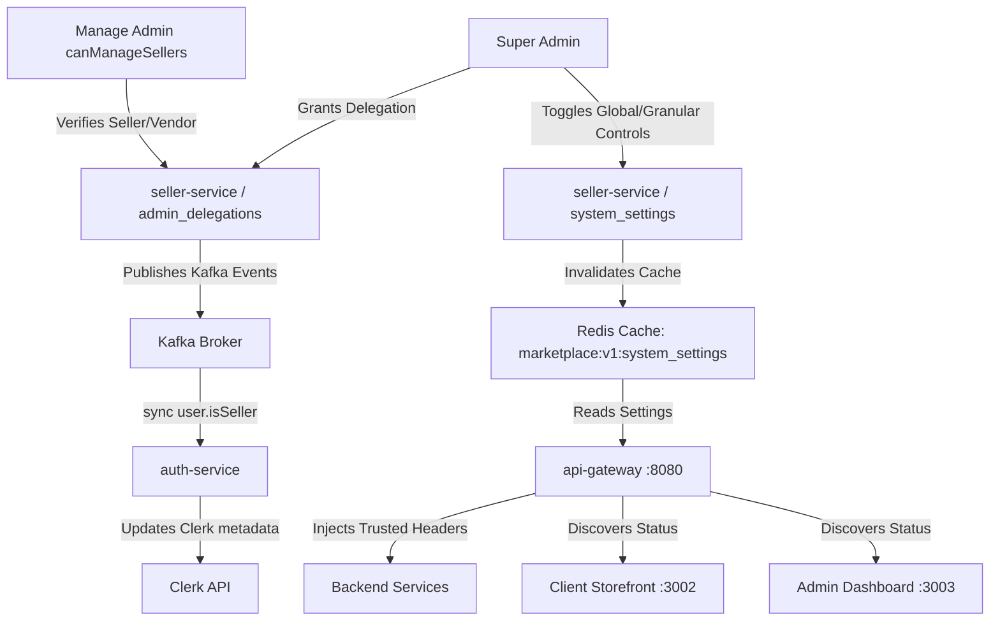
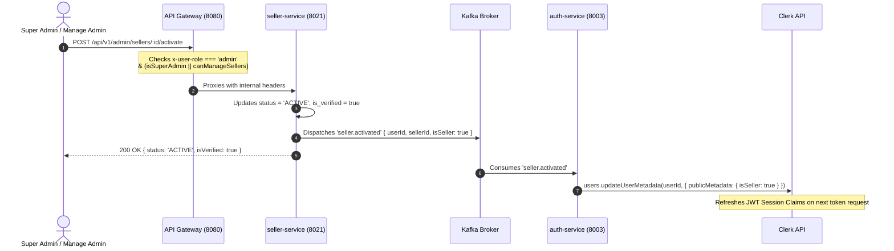
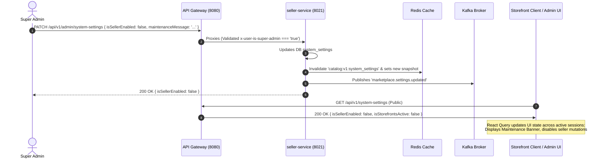

# ADR 0006: Super Admin & Delegated Seller/Vendor Management Architecture

## 1. Executive Summary & Objective

This specification details the architecture, access control models, event contracts, database schemas, and frontend/backend integration flows for:

1. **Super Admin & Delegated Manage Admin Authority**: Only Super Admins and specifically authorized Manage Admins (`canManageSellers: true`) can manage seller/vendor verification and operational lifecycle transitions.
2. **Conditional Seller UI & Capabilities (`isSeller`)**: Dynamically displaying or disabling seller-related user interfaces and endpoints based on the authoritative `isSeller` flag.
3. **Global & Granular Marketplace Operational Controls**: Enabling Super Admins to open or close seller/vendor operations dynamically in both storefront (`apps/client`) and administrative dashboards (`apps/admin`) with adaptive read-only/maintenance modes.

---

## 2. Architecture & Domain Roles



### Role Matrix & Permissions

| Role / Capability                                             | Super Admin (`super_admin`) | Manage Admin (`canManageSellers: true`) | Regular Admin (`admin`) | Verified Seller (`isSeller: true`) | Regular Customer (`user`) |
| :------------------------------------------------------------ | :-------------------------: | :-------------------------------------: | :---------------------: | :--------------------------------: | :-----------------------: |
| **Manage Delegations** (`POST/DELETE /delegations`)           |             Yes             |                   No                    |           No            |                 No                 |            No             |
| **Toggle Global Kill-Switch** (`PATCH /system-settings`)      |             Yes             |                   No                    |           No            |                 No                 |            No             |
| **Verify / Suspend Sellers** (`POST /admin/sellers/:id/*`)    |             Yes             |                   Yes                   |           No            |                 No                 |            No             |
| **Verify / Reject KYB Vendors** (`POST /admin/vendors/:id/*`) |             Yes             |                   Yes                   |           No            |                 No                 |            No             |
| **Access Seller Dashboard** (`/seller/*`)                     |             Yes             |                   Yes                   |           No            |                Yes                 |            No             |
| **Publish Products / Manage Storefront**                      |             No              |                   No                    |           No            |         Yes (when active)          |            No             |
| **Browse / Purchase on Storefront**                           |             Yes             |                   Yes                   |           Yes           |                Yes                 |            Yes            |

---

## 3. Data Model & Storage

### 3.1. System Settings (`larekmart_seller_db`)

```sql
CREATE TABLE IF NOT EXISTS system_settings (
  id VARCHAR(64) PRIMARY KEY DEFAULT 'global',
  is_seller_enabled BOOLEAN NOT NULL DEFAULT true,
  is_seller_registration_open BOOLEAN NOT NULL DEFAULT true,
  is_storefronts_active BOOLEAN NOT NULL DEFAULT true,
  maintenance_message TEXT DEFAULT 'Marketplace seller operations are temporarily paused for routine maintenance.',
  updated_by VARCHAR(128) NOT NULL,
  updated_at TIMESTAMP WITH TIME ZONE NOT NULL DEFAULT NOW()
);
```

### 3.2. Admin Delegations (`larekmart_seller_db`)

```sql
CREATE TABLE IF NOT EXISTS admin_delegations (
  id UUID PRIMARY KEY DEFAULT gen_random_uuid(),
  admin_user_id VARCHAR(128) NOT NULL,
  admin_email VARCHAR(255) NOT NULL,
  scope VARCHAR(64) NOT NULL DEFAULT 'seller_management', -- 'seller_management' | 'full_marketplace'
  granted_by_user_id VARCHAR(128) NOT NULL,
  granted_at TIMESTAMP WITH TIME ZONE NOT NULL DEFAULT NOW(),
  expires_at TIMESTAMP WITH TIME ZONE,
  is_active BOOLEAN NOT NULL DEFAULT true,
  CONSTRAINT uq_admin_scope UNIQUE(admin_user_id, scope)
);
```

### 3.3. Seller Profiles & Synchronization (`larekmart_seller_db`)

```sql
CREATE TABLE IF NOT EXISTS sellers (
  id UUID PRIMARY KEY DEFAULT gen_random_uuid(),
  user_id VARCHAR(128) NOT NULL UNIQUE,
  vendor_id UUID NOT NULL,
  store_name VARCHAR(255) NOT NULL,
  slug VARCHAR(255) NOT NULL UNIQUE,
  status VARCHAR(32) NOT NULL DEFAULT 'PENDING_REVIEW', -- 'PENDING_REVIEW' | 'ACTIVE' | 'SUSPENDED' | 'REJECTED'
  is_verified BOOLEAN NOT NULL DEFAULT false,
  verified_by VARCHAR(128),
  verified_at TIMESTAMP WITH TIME ZONE,
  created_at TIMESTAMP WITH TIME ZONE NOT NULL DEFAULT NOW(),
  updated_at TIMESTAMP WITH TIME ZONE NOT NULL DEFAULT NOW()
);
```

---

## 4. End-to-End Operational Lifecycle & Flow

### 4.1. Verification Approval Flow



### 4.2. Operational Kill-Switch Flow (Closing / Opening Operations)



---

## 5. Frontend UI Behavior & Conditional Rendering

### 5.1. Storefront (`apps/client`)

1. **When `isSeller === false`**:
   - If `isSellerRegistrationOpen === true`: Displays **"Become a Seller"** CTA in the header navigation and footer.
   - If `isSellerRegistrationOpen === false`: Hides the CTA or displays an informational modal: _"Seller onboarding is currently paused."_
   - Direct access to `/seller/*` routes is intercepted by an auth route guard and redirected to `/become-seller` or home.
2. **When `isSeller === true`**:
   - Header user dropdown highlights **"Seller Dashboard"** / **"Storefront Management"**.
   - If `isSellerEnabled === false`: Displays an alert banner: _"Marketplace seller features are in maintenance mode."_ All write actions (e.g., adding products, modifying store policies) are disabled.
3. **When Storefront Operations are Paused (`isStorefrontsActive === false`)**:
   - Product detail pages and `/stores/:slug` pages render a banner: _"This seller is currently not accepting new orders."_
   - Add-to-cart and checkout buttons for marketplace seller items are disabled.

### 5.2. Admin & Seller Dashboard (`apps/admin`)

1. **Super Admin View**:
   - Full access to `/settings` with the interactive **Marketplace Master Switch** (`isSellerEnabled`) and sub-toggles (`isSellerRegistrationOpen`, `isStorefrontsActive`).
   - Access to `/delegations` to grant/revoke seller management authority to designated admins.
   - Verification controls on `/vendors` and `/sellers`.
2. **Manage Admin View (`canManageSellers === true`)**:
   - Access to `/vendors` and `/sellers` with active **"Verify KYB"**, **"Approve Storefront"**, **"Suspend"**, and **"Activate"** action buttons.
   - System settings switch on `/settings` is displayed in a **Read-Only / Disabled** state with tooltip: _"Super Admin privileges required to modify marketplace governance switches."_
3. **Regular Admin View (`canManageSellers === false`)**:
   - Can inspect vendor and seller lists for reporting/auditing, but all modification buttons (Verify, Approve, Suspend, Reject) are disabled with a lock icon.

---

## 6. Security & Invariants

1. **Fail-Closed Verification**: Only users with explicit verified role claims can mutate seller states. Spoofed headers from untrusted origins are immediately stripped at the API Gateway boundary.
2. **Timing-Safe Internal Comparisons**: Communication between API Gateway and microservices uses `crypto.timingSafeEqual` with `INTERNAL_SERVICE_SECRET`.
3. **Audit Trail**: Every delegation grant, verification transition, and kill-switch toggle logs the actor ID, timestamp, prior state, and justification reason.
4. **Idempotent Kafka Handlers**: Outbox/consumer workers process `seller.activated` and `seller.suspended` events idempotently using message tracking.
