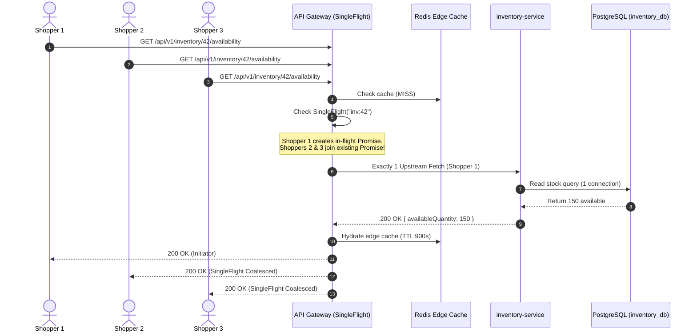

# Architecture Specification: API Gateway Thundering Herd Protection (SingleFlight)

## 1. Problem Statement & Bottleneck Analysis

In high-concurrency e-commerce events (e.g., Daraz 11.11, flash sales, push notification surges):

1. Thousands of shoppers load the homepage (`/api/v1/home`), browse popular categories, or check product stock availability (`/api/v1/inventory/:productId/availability`) at the exact same second.
2. When a cache key is cold (new product, gateway restart) or expires (TTL expiration):
   - 1,000 to 5,000 concurrent requests miss the Redis edge cache simultaneously.
   - Without in-flight request deduplication, all 5,000 requests fire simultaneous upstream HTTP fetches to `inventory-service`, `catalog-service`, or `recommendation-service`.
   - Downstream services experience an immediate CPU surge, exhaustion of PostgreSQL connection pools, and database read-lock spikes.
   - Response latencies cascade from ~5ms to >5,000ms, triggering upstream HTTP 504 timeouts and tripping API Gateway circuit breakers.

---

## 2. Solution: The SingleFlight Pattern

---

## 3. Core Components

1. **`apps/api-gateway/src/resilience/singleflight.ts`**:
   - `SingleFlightGroup` manages active in-flight promises mapped by cache/operation key.
   - Concurrent calls for key $K$ coalesce onto the running promise without duplicating downstream network calls.
   - Cleans up key immediately upon promise resolution or rejection.
   - Safety timeout guards against hanging upstream promises.
2. **Prometheus Telemetry (`apps/api-gateway/src/observability/metrics.ts`)**:
   - `gateway_singleflight_calls_total`: Total invocations.
   - `gateway_singleflight_shared_total`: Number of coalesced requests spared from hitting downstream.
   - `gateway_singleflight_inflight`: Active operations gauge.
3. **Edge Route Integration**:
   - `apps/api-gateway/src/aggregation/inventory-edge.ts`: Stock availability lookups on cache miss.
   - `apps/api-gateway/src/aggregation/home.ts`: Featured products, categories, and trending recommendations.
4. **Automated Verification**:
   - Unit tests in `apps/api-gateway/tests/unit/singleflight.test.ts` simulating 50 concurrent callers on identical keys, verifying exactly 1 execution and broadcast delivery.
