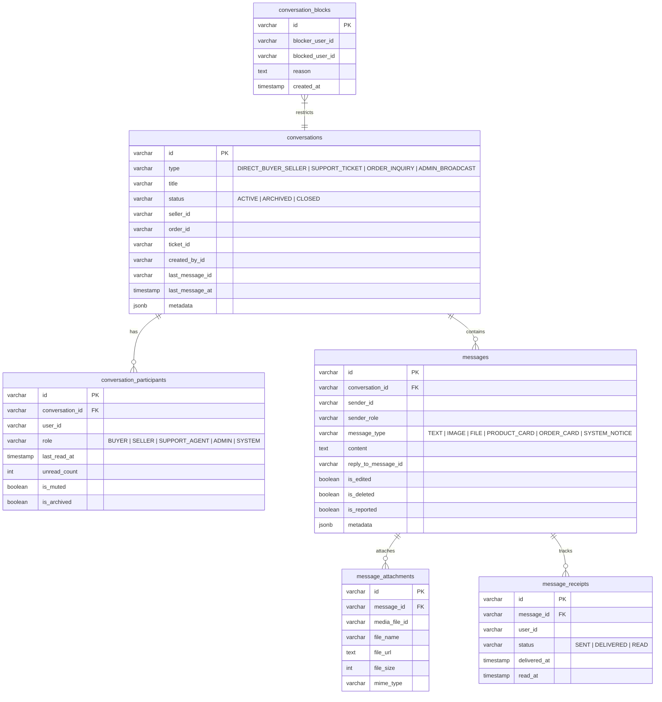

# Real-Time Chat & Communications Engine Architecture (`chat-service`)

## 1. Executive Summary

The **Chat Service** is a real-time, horizontally scalable communications microservice powering:

1. **Direct Buyer-to-Seller Messaging**: Pre-sale product inquiries, shipment updates, and post-delivery customer discussions.
2. **Customer-to-Support Agent Live Conversations**: Instant live assistance linked seamlessly to customer support tickets without data duplication.
3. **Marketplace Communications Moderation**: Automated abuse reporting, participant blocking, and staff oversight.

By decoupling real-time transport from ticket workflows in `support-service`, Larekmart maintains a high-velocity, low-latency messaging architecture while preserving auditable, SLA-governed support tickets.

```
                      +---------------------------------------+
                      |       Client / Admin Frontends        |
                      +-------------------+-------------------+
                                          |
                        HTTPS (REST)      |      WSS (Socket.IO)
                             |            |            |
                             v            |            v
                      +-------------------+-------------------+
                      |         API Gateway (:8080)           |
                      |   (Auth Gating, Secret Stripping)     |
                      +-------------------+-------------------+
                                          |
                                          v
                      +---------------------------------------+
                      |         chat-service (:8026)          |
                      |       (Fastify 5 + Socket.IO)         |
                      +-------+-------------------+-----------+
                              |                   |
            +-----------------+                   +-----------------+
            |                                                       |
            v                                                       v
+-----------------------+                               +-----------------------+
|  PostgreSQL (:5432)   |                               |     Redis (:6379)     |
|  larekmart_chat_db    |                               | - Socket.IO Adapter   |
| - conversations       |                               | - Presence Tracker    |
| - participants        |                               | - Idempotency Leases  |
| - messages            |                               +-----------------------+
| - receipts            |                                           |
| - attachments         |                                           v
| - blocks              |                               +-----------------------+
+-----------------------+                               |     Kafka Cluster     |
                                                        | - chat.message.created|
                                                        | - chat.msg.reported   |
                                                        | - chat.conv.created   |
                                                        +-----------------------+
```

---

## 2. Technology Stack & Architectural Decisions

| Layer                       | Technology                               | Decision Driver                                                                                                                                                |
| :-------------------------- | :--------------------------------------- | :------------------------------------------------------------------------------------------------------------------------------------------------------------- |
| **Runtime & Framework**     | Node.js 20+ & Fastify 5                  | High-throughput asynchronous event loop, low overhead, native JSON serialization.                                                                              |
| **Real-Time Transport**     | Socket.IO 4 + `@socket.io/redis-adapter` | Multi-pod horizontal scale-out; sticky sessions or direct WebSocket transport; cross-instance broadcast via Redis Pub/Sub.                                     |
| **Primary Database**        | PostgreSQL 16 + Drizzle ORM              | Durable relational ACID persistence for conversation history, read receipts, and participant rosters. Drizzle provides zero-overhead compile-time type safety. |
| **Transient State & Cache** | Redis (ioredis)                          | Ephemeral user presence (`online`, `offline`, `away`), active typing indicators, and distributed mutation `Idempotency-Key` leases.                            |
| **Event Pipeline**          | `@repo/kafka`                            | Asynchronous decoupled publishing to `notification-service` (push/email alerts for offline users) and `fraud-service` (suspicious message analysis).           |
| **Validation & Contracts**  | Zod + `@repo/types`                      | Single-source-of-truth contracts shared across gateway, backend services, and frontends.                                                                       |
| **Security & Auth**         | Zero-trust gateway propagation           | Verified `x-user-id`, `x-user-role`, `x-authenticated` headers with constant-time secret verification (`crypto.timingSafeEqual`).                              |

---

## 3. Data Model & Schema Design

Database: `larekmart_chat_db` on PostgreSQL (`localhost:5432`).

### 3.1 Schema Entity-Relationship Diagram



---

## 4. Cross-Service Boundaries & Integrations

1. **`support-service`**: Support ticket status, agent queues, and escalation policies stay in `support-service`. Live chat sessions created for a ticket link via `ticketId` in `conversations`, streaming messages in real-time through `chat-service`.
2. **`seller-service` & `product-service`**: Buyer questions on product pages or seller storefronts initiate `DIRECT_BUYER_SELLER` conversations with `sellerId` and optional `productId`.
3. **`order-service`**: Inquiries regarding active or delivered orders attach `orderId` to conversation metadata.
4. **`media-service`**: File uploads and image attachments are validated through `media-service` and referenced by durable URLs and IDs in `message_attachments`.
5. **`notification-service`**: Consumes `chat.message.created` from Kafka to send push or email alerts to offline recipients.
6. **`fraud-service`**: Consumes `chat.message.reported` and high-frequency message streams to detect off-platform payment solicitations, spam, or abusive behavior.

---

## 5. Security & Zero-Trust Hardening

1. **Gateway Auth Perimeter**: The API Gateway validates Clerk Bearer tokens, strips client-supplied `x-user-*` headers, and attaches verified identity headers.
2. **Timing-Safe Secret Verification**: Internal endpoints verify `x-internal-secret` using constant-time comparisons (`crypto.timingSafeEqual`) to prevent timing attacks.
3. **Conversation Isolation**: Non-participants are strictly denied access (`HTTP 403 Forbidden`) unless possessing administrative privileges (`x-user-role: ADMIN`).
4. **Communication Blocking**: Users blocked via `conversation_blocks` cannot initiate conversations or send messages to the blocking party.
5. **Input Validation**: All payloads are rigorously validated with Zod schemas (`packages/types/src/chat.ts`) preventing injection or malformed data.
