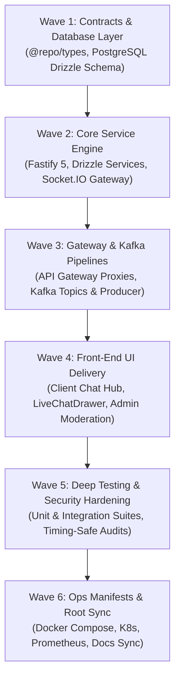

# Real-Time Chat Service Implementation Plan (`chat-service`)

## 1. Overview & Objectives

This implementation plan details the complete lifecycle delivery of `chat-service` according to the **6-Pillar Feature Service Delivery Standard**:

- **Pillar 1**: Front-end storefront and admin UI integration.
- **Pillar 2**: Cross-service, Kafka pipeline, and API Gateway route registration.
- **Pillar 3**: Manifests (Docker Compose, Kubernetes, Prometheus, CI/CD) and documentation sync.
- **Pillar 4**: Deep project analysis, unit testing, and integration testing (100% pass rate).
- **Pillar 5**: Security audit, zero-trust hardening, and privacy isolation.
- **Pillar 6**: Global README and root architecture sync.

---

## 2. Work Breakdown Structure

---

## 3. Wave Details

### Wave 1: Domain Contracts & Database Layer

- [x] Defined TypeScript types and Zod schemas in `packages/types/src/chat.ts`.
- [x] Exported chat contracts from `packages/types/src/index.ts`.
- [x] Created PostgreSQL database `larekmart_chat_db` on port 5432.
- [x] Implemented Drizzle ORM schema with 6 tables (`conversations`, `conversation_participants`, `messages`, `message_receipts`, `message_attachments`, `conversation_blocks`).
- [x] Created migration runner `src/db/migrate.ts` and seeder `src/db/seed.ts`.
- [x] Registered `chat-service` in monorepo database orchestrator `scripts/db-migrate.js`.

### Wave 2: Service Engine & Socket.IO Gateway

- [x] Scaffolded `apps/chat-service` with Fastify 5 runtime and TypeScript configuration.
- [x] Configured Socket.IO with `@socket.io/redis-adapter` for horizontal multi-pod scalability.
- [x] Implemented `ConversationService` and `MessageService` for business logic and participant authorization.
- [x] Built Fastify routes for conversations (`/api/v1/chat/conversations`) and messages (`/api/v1/chat/conversations/:id/messages`).
- [x] Integrated Redis distributed `Idempotency-Key` middleware.
- [x] Implemented Prometheus metrics (`/metrics`) and health probes (`/health`).

### Wave 3: API Gateway & Event Pipelines

- [x] Configured `CHAT_SERVICE_URL` in `apps/api-gateway/src/config/env.ts`.
- [x] Registered `chat-service` in `apps/api-gateway/src/gateway/service-registry.ts`.
- [x] Registered `/api/v1/chat` in `apps/api-gateway/src/routing/authenticated.routes.ts`.
- [x] Added Kafka topics to `packages/kafka/src/init-topics.ts`:
  - `chat.conversation.created`
  - `chat.message.created`
  - `chat.message.reported`
- [x] Integrated `@repo/kafka` producer with transactional safety.

### Wave 4: Front-End UI Delivery

- [x] Created typed API client `apps/client/src/services/chat.service.ts`.
- [x] Created typed API client `apps/admin/src/services/chat.service.ts`.
- [x] Built Storefront Chat Hub `apps/client/src/app/account/chat/page.tsx` with conversation filters, active messaging, and moderation tools.
- [x] Built reusable `apps/client/src/components/chat/LiveChatDrawer.tsx` for buyer-to-seller and live support.
- [x] Built Admin Live Chat & Moderation Center `apps/admin/src/app/(dashboard)/chat/page.tsx`.
- [x] Updated Storefront Account navigation (`apps/client/src/app/account/page.tsx`) and Admin Sidebar (`apps/admin/src/components/AppSidebar.tsx`).

### Wave 5: Comprehensive Testing & Security Hardening

- [x] Implemented standalone unit tests: `apps/chat-service/tests/unit/chat.unit.test.ts` (12 test cases).
- [x] Implemented end-to-end integration tests: `apps/chat-service/tests/integration/chat.integration.test.ts` (11 test cases).
- [x] Verified 100% test pass rate across unit and integration suites.
- [x] Implemented constant-time comparison for internal secret checks.
- [x] Enforced strict participant permission boundaries (HTTP 403 for non-participants).
- [x] Verified 0 TypeScript compile errors (`tsc --noEmit`).

### Wave 6: Manifests, Observability & Documentation

- [x] Update `docker-compose.yml` and `docker-compose.traefik.yml`.
- [x] Create Kubernetes Kustomize manifest `infrastructure/kubernetes/base/services/chat-service.yaml`.
- [x] Add Prometheus scrape target in `infrastructure/observability/prometheus/prometheus.yml`.
- [x] Create `apps/chat-service/AGENTS.md` and `apps/chat-service/README.md`.
- [x] Sync `docs/API.md`, `docs/ARCHITECTURE.md`, `docs/EVENT-DRIVEN-ARCHITECTURE.md`, `docs/DEPENDENCIES.md`.
- [x] Sync root `README.md` and `AGENTS.md` workspace tables.
