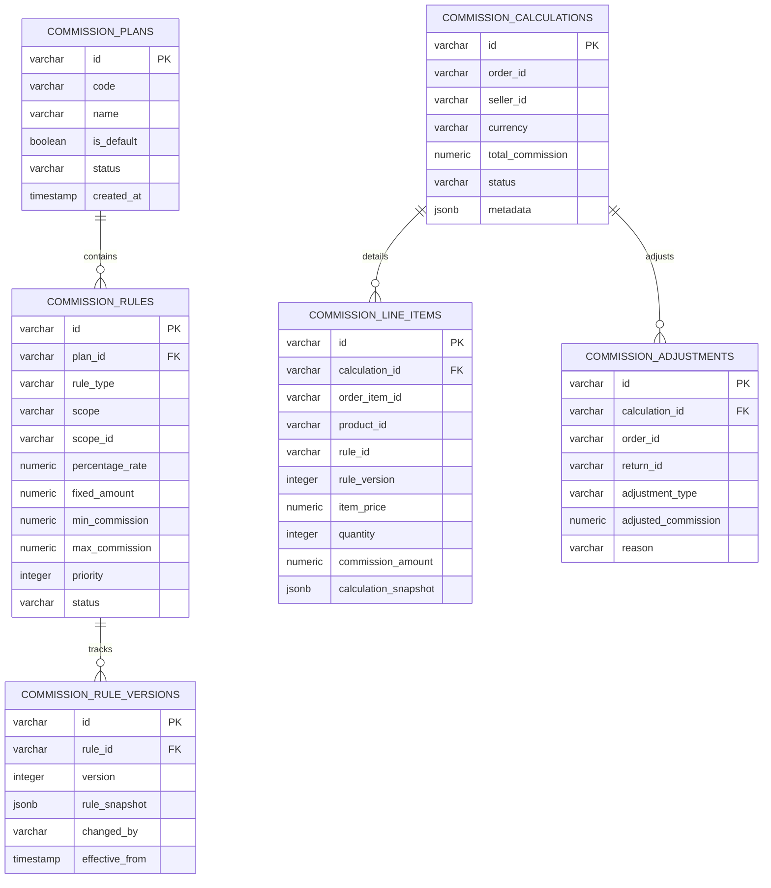
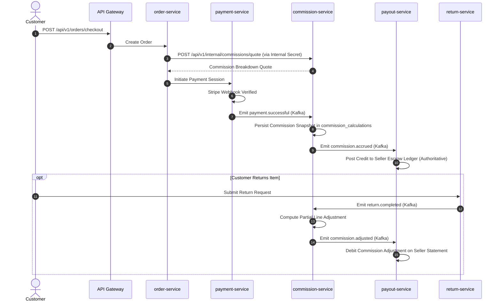

# Marketplace Commission Service & Financial Ledger Architecture

## 1. Executive Overview

The **Commission Service** (`apps/commission-service`, Port 8022) is the authoritative marketplace financial engine responsible for configuring fee structures, calculating commission obligations on multi-vendor order line items, enforcing minimum and maximum rate caps, and publishing auditable calculation snapshots to Kafka.

In multi-tenant e-commerce platforms operating at Daraz/Alibaba/Amazon scale, commission rules change dynamically due to seasonal seller promotions, negotiated vendor contract tiers, and category rate adjustments. Modifying commission rules must never alter historical order settlements. To guarantee absolute financial auditability, the Commission Service implements **immutable rule versioning** and **frozen calculation snapshots** with arbitrary-precision `Decimal.js` mathematics.

```
┌────────────────────────────────────────────────────────────────────────────────────────┐
│                                 API Gateway (:8090)                                    │
└───────────────────────────┬────────────────────────────────┬───────────────────────────┘
                            │ /api/v1/admin/commissions/*    │
                            │ [requireAdmin: true]           │
                            ▼                                ▼
                 ┌───────────────────────┐        ┌───────────────────────┐
                 │  commission-service   │        │     seller-service    │
                 │      (Port 8022)      │        │      (Port 8021)      │
                 └──────────┬────────────┘        └───────────────────────┘
                            │
              ┌─────────────┼────────────────────────────┐
              │             │                            │
              ▼             ▼                            ▼
      PostgreSQL / PgBouncer   Kafka Event Bus     payout-service (Port 8023)
      (commission_db:6432)   (commission.accrued)  (Balanced Append-Only Ledger)
```

---

## 2. Technology Stack & Service Boundaries

| Component            | Choice                                     | Rationale                                                                                 |
| :------------------- | :----------------------------------------- | :---------------------------------------------------------------------------------------- |
| **Runtime & HTTP**   | Node.js + TypeScript + Fastify 5           | High throughput, low latency JSON serialization, schema validation hooks.                 |
| **Persistence**      | PostgreSQL (`commission_db`) via PgBouncer | Robust relational ACID guarantees with connection multiplexing on port 6432.              |
| **ORM & Migrations** | Drizzle ORM                                | Zero-overhead, type-safe SQL query generation without prepared statement cache pollution. |
| **Financial Math**   | `Decimal.js` (34 digits precision)         | Complete elimination of IEEE-754 floating-point rounding errors on currency fees.         |
| **Messaging**        | `@repo/kafka` (Producer & Consumer)        | Asynchronous cross-service event stream with DLQ and poison-pill isolation.               |
| **Cache & Leases**   | `@repo/redis` (ioredis)                    | Active rule cache invalidation and distributed quote idempotency.                         |
| **Observability**    | `@repo/monitoring` (Prometheus + Pino)     | Structured audit logging, metrics (`/metrics`), and health endpoints (`/health`).         |

---

## 3. Database Schema & Immutable Versioning

The database schema guarantees that an order line item's commission rate is locked at time of accrual. Every rule mutation atomically increments a version counter and appends an immutable snapshot to `commission_rule_versions`.



---

## 4. Rule Precedence & Precision Calculation Engine

When calculating fees for a shopping cart or order item, multiple overlapping rules may apply (e.g., a platform-wide 8% fee, a 12% Consumer Electronics category fee, a negotiated 5% VIP Seller fee, and a 2% Promotional SKU fee).

The calculation engine resolves the winning rule using a strict 4-level specificity hierarchy:

```
Level 1: PRODUCT   (Specific SKU promotion / negotiated listing rate)
   │
   ▼ (if no active match)
Level 2: SELLER    (Negotiated contractual seller fee schedule)
   │
   ▼ (if no active match)
Level 3: CATEGORY  (Category-specific market rates, e.g. Electronics, Fashion)
   │
   ▼ (if no active match)
Level 4: GLOBAL    (Platform default baseline commission rate)
```

### Calculation Formula with Clamping

For a given line item with price $P$ and quantity $Q$, the gross line total is $T = P \times Q$.

The unconstrained commission $C_{\text{raw}}$ is calculated as:
$$C_{\text{raw}} = \left( T \times \frac{R_{\text{percentage}}}{100} \right) + (F_{\text{fixed}} \times Q)$$

The final commission $C_{\text{final}}$ is clamped against minimum and maximum boundaries:
$$C_{\text{final}} = \min\left(C_{\text{max}}, \max\left(C_{\text{min}}, C_{\text{raw}}\right)\right)$$

Net seller payout for this line item is:
$$N = T - C_{\text{final}}$$

All calculations are evaluated with 4 decimal places in `Decimal.js` and rounded to 2 decimal places using half-up Banker's rounding for currency balance integrity.

---

## 5. Event-Driven Lifecycle & Service Interactions

Cross-service data flows strictly adhere to Larekmart's Kafka-only architectural contract:



---

## 6. Financial Ledger & Payout Service Integration (`payout-service`)

The upcoming `payout-service` (Port 8023) integrates with `commission-service` to manage seller disbursements and platform revenue reconciliation.

### Append-Only Double-Entry Principles

1. **Never mutate balance columns:** Balances are derived from balanced ledger entries (`SUM(debit) - SUM(credit)`).
2. **Authoritative Provider Confirmation:** Payouts remain in `PROCESSING` until Stripe Connect / 1Link ACH callbacks verify transfer settlement.
3. **Reserve Holds:** In-transit returns or fraud disputes freeze an adjustable reserve percentage (e.g. 10% rolling reserve for 14 days) before funds become eligible for batch settlement.

---

## 7. Production Verification & Metrics

- **Unit & Integration Tests:** Verified via `pnpm --filter commission-service test` testing Decimal.js math, min/max clamping, multi-seller item grouping, and route authentication gates.
- **Static Type Check:** Verified via `pnpm --filter commission-service check-types` and monorepo root `tsc --noEmit`.
- **PgBouncer Multiplexing:** Enforced `statement_cache_size=0` on pool connection strings to ensure multi-tenant transaction safety without prepared statement collision.
- **Prometheus Metrics:** Real-time counters and histograms exposed at `/metrics`:
  - `commission_calculations_total{status="SUCCESS|REVERSED"}`
  - `commission_calculation_duration_seconds`
  - `commission_accrual_amount_sum{currency="PKR|USD"}`
