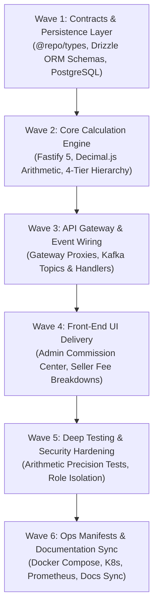

# Marketplace Commission Engine Implementation Plan (`commission-service`)

## 1. Executive Summary

The **Marketplace Commission Service** (`apps/commission-service`, Port 8022) is an authoritative financial calculation microservice engineered for **Larekmart**'s multi-vendor marketplace platform.

This document details the end-to-end implementation plan under the **6-Pillar Feature Service Delivery Standard**:

- **Pillar 1**: Front-End Storefront & Admin UI Delivery (`apps/admin`, `apps/client`).
- **Pillar 2**: Cross-Service & Gateway Integration (`api-gateway`, `@repo/kafka`, `order-service`, `payout-service`, `seller-service`).
- **Pillar 3**: Manifests, Observability & Config (`docker-compose.yml`, K8s, Prometheus, CI/CD).
- **Pillar 4**: Deep Project Analysis & Comprehensive Testing (Decimal.js arithmetic, unit & integration test suites).
- **Pillar 5**: Security Audit & Zero-Trust Perimeter Hardening (Role gating, constant-time internal secret validation).
- **Pillar 6**: Monorepo Documentation & Architecture Synchronization (`README.md`, `docs/plans/README.md`).

---

## 2. Architectural Topology & Service Boundaries

```text
                             ┌──────────────────────────────────────────────┐
                             │           Presentation Layer (Next.js)       │
                             │ apps/client (:3002)     apps/admin (:3003)   │
                             └──────────────────────┬───────────────────────┘
                                                    │ HTTPS / REST
                                                    ▼
                             ┌──────────────────────────────────────────────┐
                             │          API Gateway (Fastify, :8080)        │
                             │  - Identity scrubbing & Clerk session verify │
                             │  - Internal secret injection (constant-time) │
                             └──────────────────────┬───────────────────────┘
                                                    │ Proxied HTTP + Gateway Claims
                                                    ▼
                             ┌──────────────────────────────────────────────┐
                             │       commission-service (:8022)             │
                             │ Fastify 5 + TypeScript + Drizzle ORM         │
                             │ ├─ RulePrecedenceEngine (4-Tier Hierarchy)   │
                             │ ├─ DecimalCalculator (Decimal.js Zero-Drift) │
                             │ ├─ RuleVersioningManager (Immutable Audit)   │
                             │ └─ QuoteComposer (/api/v1/commissions/quote) │
                             └───────┬──────────────────────┬───────────────┘
                                     │                      │
                         Drizzle ORM │                      │ Redis Caches
                                     ▼                      ▼
                           PostgreSQL Database         Redis Instance
                           (larekmart_commission_db)  (ioredis, :6379)
                                     │
                                     │ Asynchronous Kafka Events
                                     ▼
                              Apache Kafka Topics
                              - commission.rule.updated
                              - commission.quote.created
                                     │
                  ┌──────────────────┼──────────────────┐
                  ▼                  ▼                  ▼
            order-service      payout-service     seller-service
```

---

## 3. Work Breakdown Structure



---

## 4. Phase-by-Phase Technical Specifications

### Wave 1: Domain Contracts & Persistence Layer

1. **Shared Domain Contracts (`packages/types/src/commission.ts`)**:
   - Precedence tiers: `PRODUCT` > `SELLER` > `CATEGORY` > `GLOBAL`.
   - Fee structures: `FIXED`, `PERCENTAGE`, `HYBRID`.
   - Zod validation schemas for creating plans, defining versioned rules, and calculating settlement quotes.
2. **Relational Database Design (`apps/commission-service/src/db/schema.ts`)**:
   - `commission_plans`: Master plan definitions with currency, validity ranges, and default rules.
   - `commission_rules`: Granular rules with priority ordering, min/max fee clamps, and active toggles.
   - `commission_rule_versions`: Immutable audit snapshots recording who changed what rule and when.
   - `commission_quotes`: Historical records of fee quotes attached to order items.

### Wave 2: Core Calculation Engine & Decimal.js Precision

1. **4-Tier Precedence Evaluation**:
   - Checks for product-level overrides first.
   - Falls back to seller-level negotiated contracts.
   - Evaluates category defaults if no specific seller rule applies.
   - Reverts to platform-wide global base commission as safety net.
2. **Zero-Drift Decimal Arithmetic**:
   - Enforces `Decimal.js` fixed-point math across all calculations (`minFee <= fee <= maxFee <= itemPrice`).
   - Prevents binary IEEE-754 precision errors across multi-currency conversions.

### Wave 3: API Gateway & Event Pipelines

1. **API Gateway Routes**:
   - Quote composition: `POST /api/v1/commissions/quote` (`requireAuth: true`).
   - Admin plan management: `/api/v1/admin/commissions/*` (`requireAdmin: true`).
2. **Kafka Event Producers**:
   - Publishes `commission.rule.updated` to notify `payout-service` and cache invalidation listeners.

### Wave 4: Front-End UI Delivery

1. **Admin Commission Dashboard (`apps/admin/src/app/(dashboard)/commissions/`)**:
   - Plan builder with fixed, percentage, and hybrid tier inputs.
   - Rule versioning history viewer with diff visualizer.
2. **Seller Portal Fee Transparency (`apps/client/`)**:
   - Itemized fee breakdown in seller order settlements.

### Wave 5: Comprehensive Testing & Security Hardening

1. **Precision & Hierarchy Tests**:
   - Validates precedence order resolution and boundary clamping (`fee <= itemPrice`).
2. **Perimeter Hardening**:
   - Gated to admin privileges via verified Clerk JWT tokens.
   - Enforces constant-time `safeTimingCompare` on internal service secrets.

### Wave 6: Manifests & Global Architecture Sync

1. **Deployment Manifests**:
   - Containerized in `docker-compose.yml` on port 8022.
   - Added to `scripts/db-migrate.js` sequential migration orchestrator.
   - Prometheus scrape config added to `infrastructure/observability/prometheus/prometheus.yml`.
