# Critical Architectural Bottlenecks Analysis & 4-Pillar Hardening Plan

**Date:** 2026-11-04  
**Target:** Larekmart Production Microservices Architecture (11.11 / Daraz Flash-Sale Scale)  
**Status:** Approved & Implemented Architectural Blueprint

---

## Executive Summary

During the architectural exploration of the Larekmart monorepo (23 backend microservices, 1 API gateway, 2 frontends, 15 packages), we examined four primary architectural stress vectors under extreme flash-sale concurrency (50,000+ RPS).

We identified **four critical structural bottlenecks** that could lead to cascading outages, consumer partition lag, database connection exhaustion, or customer order loss:

1. **Synchronous Stripe Verification in Inventory Consumer**: Every `payment.successful` event triggered a sequential HTTP call (`stripe.checkout.sessions.retrieve()`), hitting Stripe's 100 req/s rate limit and stalling Kafka partition consumption.
2. **Early ACK Silent Dropping in Order Saga**: If `inventory.stock.sold` or `tax.calculation.completed` arrived milliseconds before MongoDB finished persisting the initial order, the event was silently discarded. After 60 seconds, the timeout sweeper cancelled the order and refunded the customer.
3. **PostgreSQL Connection Pool Exhaustion**: 13 microservices connected directly to PostgreSQL on port 5432, bypassing PgBouncer (:6432). Horizontal pod scaling caused Prisma pools to exceed PostgreSQL's `max_connections` (100).
4. **Keyless Kafka Partitioning & Non-Idempotent Saga Refunds**: `producer.send()` distributed messages round-robin without keys, breaking per-order causal ordering. Concurrently, `handleCheckoutRefundRequest` omitted a Stripe `idempotencyKey`, risking duplicate customer refunds.

---

## 1. Deep Dive: Bottleneck Breakdown

```mermaid
flowchart TD
    subgraph Bottleneck1["1. Consumer Bottleneck"]
        P1[payment-service] -->|payment.successful| K1[Kafka Broker]
        K1 -->|Consumer Loop| I1[inventory-service]
        I1 -->|Sync HTTP 100-300ms| S1[Stripe API :429 Rate Limit]
    end

    subgraph Bottleneck2["2. Saga Race Condition"]
        K2[Kafka Broker] -->|Dual-ACK| O2[order-service]
        O2 -->|Order not found in Mongo yet| D2[ACK Dropped to Void]
        D2 -->|60s Sweeper| C2[Order Cancelled & Customer Refunded]
    end

    subgraph Bottleneck3["3. Connection Exhaustion"]
        M3[13 Microservices] -->|Direct :5432| PG3[Postgres max_connections=100]
        PG3 -->|Connection Starvation| E3[FATAL: remaining connection slots reserved]
    end

    subgraph Bottleneck4["4. Message Skew & Double-Spend"]
        K4[Round-Robin Partitions] -->|Out of Order Delivery| S4[Saga State Machine]
        R4[Kafka Retries] -->|Duplicate Stripe Refund| D4[Merchant Loss / Double Refund]
    end
```

---

## 2. The 4-Pillar Architectural Hardening Solution

### Pillar 1: Asynchronous Cryptographic Event Attestation

- **Mechanism**:
  - `payment-service` verifies incoming Stripe webhooks using `stripe.webhooks.constructEvent()` with `STRIPE_WEBHOOK_SECRET`.
  - When publishing `payment.successful`, `payment-service` computes an HMAC-SHA256 signature using `INTERNAL_SERVICE_SECRET`:
    $$\text{signature} = \text{HMAC-SHA256}(\text{sessionId} + \text{amount} + \text{timestamp}, \text{INTERNAL\_SERVICE\_SECRET})$$
  - Downstream services (`inventory-service`, `order-service`) verify this signature locally in **<0.01ms** without performing external HTTP network calls.
- **Impact**: Completely eliminates the 100 req/s Stripe API bottleneck and eliminates consumer partition lag.

### Pillar 2: Optimistic Saga Correlation & Early ACK Jittered Buffer

- **Mechanism**:
  - In `order-service`, if `Order.findOne()` returns `null` when processing `inventory.stock.sold` or `tax.calculation.completed`:
    - Do **not** silently return.
    - Execute a jittered exponential backoff retry loop (`findOrderWithRetry` with 4 attempts at 50ms, 150ms, 350ms, 800ms).
    - If the order document appears during the retry window, apply the ACK and proceed with Dual-ACK confirmation.
    - If still absent after all retries, buffer the ACK correlation record in Redis with a 5-minute TTL (`saga:early_ack:{referenceId}`) so that when the initial order creation completes, it checks the buffer and confirms immediately.
- **Impact**: Eliminates out-of-order event race conditions and prevents false-positive order cancellations.

### Pillar 3: Universal PgBouncer :6432 Multiplexing with `?pgbouncer=true`

- **Mechanism**:
  - Standardize all 13 PostgreSQL microservice configuration files (`.env`, `docker-compose.yml`, K8s deployment manifests) to point `DATABASE_URL` to `pgbouncer:6432`.
  - Append `?schema=public&pgbouncer=true` to all Prisma database connection URLs via `normalizePrismaUrl`, disabling prepared statement caching for seamless compatibility with PgBouncer's `pool_mode = transaction`.
  - Reserve direct port 5432 connections strictly for `prisma migrate` / `db:migrate` scripts.
- **Impact**: Enables 1,000+ client connections to be multiplexed across 250 PostgreSQL server connections, protecting the database from connection starvation during horizontal pod autoscaling.

### Pillar 4: Hybrid Kafka Entity-Keyed Partitioning & Idempotent Saga Refunds

- **Mechanism**:
  - Upgrade `producer.send(topic, message, options?: { key?: string })` in `packages/kafka/src/producer.ts`.
  - Key all order lifecycle events (`payment.successful`, `order.created`, `inventory.stock.sold`, `tax.calculation.completed`, `order.confirmed`) by `orderId || sessionId || referenceId` to enforce strict FIFO ordering on a single partition per order.
  - Retain entropy-salted or round-robin partition distribution for general catalog broadcasts (`inventory.updated`, `product.viewed`) to prevent hot-partition skew on single SKUs.
  - Update `handleCheckoutRefundRequest` in `apps/payment-service/src/utils/refund.handler.ts` to include `{ idempotencyKey: 'saga-refund-${orderId}' }` when calling `stripe.refunds.create()`.
- **Impact**: Guarantees in-order delivery per customer order while protecting the business against duplicate refund payouts.

---

## 3. Implementation Blueprint & File Targets

| Pillar                        | Workspaces                                                           | Target Files                                                                                                                                                                                                                                                        |
| :---------------------------- | :------------------------------------------------------------------- | :------------------------------------------------------------------------------------------------------------------------------------------------------------------------------------------------------------------------------------------------------------------ |
| **Pillar 1: Attestation**     | `payment-service`, `inventory-service`, `@repo/types`, `@repo/kafka` | `packages/kafka/src/attestation.ts` `apps/payment-service/src/routes/webhooks.route.ts` `apps/inventory-service/src/workers/inventory-event.consumer.ts` `packages/types/src/order.ts`                                                                  |
| **Pillar 2: Saga Buffer**     | `order-service`                                                      | `apps/order-service/src/utils/order.ts` `apps/order-service/src/outbox/outbox-relay.ts` `apps/order-service/src/utils/subscriptions.ts`                                                                                                                     |
| **Pillar 3: PgBouncer**       | `docker-compose.yml`, 6 database packages                            | `docker-compose.yml` `packages/product-db/src/client.ts` `packages/inventory-db/src/client.ts` `packages/catalog-db/src/client.ts` `packages/shipping-db/src/client.ts` `packages/user-db/src/client.ts` `packages/vendor-db/src/client.ts` |
| **Pillar 4: Kafka & Refunds** | `packages/kafka`, `payment-service`                                  | `packages/kafka/src/producer.ts` `apps/payment-service/src/utils/refund.handler.ts`                                                                                                                                                                             |
