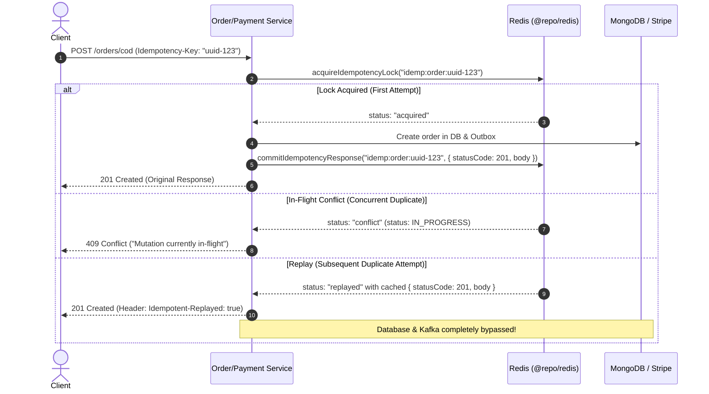

# Architecture Specification: Distributed Mutation Idempotency Key Engine

## 1. Problem Statement & Bottleneck Analysis

In distributed e-commerce systems, network unreliability causes clients (browsers, iOS/Android mobile apps) to retry state-mutating requests:

1. A customer clicks **"Place Order"** (`POST /orders/cod`) or initiates checkout.
2. The server processes the mutation, writes the order to MongoDB, and dispatches the Kafka event, but the client connection drops before receiving the HTTP 201 response.
3. The mobile application or user retries the exact same request.
4. **The Bottleneck**: Without an Idempotency-Key engine, the server generates a new order ID, writes a **duplicate order** to MongoDB, burns duplicate inventory reservations, and emits duplicate downstream Kafka events (`order.created`).
5. In payment gateways (`payment-service`), retries result in duplicate checkout sessions or double charging customer credit cards.

---

## 2. Solution: Distributed Redis Idempotency State Machine

---

## 3. Implementation Plan & Architecture

1. **`@repo/redis` Primitives (`packages/redis/src/idempotency.ts`)**:
   - `acquireIdempotencyLock(client, key, lockTtlMs)`: Atomic `SET NX PX` claiming in-progress lease.
   - `commitIdempotencyResponse(client, key, response, retentionTtlSec)`: Caches response for 24h.
   - `releaseIdempotencyLock(client, key)`: Releases lock on mutation failure so client can retry.
   - Re-exported from `packages/redis/src/index.ts`.
2. **`order-service` Middleware (`apps/order-service/src/middleware/idempotency.ts`)**:
   - Fastify wrapper `executeWithIdempotency(request, reply, handler, options)`.
   - Inspects `idempotency-key` header.
   - Transparently intercepts and replays cached responses with `Idempotent-Replayed: true`.
   - Rejects concurrent duplicate mutations with 409 Conflict.
3. **Route Integration (`apps/order-service/src/routes/order.ts`)**:
   - Guard `POST /orders/cod` with `executeWithIdempotency`.
4. **Automated Verification**:
   - Invariant tests in `apps/order-service/tests/idempotency.test.ts` verifying:
     - 1st call executes mutation and returns 201.
     - Concurrent 2nd call receives 409 Conflict.
     - Completed 2nd call replays identical cached response with `Idempotent-Replayed: true`.
     - Order count in MongoDB remains **EXACTLY 1**.
     - Error during creation releases lock, allowing retry.
