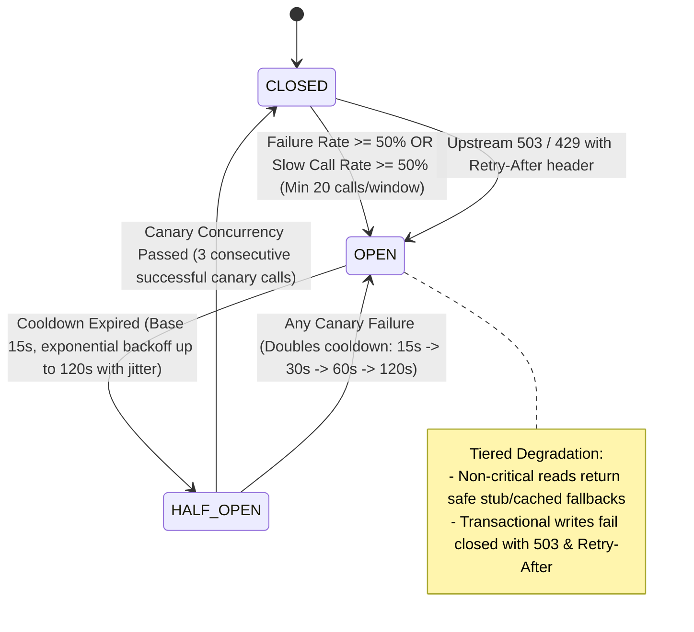

# Architecture Specification: Dynamic Circuit Breaker Self-Tuning & Upstream Health Feedback

## 1. Executive Summary & Problem Analysis

In a 23-microservice e-commerce ecosystem operating at Daraz scale (e.g. 11.11 shopping festivals):

- **Current Limitation**: The existing API Gateway circuit breaker (`apps/api-gateway/src/resilience/circuit-breaker.ts`) relies on a naive consecutive failure counter (default 5 consecutive errors) and a static 15-second reset timeout.
- **The Failure Modes**:
  1. **Partial Degradation Masking**: If a downstream service is severely overloaded and failing 80% of requests, but 1 out of 5 requests occasionally succeeds, a consecutive counter **never trips**, subjecting thousands of callers to cascading timeouts and high latency.
  2. **Latency Storms (Slow Calls)**: A service that stops responding within 200ms and instead hangs for 5,000ms until timing out ties up Fastify event-loop connections and worker sockets without immediately tripping a static error counter.
  3. **Canary Stampedes**: Transitioning directly from `OPEN` to a single trial without concurrency gating can allow a burst of queued requests to slam a recovering microservice, instantly knocking it back down.
  4. **Blind Backpressure**: Downstream services returning HTTP 429 or 503 with explicit `Retry-After` headers are ignored, forcing the gateway to guess cooldown periods.

To eliminate this bottleneck, this specification implements the **Adaptive Sliding-Window Dynamic Circuit Breaker with Upstream Health Feedback**.

---

## 2. Core Architecture & State Machine



---

## 3. Detailed Component Architecture

### A. Hybrid Sliding-Window Bucket Collector (`SlidingWindowMetrics`)

- **Window Size**: 10 seconds divided into 10 discrete 1-second rolling time buckets.
- **Per-Bucket Metrics**:
  - `successes`: Count of HTTP 2xx/3xx/4xx requests (excluding 429).
  - `failures`: Count of HTTP 5xx errors and network timeouts.
  - `slowCalls`: Count of requests exceeding the slow call duration threshold (e.g. > 2,000ms).
  - `totalDurationMs`: Aggregate duration for percentile estimations.
- **Rolling Window Pruning**: Buckets older than 10 seconds are automatically evicted in $O(1)$ time upon metric recording.

### B. Dynamic Tripping Conditions

A circuit trips from `CLOSED` to `OPEN` when:

1. **Minimum Request Volume**: At least 20 requests have been recorded within the active 10s window (prevents tripping on low-traffic noise).
2. **Failure Rate Threshold**:
   $$\text{Failure Rate} = \frac{\text{failures}}{\text{total}} \ge 50\%$$
3. **Slow Call Rate Threshold**:
   $$\text{Slow Call Rate} = \frac{\text{slowCalls}}{\text{total}} \ge 50\%$$
   _(where a call is slow if latency $> 2,000\text{ms}$)_.
4. **Explicit Upstream Signal**: Receipt of downstream `503 Service Unavailable` or `429 Too Many Requests` containing a valid `Retry-After` header immediately sets the circuit to `OPEN` for the duration specified by the upstream service.

### C. Tiered Degradation Engine

When a route's circuit is `OPEN`:

- **Tier 1 (Non-Critical Reads)**: Routes tagged as `degradable: true` (e.g. `/api/v1/reviews/*`, `/api/v1/recommendations/*`, `/api/v1/wishlists/*`):
  - Returns HTTP 200/203 with structured empty/stub fallback JSON:
    ```json
    { "data": [], "degraded": true, "message": "Service temporarily degraded" }
    ```
- **Tier 2 (Transactional / Mission-Critical Writes)**: Orders (`/orders`), Payments (`/sessions/*`), Inventory reservations (`/reservations`):
  - Fails closed immediately without touching network sockets:
    ```json
    {
      "message": "Downstream service is temporarily unavailable. Please retry shortly."
    }
    ```
  - Headers attached: `Retry-After: <cooldown_seconds>`, `X-Circuit-Breaker-State: OPEN`.

### D. Exponential Canary Recovery (`HALF_OPEN`)

- **Initial Reset Cooldown**: 15 seconds.
- **Canary Concurrency Gate**: In `HALF_OPEN`, only a controlled number of concurrent canary probes (default: 2) are permitted through to probe the downstream service.
- **Consecutive Success Threshold**: 3 consecutive successful canary responses with latency $< 2,000\text{ms}$ reset the circuit to `CLOSED`.
- **Backoff Penalty**: If any canary probe fails or times out, the circuit immediately reverts to `OPEN`, and the reset timeout is multiplied by 2 (with random $\pm 10\%$ jitter) up to a maximum cap of 120 seconds.

---

## 4. Prometheus Telemetry & Observability

Exported to `/metrics` via `@repo/monitoring`:

- `gateway_circuit_breaker_state`: Gauge (0=CLOSED, 1=HALF_OPEN, 2=OPEN) labeled by `service`.
- `gateway_circuit_breaker_trips_total`: Counter labeled by `service`, `reason` (`failure_rate`, `slow_call_rate`, `upstream_signal`).
- `gateway_circuit_breaker_slow_calls_total`: Counter labeled by `service`.
- `gateway_circuit_breaker_canary_attempts_total`: Counter labeled by `service`, `result` (`success`, `failure`).

---

## 5. Implementation Roadmap

1. **Module Implementation**:
   - `apps/api-gateway/src/resilience/sliding-window-metrics.ts`: 10-second rolling time bucket collector.
   - Refactor `apps/api-gateway/src/resilience/circuit-breaker.ts`: Implement dynamic sliding-window evaluation, slow call detection, exponential canary backoff, and upstream `Retry-After` parsing.
2. **Gateway Proxy Integration**:
   - Update `apps/api-gateway/src/gateway/proxy.ts`: Record response latency and status code into the sliding window; parse `Retry-After` on 503/429 responses.
3. **Automated Unit & Integration Testing**:
   - `apps/api-gateway/tests/unit/circuit-breaker-dynamic.test.ts`:
     - Test 1: High failure rate (>50%) trips circuit to OPEN.
     - Test 2: Slow calls (>2000ms) trip circuit to OPEN even with HTTP 200 responses.
     - Test 3: Upstream `Retry-After` header dynamically overrides circuit open duration.
     - Test 4: `HALF_OPEN` canary gating and 3-consecutive-success recovery.
     - Test 5: Exponential backoff penalty on failed canary probe (15s -> 30s -> 60s).
4. **Verification**:
   - `pnpm --filter api-gateway check-types`
   - `pnpm --filter api-gateway test`
   - Prettier formatting and documentation sync.
