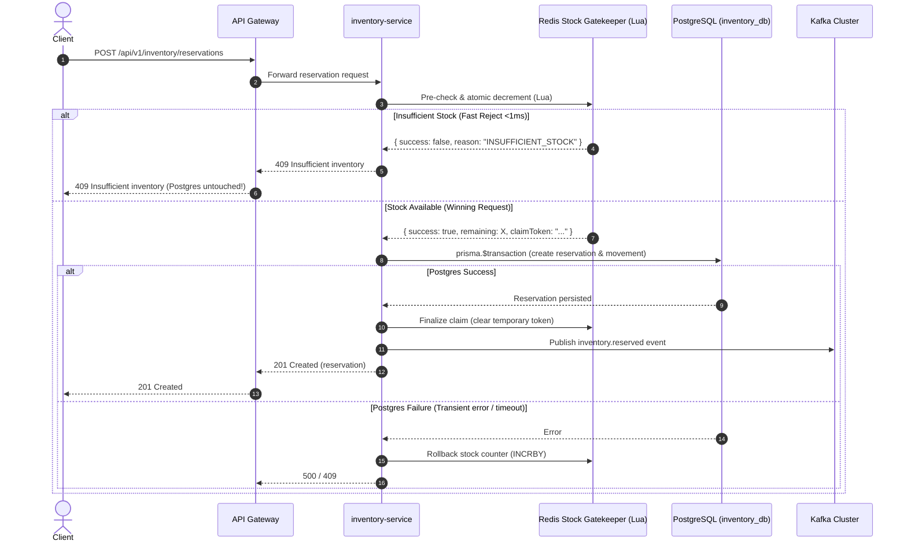

# Architectural Plan: High-Velocity Redis Stock Gatekeeper for Flash Sales

## 1. Problem Statement & Bottleneck Analysis

In high-velocity flash sales (e.g., 5,000 req/sec on limited stock):

- The naive implementation executes `prisma.$transaction` with pessimistic row locking (`updateMany` with `availableQuantity: { gte: quantity }`), followed by consecutive queries (`findUniqueOrThrow`, `inventoryReservation.create`, `inventoryMovement.create`, `inventoryItem.update`).
- **The Bottleneck**: All 5,000 concurrent requests contend for the exact same database row lock. PostgreSQL connection pool quickly exhausts, transaction queues spike, and even after stock drops to 0, incoming requests continue to hit the database to fail.
- **The Impact**: P99 latency spikes from 15ms to >5,000ms, database timeouts (`PrismaClientKnownRequestError: Timed out fetching a new connection`), and cascade degradation across the cluster.

---

## 2. Solution: The Redis Stock Gatekeeper Pattern



---

## 3. Detailed Component Architecture

### A. Redis Key Schema

- **Stock Counter**: `stock:available:{productId}:{variantId}:{warehouseId}` (Integer).
- **Claim Token**: `stock:claim:{referenceId}` (String holding claimed quantity, TTL: 60s).
- **Cold Load Mutex**: `stock:lock:{productId}:{variantId}:{warehouseId}` (String, TTL: 2s).

### B. Redis Lua Script (Atomic Reservation Pre-Check)

```lua
-- KEYS[1]: stock:available:{productId}:{variantId}:{warehouseId}
-- KEYS[2]: stock:claim:{referenceId}
-- ARGV[1]: requestedQuantity
-- ARGV[2]: claimTtlSeconds (e.g. 60)

local currentStock = redis.call('GET', KEYS[1])
if not currentStock then
    return { -1, 0 } -- Code -1: Key does not exist (cold cache)
end

local stock = tonumber(currentStock)
local requested = tonumber(ARGV[1])

if stock < requested then
    return { 0, stock } -- Code 0: Insufficient stock, returns current stock
end

-- Atomic decrement and claim registration
local remaining = redis.call('DECRBY', KEYS[1], requested)
redis.call('SET', KEYS[2], requested, 'EX', ARGV[2])

return { 1, remaining } -- Code 1: Success, returns remaining stock
```

### C. Cold Cache Initialization (Distributed Mutex)

1. If Lua returns `-1` (key missing):
2. Acquire `stock:lock:{productId}:{variantId}:{warehouseId}` with 2-second TTL.
3. Fetch ground truth `availableQuantity` from PostgreSQL `inventoryItem`.
4. `SET stock:available:... availableQuantity`.
5. Release mutex and re-execute reservation Lua script.

### D. Compensation & Release Handling

- **Database Failure**: If PostgreSQL transaction fails after a successful Redis claim, execute `INCRBY` by `requestedQuantity` and delete `stock:claim:{referenceId}`.
- **Reservation Expiry & Cancellation**: When `releaseInventoryReservation` or `expireInventoryReservation` executes:
  - Update PostgreSQL row.
  - Execute `INCRBY stock:available:... quantity`.
  - Invalidate centralized read cache and publish `inventory.stock.updated`.

---

## 4. Implementation Details

1. **Module**: `apps/inventory-service/src/gatekeeper/redis-stock-gatekeeper.ts`.
2. **Route Integration**: `apps/inventory-service/src/routes/inventory.route.ts` inside `POST /reservations`.
3. **Expiry Worker**: `apps/inventory-service/src/workers/reservation-expiry.worker.ts` and release handlers.
4. **Automated Verification**: `apps/inventory-service/tests/redis-stock-gatekeeper.test.ts`.
   - High-concurrency flash-sale oversell prevention.
   - Fast-rejection under 0 stock without PostgreSQL queries.
   - Cold cache initialization with distributed mutex.
   - Automatic compensation rollback on database error.
