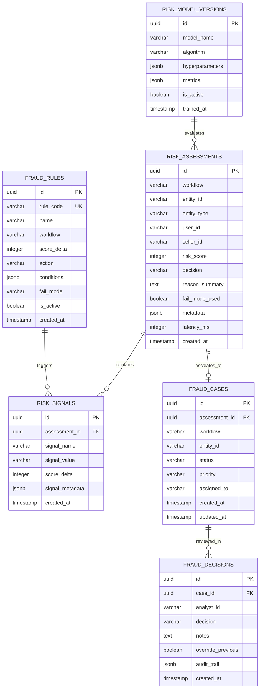

# Fraud Detection Engine & Real-Time Risk Scoring Architecture

## 1. Executive Overview

The **Fraud Detection Service** (`apps/fraud-service`, Port 8024) is a mission-critical, low-latency microservice designed for **Larekmart**'s multi-vendor marketplace ecosystem (comparable to Amazon, Daraz, and AliExpress). Built with **Python 3.12+, FastAPI, SQLAlchemy 2.0 (asyncpg), PostgreSQL (`fraud_db`), Redis, Kafka (`aiokafka`), scikit-learn, and NumPy/Pandas**, it safeguards the marketplace across payments, orders, accounts, promotions, seller payouts, and merchant operations.

```
┌────────────────────────────────────────────────────────────────────────────────────────┐
│                                 API Gateway (:8090)                                    │
└─────────────┬────────────────────────────────────────────────────────────┬─────────────┘
              │ /api/v1/internal/fraud/assess                              │ /api/v1/admin/fraud/*
              │ [x-internal-secret constant-time validation]              │ [Clerk Admin Role Gate]
              ▼                                                            ▼
┌────────────────────────────────────────────────────────────────────────────────────────┐
│                               fraud-service (:8024)                                    │
│  ┌───────────────────────────┐  ┌───────────────────────────┐  ┌────────────────────┐  │
│  │   Sliding-Window Velocity │  │  Configurable Rule Engine │  │  scikit-learn ML   │  │
│  │ (Redis ZSET Rate Counters)│  │ (Explainable Scores 0-100)│  │ (IsolationForest)  │  │
│  └─────────────┬─────────────┘  └─────────────┬─────────────┘  └─────────┬──────────┘  │
│                │                              │                          │             │
│                └───────────────────────┬──────┴──────────────────────────┘             │
│                                        ▼                                               │
│                        Decision: ALLOW | REVIEW | BLOCK                                │
└────────────────────────────────────────┬───────────────────────────────────────────────┘
                                         ▼
                 Kafka Event Bus & PostgreSQL Storage
        (fraud.assessment.completed, fraud.risk.detected, fraud.case.created)
```

---

## 2. Core Responsibilities & Domain Invariants

1. **Multi-Workflow Risk Assessment**:
   - `PAYMENT`: Repeated failed attempts, stolen card velocity, BIN/country mismatch, 3DS challenges.
   - `ORDER`: Account age vs total order value, abnormal basket items, rapid successive orders, shipping vs billing address distance anomalies.
   - `ACCOUNT`: Credential stuffing velocity, rapid password/email changes, device fingerprint hopping.
   - `PROMOTION`: Coupon abuse, single device generating hundreds of guest checkouts with first-order voucher codes.
   - `PAYOUT`: Seller changing bank IBAN immediately before large payout request, velocity spikes in sudden orders before settlement withdrawal.
   - `SELLER`: Shilling / fake orders for rating inflation, inventory ghosting.

2. **Explainable Rule Scoring Before Black-Box ML**:
   - Every risk decision is backed by an auditable breakdown of triggered rules and `risk_signals` (`scoreDelta`, `reason`, `signalValue`).
   - A deterministic composite risk score from $0$ (safe) to $100$ (critical risk) maps to decisions:
     - **ALLOW** ($0 \le \text{score} < 40$): Low risk; transaction proceeds uninterrupted.
     - **REVIEW** ($40 \le \text{score} < 75$): Suspicious activity; flagged for manual review; creates a `fraud_case`.
     - **BLOCK** ($\text{score} \ge 75$): Extreme risk; transaction denied immediately; alerts dispatched.

3. **Configurable Fail-Open vs Fail-Closed Policies**:
   - **Fail-Closed**: High-stakes workflows (`PAYMENT`, `PAYOUT`) reject or pause execution with `REVIEW` on infrastructure degradation to protect financial reserves.
   - **Fail-Open**: Low-friction workflows (`PROMOTION`, low-value `ORDER`) allow the transaction while emitting a high-priority telemetry warning, preventing checkout downtime.

4. **Integrated Case Management & Analyst Audit Trail**:
   - When risk triggers `REVIEW` or `BLOCK`, an immutable `fraud_case` is created.
   - Risk analysts review cases via `/api/v1/admin/fraud/cases/{id}/review`, recording audit-trailed decisions (`APPROVE`, `BLOCK`, `DISMISS`) with reason notes.

---

## 3. Database Schema (`fraud_db`)

The database consists of 6 core tables:



---

## 4. API Specification

| Method | Endpoint                                  | Access Guard        | Description                                                            |
| :----- | :---------------------------------------- | :------------------ | :--------------------------------------------------------------------- |
| `POST` | `/api/v1/internal/fraud/assess`           | `x-internal-secret` | Synchronous risk assessment evaluating rules, velocity & ML.           |
| `GET`  | `/api/v1/internal/fraud/assessments/{id}` | `x-internal-secret` | Retrieve assessment audit trail and triggered signals.                 |
| `GET`  | `/api/v1/admin/fraud/cases`               | Clerk Admin Role    | Query open/investigating fraud cases with pagination and filters.      |
| `POST` | `/api/v1/admin/fraud/cases/{id}/review`   | Clerk Admin Role    | Submit analyst resolution (`APPROVE`, `BLOCK`, `DISMISS`).             |
| `POST` | `/api/v1/admin/fraud/rules`               | Clerk Admin Role    | Dynamically create or update custom risk rules without redeploying.    |
| `GET`  | `/health`                                 | Public              | Readiness & liveness probe testing PostgreSQL and Redis.               |
| `GET`  | `/metrics`                                | Prometheus Scraper  | Export risk metrics, assessment latencies, and decision distributions. |

---

## 5. Kafka Event Ingestion & Emission

### Published Topics:

- `fraud.assessment.completed`: Broadcast after every evaluation for analytics and downstream auditing.
- `fraud.risk.detected`: Emitted when score exceeds review/block thresholds.
- `fraud.case.created`: Alerting and analyst queue notification.
- `fraud.case.resolved`: Case resolved by analyst, updating ML feature stores and allowlists.

### Consumed Topics:

- `order.created`: Asynchronous background profiling of order patterns.
- `payment.successful` / `payment.failed`: Real-time payment failure velocity tracking.
- `payout.scheduled`: Real-time cross-service risk assessment hook with `payout-service`.
