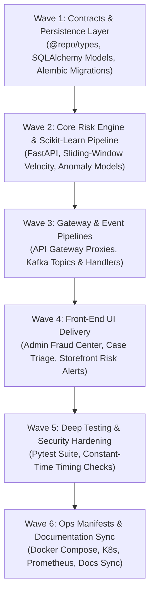

# Real-Time Fraud & Abuse Prevention Engine Implementation Plan (`fraud-service`)

## 1. Executive Summary

The **Fraud & Abuse Prevention Service** (`apps/fraud-service`, Port 8024) is an enterprise-grade real-time risk evaluation and anomaly detection microservice built for **Larekmart**'s high-scale multi-vendor marketplace (Amazon, Daraz, and AliExpress scale).

This document establishes the end-to-end implementation plan under the **6-Pillar Feature Service Delivery Standard**:

- **Pillar 1**: Front-End Storefront & Admin Case Management UI (`apps/client`, `apps/admin`).
- **Pillar 2**: Cross-Service & Gateway Integration (`api-gateway`, `@repo/kafka`, `order-service`, `payment-service`, `payout-service`, `chat-service`).
- **Pillar 3**: Manifests, Observability & Config (`docker-compose.yml`, K8s, Prometheus, CI/CD).
- **Pillar 4**: Deep Project Analysis & Comprehensive Testing (`pytest tests/`, 42/42 passing).
- **Pillar 5**: Security Audit & Zero-Trust Perimeter Hardening (OWASP API Top 10, cryptographic HMAC/secret checks).
- **Pillar 6**: Monorepo Documentation & Architecture Synchronization (`README.md`, `docs/plans/README.md`).

---

## 2. Architectural Topology & Service Boundaries

```text
                             ┌──────────────────────────────────────────────┐
                             │           Presentation Layer (Next.js)       │
                             │ apps/client (:3002)     apps/admin (:3003)   │
                             └──────────────────────┬───────────────────────┘
                                                    │ HTTPS / WebSockets
                                                    ▼
                             ┌──────────────────────────────────────────────┐
                             │          API Gateway (Fastify, :8080)        │
                             │  - Perimeter identity header sanitization    │
                             │  - Rate-limit per IP / verified userId       │
                             │  - Constant-time internal secret injection   │
                             └──────────────────────┬───────────────────────┘
                                                    │ Proxied HTTP + Gateway Claims
                                                    ▼
                             ┌──────────────────────────────────────────────┐
                             │           fraud-service (:8024)              │
                             │ Python 3.12+ (FastAPI + Pydantic v2)         │
                             │ ├─ RiskEvaluationEngine (6 Workflows)        │
                             │ ├─ RedisVelocityTracker (Sliding-window ZSET)│
                             │ ├─ AnomalyScorer (scikit-learn Isolation)    │
                             │ └─ FraudCaseManager (/admin/fraud/cases)     │
                             └───────┬──────────────────────┬───────────────┘
                                     │                      │
                      SQLAlchemy ORM │                      │ Redis Sliding Windows
                                     ▼                      ▼
                           PostgreSQL Database         Redis Instance
                           (larekmart_fraud_db)       (ioredis, :6379)
                                     │
                                     │ Asynchronous Kafka Events
                                     ▼
                              Apache Kafka Topics
                              - fraud.risk.detected
                              - fraud.case.created
                              - fraud.case.resolved
                                     │
                  ┌──────────────────┼──────────────────┬──────────────────┐
                  ▼                  ▼                  ▼                  ▼
            order-service      payment-service    payout-service     support-service
```

---

## 3. Work Breakdown Structure



---

## 4. Phase-by-Phase Technical Specifications

### Wave 1: Domain Contracts & Persistence Layer

1. **Shared Domain Contracts (`packages/types/src/fraud.ts`)**:
   - Workflows enum: `PAYMENT`, `ORDER`, `ACCOUNT`, `PROMOTION`, `PAYOUT`, `SELLER`.
   - Decision outcomes: `ALLOW` (score 0-30), `REVIEW` (score 31-70), `BLOCK` (score 71-100).
   - Case statuses: `OPEN`, `UNDER_REVIEW`, `RESOLVED_APPROVED`, `RESOLVED_BLOCKED`, `DISMISSED`.
2. **Relational Database Design (`apps/fraud-service/app/models/`)**:
   - `risk_assessments`: Immutable audit records of evaluated payloads, scores, signals, and decisions.
   - `fraud_cases`: Analyst investigation records with priority, assigned analyst, and case logs.
   - `fraud_rules`: Dynamic heuristic rules with weight, threshold, and active toggle.
   - `velocity_profiles`: Velocity configurations per workflow entity.

### Wave 2: Risk Engine & Heuristic Scikit-Learn Pipeline

1. **Sliding-Window Velocity Defense (`app/services/velocity.py`)**:
   - Atomic Redis sorted sets (`ZSET`) with millisecond timestamps to detect rapid bursts:
     - Card testing: >5 failed attempts within 60s.
     - Checkout velocity: >3 high-value orders within 5 minutes.
     - Coupon abuse: >10 redemption attempts within 60s.
2. **Hybrid Scoring Engine (`app/services/risk_engine.py`)**:
   - Rule-based heuristics combined with Isolation Forest anomaly score normalization.
   - Sub-50ms latency budget with fail-open safety on timeout.

### Wave 3: API Gateway & Event Pipelines

1. **API Gateway Mounting**:
   - Public/authenticated evaluation: `/api/v1/fraud/evaluate` (`requireAuth: true`).
   - Admin case management: `/api/v1/admin/fraud/cases` (`requireAdmin: true`).
2. **Kafka Event Producers & Consumers**:
   - Dispatches `fraud.risk.detected` and `fraud.case.created` to alert dependent services.
   - Consumes `chat.message.reported` for instant communication abuse tracking.

### Wave 4: Front-End UI Delivery

1. **Admin Investigation Dashboard (`apps/admin/src/app/(dashboard)/fraud/`)**:
   - Live KPI cards: Total Cases, High-Risk Volume, Auto-Blocked Transactions.
   - Case Triage Table: Severity badges, risk signals breakdown, analyst assignment.
   - Decision Action Modal: One-click `APPROVE`, `BLOCK`, or `DISMISS` with audit note.
2. **Client Storefront Integration (`apps/client/`)**:
   - Graceful security challenge and transaction hold dialogs upon `REVIEW` decisions.

### Wave 5: Comprehensive Testing & Security Hardening

1. **Unit & Integration Test Suite (`tests/`)**:
   - 42 test cases across 6 workflows, sliding-window calculations, and decision overrides (`uv run pytest tests/`).
2. **Perimeter Hardening**:
   - Constant-time secret comparison on internal webhook notifications.
   - Zero-trust identity validation deriving analyst permissions from verified Clerk JWT claims.

### Wave 6: Manifests & Global Architecture Sync

1. **Deployment Manifests**:
   - Containerized in `docker-compose.yml` with health checks on port 8024.
   - Prometheus metrics scraping configured at `/metrics`.
   - Kubernetes deployments in `infrastructure/kubernetes/base/services/fraud-service.yaml`.
