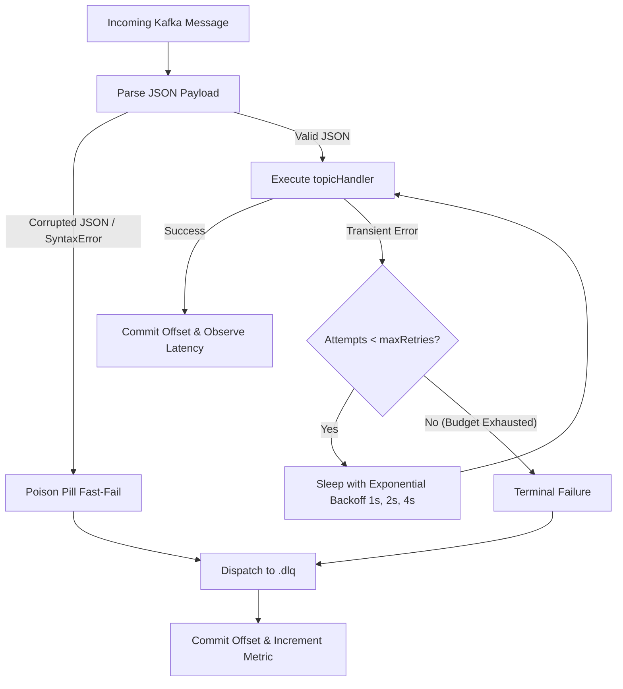

# Architectural Plan: Kafka Consumer Poison-Pill Isolation & Dead-Letter Queue (DLQ)

## 1. Problem Statement & Bottleneck Analysis

In distributed event-driven systems:

- When a message arrives at `packages/kafka/src/consumer.ts`:
  - If `JSON.parse(value)` fails (malformed payload or corrupted bytes), `catch (error)` logs the error, but the offset is committed and the message is **permanently discarded** with no audit record or replay capability.
  - If `topicHandler(parsed)` throws (downstream DB unavailable, network blip, concurrency conflict), the error is caught and logged, the offset is committed, and **the event is permanently lost**.
  - Conversely, without a DLQ mechanism, if an unhandled error were to throw out of `eachMessage`, KafkaJS would crash the consumer loop or retry the exact same poison pill infinitely, halting partition consumption for all subsequent valid events.

---

## 2. Solution: Smart Retry & Dead-Letter Queue Architecture



---

## 3. Detailed Component Architecture

### A. Configuration Interface (`packages/kafka/src/consumer.ts`)

```typescript
export interface ConsumerRetryOptions {
  /** Whether to enable DLQ dispatch on terminal failure. Default: true. */
  enableDlq?: boolean;
  /** Maximum number of handler retries before sending to DLQ. Default: 3. */
  maxRetries?: number;
  /** Initial delay before first retry in milliseconds. Default: 1000ms. */
  initialRetryDelayMs?: number;
  /** Exponential backoff multiplier. Default: 2. */
  backoffMultiplier?: number;
  /** Suffix appended to topic name for dead-letter queue. Default: ".dlq". */
  dlqTopicSuffix?: string;
}
```

### B. Standardized DLQ Headers & Metadata

When a message is routed to `<topic>.dlq`, the following metadata headers are attached:

- `x-original-topic`: Name of the source topic (e.g. `payment.successful`).
- `x-original-partition`: Partition number where the message was received.
- `x-original-offset`: Source offset.
- `x-consumer-group`: Consumer group ID processing the message.
- `x-error-message`: Extracted error message.
- `x-error-name`: Error constructor name (e.g. `SyntaxError`, `PrismaClientKnownRequestError`).
- `x-error-stack`: Truncated stack trace for debugging.
- `x-attempt-count`: Total number of processing attempts made.
- `x-is-poison-pill`: `"true"` if fast-failed on malformed payload, `"false"` if failed after retries.
- `x-failed-at`: ISO 8601 timestamp.

### C. Smart Error Classification

- **Poison Pills (Zero-delay fast-fail to DLQ)**:
  - `SyntaxError` (e.g. malformed JSON strings).
  - `TypeError` originating from schema decoding.
  - Skips retry loops to avoid stalling partition processing.
- **Operational / Transient Errors (Exponential Backoff)**:
  - Database connection errors, lock contention, external network timeouts.
  - Retried with exponential jittered delay before moving to DLQ.

### D. Observability Metrics

- `kafka_consumer_retries_total`: Counters of retry attempts labeled by `topic`, `consumer_group`.
- `kafka_consumer_dlq_total`: Counter of messages dispatched to DLQ labeled by `topic`, `consumer_group`, `reason`.
- `kafka_consumer_poison_pills_total`: Counter of malformed payloads isolated.

---

## 4. Implementation Components

1. **`packages/kafka/src/consumer.ts`**:
   - Embedded lazy producer handle for DLQ routing.
   - `isPoisonPill(error: unknown): boolean` classification.
   - Exponential backoff retry loop.
   - `dispatchToDlq(topic, message, metadata)` with rich debugging headers.
2. **Export Consumer Types**:
   - `ConsumerRetryOptions` re-exported from `packages/kafka/src/index.ts`.
3. **Automated Verification**:
   - `packages/kafka/tests/consumer-dlq.test.ts` verifying transient retries, poison pills, and DLQ dispatch.
