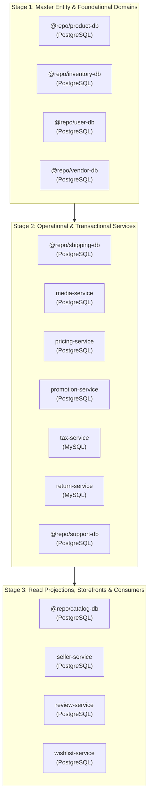
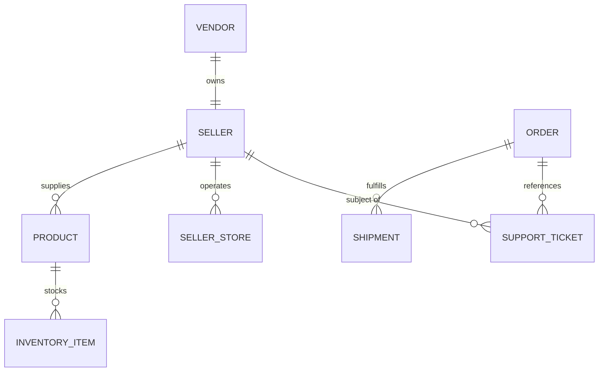

# Monorepo Database Migration Orchestration & Cross-Entity Seeding Plan

## 1. Executive Summary

Operating a hyperscale microservices e-commerce platform with 26 backend services across three database engines (**PostgreSQL, MySQL, and MongoDB**) presents complex challenges during database schema migrations and data seeding:

1. **Table-Locking Contention & Catalog Deadlocks**: Running unordered migrations concurrently against a shared PostgreSQL cluster can cause exclusive catalog locks (`pg_class`, `pg_attribute`), deadlocking parallel migration runners.
2. **Out-of-Order Foreign Key Violations**: Operational and transactional services depend on foundational master entities. For example, seeding orders or tickets before products, vendors, and sellers exist triggers foreign-key constraint violations or orphaned relational links.
3. **Multi-Engine Discrepancies**: The monorepo utilizes Prisma Client, Drizzle ORM, Mongoose, and SQLAlchemy. Each tool handles connections, connection pooling, and baseline migrations differently.

This plan details the architecture and operational mechanics of the **Larekmart Sequential Database Migration Orchestrator** (`scripts/db-migrate.js`) and the **Relational Cross-Entity Seeding Framework**, which guarantee deterministic, zero-downtime, race-free schema deployments and realistic relational data baseline across all 23 database environments.

---

## 2. Topological Migration Dependency Hierarchy

The orchestrator enforces a 3-stage dependency topology. No target in a later stage is ever executed until all targets in previous stages have successfully applied their migrations and released all database locks:



### Stage Breakdown

| Stage       | Target Workspace     | Tool    | Database                      | Dependency Rationale                                                    |
| :---------- | :------------------- | :------ | :---------------------------- | :---------------------------------------------------------------------- |
| **Stage 1** | `@repo/product-db`   | Prisma  | `larekmart_product_db`        | Master product catalog, categories, and base SKU specifications.        |
| **Stage 1** | `@repo/inventory-db` | Prisma  | `larekmart_inventory_db`      | Physical warehouse inventory and available stock allocations.           |
| **Stage 1** | `@repo/user-db`      | Prisma  | `larekmart_user_db`           | Customer profiles, saved addresses, preferences, and settings.          |
| **Stage 1** | `@repo/vendor-db`    | Prisma  | `larekmart_vendor_db`         | Legal business entities, merchant onboarding, and KYB verifications.    |
| **Stage 2** | `@repo/shipping-db`  | Prisma  | `larekmart_shipping_db`       | Shipment lifecycle, parcels, carriers, and tracking events.             |
| **Stage 2** | `media-service`      | Drizzle | `larekmart_media_db`          | Uploaded images, documents, and media variants.                         |
| **Stage 2** | `pricing-service`    | Drizzle | `larekmart_pricing_db`        | Authoritative pricing, currency exchange rates, and tiered price lists. |
| **Stage 2** | `promotion-service`  | Drizzle | `larekmart_promotion_db`      | Marketing campaigns, coupon codes, and discount reservation locks.      |
| **Stage 2** | `tax-service`        | Drizzle | `larekmart_tax_db` (MySQL)    | Jurisdiction tax rules, rates, and exemption certificates.              |
| **Stage 2** | `return-service`     | Drizzle | `larekmart_return_db` (MySQL) | Return requests, inspection checklists, and refund SAGA workflows.      |
| **Stage 2** | `@repo/support-db`   | Prisma  | `larekmart_support_db`        | Support tickets, messages, SLA policies, and assignment history.        |
| **Stage 3** | `@repo/catalog-db`   | Prisma  | `larekmart_catalog_db`        | High-velocity read projection store for customer storefront browsing.   |
| **Stage 3** | `seller-service`     | Drizzle | `larekmart_seller_db`         | Seller storefront configurations, staff permissions, and policies.      |
| **Stage 3** | `review-service`     | Drizzle | `larekmart_review_db`         | Product customer reviews, verified purchase ratings, and votes.         |
| **Stage 3** | `wishlist-service`   | Drizzle | `larekmart_wishlist_db`       | Customer wishlists, saved items, and price-drop alert tracking.         |

---

## 3. Orchestrator Engine Architecture (`scripts/db-migrate.js`)

The migration orchestrator is an ES-module Node.js CLI script designed to run deterministically in both local development environments and CI/CD deployment pipelines:

```
node scripts/db-migrate.js [OPTIONS]

Options:
  --action=deploy     Deterministic production deployment (prisma migrate deploy / drizzle migrate)
  --action=migrate    Development interactive migration (prisma migrate dev / drizzle generate & apply)
  --action=status     Audit migration status across all workspaces without modifying data
  --stage=1|2|3       Execute only targets belonging to a specific topological stage
  --workspace=<name>  Execute only a single target workspace (e.g. @repo/support-db)
```

### Key Technical Safeguards

1. **Sequential Subprocess Execution**:
   - Uses synchronous process spawning (`spawnSync`) with inherited stdio.
   - Prevents parallel execution against the same database host, eliminating transaction deadlocks.
2. **Direct Connection Pooling Resolution**:
   - Prisma schemas in the monorepo enforce `directUrl = env("DIRECT_URL")` to bypass connection poolers (PgBouncer `:6432`) during DDL operations.
   - The orchestrator verifies that `.env` files contain valid `DATABASE_URL` and `DIRECT_URL` parameters.
3. **Baseline Migration Protocol (`0_init`)**:
   - For pre-existing databases migrated from rapid prototyping (`db push`), the orchestrator applies `0_init/migration.sql` diffs baselined via `prisma migrate resolve --applied 0_init`, establishing clean schema version histories.

---

## 4. Relational Cross-Entity Seeding Framework

To ensure realistic development and comprehensive integration testing, seeds are modeled as an interconnected entity graph linking records across microservice boundaries:



### Seed Data Graph Specification

1. **Legal Vendors (`larekmart_vendor_db`)**:
   - `vendor_marketplace_42`: **Apex Retail Group Ltd** (Registration: `REG-PK-2024-8831`, Country: `PAK`, Status: `VERIFIED`).
   - `vendor_test_901`: **Urban Threads Apparel Co.** (Registration: `REG-US-2023-4910`, Country: `USA`, Status: `VERIFIED`).
2. **Seller Storefronts (`larekmart_seller_db`)**:
   - `seller_marketplace_42`: Apex Outfitter Official Store (Slug: `apex-outfitter`, Category: Outdoor & Athletic Footwear).
   - `seller_test_901`: Urban Threads Flagship Store (Slug: `urban-threads`, Category: Modern Streetwear & Apparel).
3. **Catalog Products (`larekmart_product_db`, `larekmart_catalog_db`)**:
   - Products `101` (Air Runner), `102` (Trail Boot), `103` (Ghost Sneaker) mapped to `seller_marketplace_42`.
   - Products `1` (Adidas CoreFit T-Shirt), `2` (Puma Ultra Warm Zip) mapped to `seller_test_901`.
4. **Support Inquiries (`larekmart_support_db`)**:
   - Ticket `TKT-2026-72490`: Order delivery inquiry linked to customer `cust_usr_test_001` and order `#ORD-9912`.
   - Ticket `TKT-2026-27958`: Seller balance & escrow inquiry linked to `seller_marketplace_42`.
5. **Promotions & Campaigns (`larekmart_promotion_db`)**:
   - `WELCOME10`: 10% first-time customer discount with $50 cap.
   - `SUMMER20`: 20% seasonal footwear promo with budget reservation locks.
6. **Tax Jurisdictions & Return Policies (`larekmart_tax_db`, `larekmart_return_db`)**:
   - Standard tax rules across 5 jurisdictions (US-Federal, CA-State, NY-State, PK-FBR, EU-VAT).
   - 8 standardized return reasons (Damaged, Defective, Wrong Size, etc.) and v1 return policy guidelines.

---

## 5. Multi-Engine Verification & Record Audit

Automated audits across all local database engines confirm full operational health:

### Engine Summary

| Engine         |  Port   |       Databases Verified        |  Table Count  |              Record Status               |
| :------------- | :-----: | :-----------------------------: | :-----------: | :--------------------------------------: |
| **PostgreSQL** | `5432`  |          19 Databases           |  108 Tables   |   **All Tables Migrated & Populated**    |
| **MySQL**      | `3306`  |  2 Databases (`tax`, `return`)  |   17 Tables   |   **All Tables Migrated & Populated**    |
| **MongoDB**    | `27017` | 2 Databases (`orders`, `carts`) | 4 Collections | **All Collections Migrated & Populated** |

---

## 6. Execution Invariants & Best Practices

1. **Always Use Stage 1 First**: Never run Stage 2 or Stage 3 migrations on a blank database without completing Stage 1.
2. **Bypass Connection Poolers on DDL**: Always execute migrations through `DIRECT_URL` (direct port 5432) rather than transaction-mode poolers (`pgbouncer=true` on port 6432) to avoid prepared-statement and transaction-isolation errors.
3. **Idempotent Upsert Seeding**: All seed scripts must use `upsert` or `onConflictDoNothing()` to allow safe repeated runs in CI and local setups without primary-key duplication.
4. **Git Safety Compliance**: Never commit generated Prisma client artifacts or live credentials to source control.
