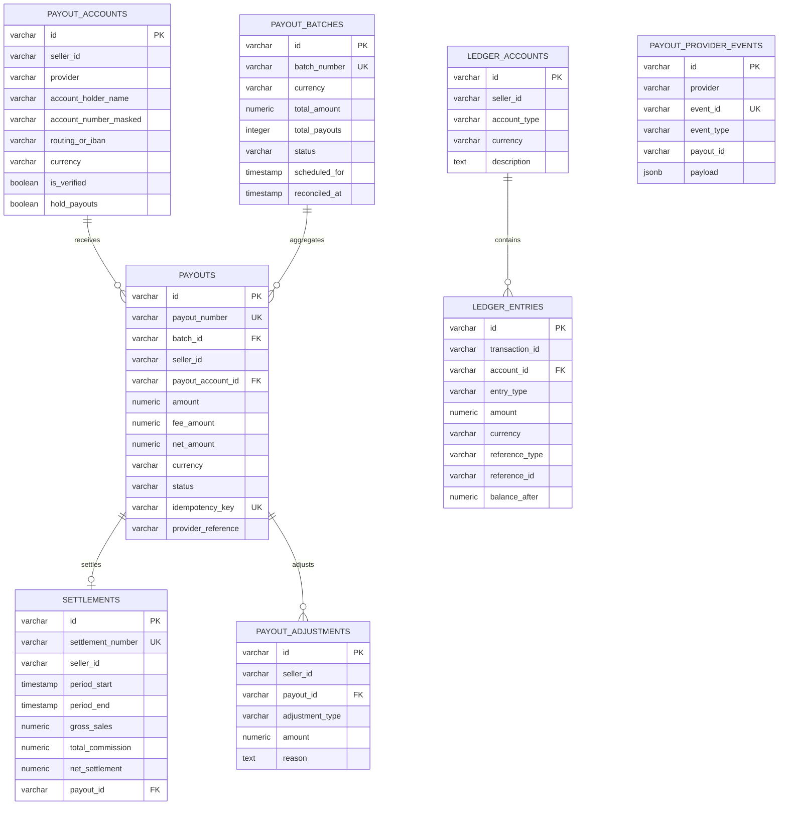

# Payout Service & Balanced Double-Entry Financial Ledger Architecture

## 1. Executive Overview

The **Payout Service** (`apps/payout-service`, Port 8023) is a financially sensitive microservice built with **Node.js, TypeScript, NestJS 11 + Fastify, Drizzle ORM, PostgreSQL (`payout_db`), Redis, Kafka, and Decimal.js**.

Operating a marketplace at Daraz, AliExpress, or Amazon scale requires strict adherence to cryptographic and financial invariants. Treating a mutable database column (e.g. `seller.balance = balance + 100`) as the source of truth causes phantom reads, concurrency race conditions, and unverifiable settlement audits. The Payout Service eliminates these vulnerabilities by enforcing a **balanced, append-only double-entry ledger** where available balances, pending settlements, dispute holds, and lifetime disbursements are derived solely from immutable transaction journals.

```
┌────────────────────────────────────────────────────────────────────────────────────────┐
│                                 API Gateway (:8090)                                    │
└─────────────┬────────────────────────────────────────────────────────────┬─────────────┘
              │ /api/v1/sellers/me/balance                                 │ /api/v1/admin/payouts
              │ /api/v1/sellers/me/payouts                                 │ [requireAdmin: true]
              ▼                                                            ▼
┌────────────────────────────────────────────────────────────────────────────────────────┐
│                              payout-service (:8023)                                    │
│  ┌───────────────────────────┐  ┌───────────────────────────────────────────────────┐  │
│  │   Double-Entry Ledger     │  │           Payout Schedule & Settlement            │  │
│  │ (Debits strictly = Credits│  │  (Batches, Reserve Holds & Provider Adapters)     │  │
│  └─────────────┬─────────────┘  └─────────────────────────┬─────────────────────────┘  │
└────────────────┼──────────────────────────────────────────┼────────────────────────────┘
                 ▼                                          ▼
   PostgreSQL / PgBouncer (:6432)             Kafka Messaging Pipeline
    (payout_db, statement_cache_size=0)       (payout.scheduled, payout.completed)
```

---

## 2. Technology Stack & Operational Guarantees

| Component | Choice | Purpose |
| :--- | :--- | :--- |
| **Framework** | NestJS 11 + Fastify (`@nestjs/platform-fastify`) | Enterprise modular DI, performance, Fastify routing. |
| **Persistence** | PostgreSQL (`payout_db`) via Drizzle ORM | ACID transactions, explicit table constraints, PgBouncer on port 6432. |
| **Connection Pooling** | PgBouncer with `statement_cache_size=0` | Eliminates prepared statement cache collision in transaction pool mode. |
| **Financial Arithmetic**| `Decimal.js` (34 digits of precision) | Absolute prevention of IEEE-754 floating-point inaccuracies on currency. |
| **Messaging** | `@repo/kafka` (Producer & Consumer) | Asynchronous event streaming with automatic DLQ routing. |
| **Provider Adapters** | `IPayoutProviderAdapter` (Bank ACH / Stripe Connect) | Decoupled abstraction for bank wires, 1Link, Raast, and Stripe Connect. |
| **Perimeter Security** | Zero-Trust Gateway Secret + Admin Role Gates | Constant-time `x-internal-secret` verification; RBAC on admin endpoints. |

---

## 3. Database Entity Model

The service manages 8 database tables:



---

## 4. Double-Entry Accounting Engine Invariants

1. **Balance Equation**:
   Every financial event must generate at least 2 legs. The sum of all Credits must strictly equal the sum of all Debits:
   $$\sum \text{Credits} - \sum \text{Debits} = 0$$

2. **Derived Balance Formula**:
   Seller available balance is computed from the immutable journal:
   $$\text{AvailableBalance} = \max\left(0, \left(\sum \text{EscrowCredits} - \sum \text{EscrowDebits}\right) - \text{DisputeReserveHold}\right)$$

3. **Reserve Holds & Dispute Freezing**:
   When a buyer files a dispute or chargeback, funds transition:
   $$\text{Debit(SELLER\_ESCROW)} \longrightarrow \text{Credit(DISPUTE\_RESERVE)}$$
   Upon dispute resolution in seller's favor, funds transition back:
   $$\text{Debit(DISPUTE\_RESERVE)} \longrightarrow \text{Credit(SELLER\_ESCROW)}$$

---

## 5. API Endpoints Contract

### Seller Storefront APIs (Authenticated via Gateway Clerk Session)
- `GET /api/v1/sellers/me/payouts`: Historical disbursements and current transfer statuses.
- `GET /api/v1/sellers/me/balance`: Real-time ledger balance (available, pending, and reserve hold).
- `GET /api/v1/sellers/me/statements`: Periodic settlement reports and earnings summaries.

### Internal APIs (Zero-Trust via `x-internal-secret`)
- `POST /api/v1/internal/payouts/schedule`: Triggers batch settlement run for eligible sellers above minimum threshold.
- `POST /api/v1/internal/payouts/reconcile`: Ingests provider ACH / bank settlement results and updates batch status.

### Admin APIs (`requireAdmin: true`)
- `GET /api/v1/admin/payouts`: Full marketplace payout audit log with filtering by status and date.
- `POST /api/v1/admin/payouts/:payoutId/retry`: Retries failed disbursements after bank account corrections.
