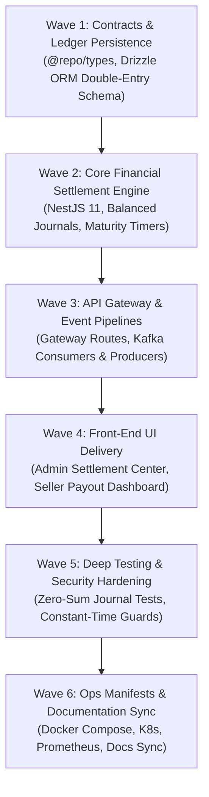

# Seller Payouts & Double-Entry Ledger Implementation Plan (`payout-service`)

## 1. Executive Summary

The **Seller Payouts Service** (`apps/payout-service`, Port 8023) is a mission-critical financial settlement microservice engineered for **Larekmart**'s multi-vendor marketplace platform.

This document establishes the end-to-end implementation plan under the **6-Pillar Feature Service Delivery Standard**:

- **Pillar 1**: Front-End Storefront Seller Portal & Admin Ledger UI (`apps/client`, `apps/admin`).
- **Pillar 2**: Cross-Service & Gateway Integration (`api-gateway`, `@repo/kafka`, `order-service`, `commission-service`, `fraud-service`).
- **Pillar 3**: Manifests, Observability & Config (`docker-compose.yml`, K8s, Prometheus, CI/CD).
- **Pillar 4**: Deep Project Analysis & Comprehensive Testing (Double-entry zero-sum invariants, unit & integration test suites).
- **Pillar 5**: Security Audit & Zero-Trust Perimeter Hardening (Role gating, constant-time internal secret validation).
- **Pillar 6**: Monorepo Documentation & Architecture Synchronization (`README.md`, `docs/plans/README.md`).

---

## 2. Architectural Topology & Service Boundaries

```text
                             ┌──────────────────────────────────────────────┐
                             │           Presentation Layer (Next.js)       │
                             │ apps/client (:3002)     apps/admin (:3003)   │
                             └──────────────────────┬───────────────────────┘
                                                    │ HTTPS / REST
                                                    ▼
                             ┌──────────────────────────────────────────────┐
                             │          API Gateway (Fastify, :8080)        │
                             │  - Identity scrubbing & Clerk session verify │
                             │  - Role validation & internal secret sign    │
                             └──────────────────────┬───────────────────────┘
                                                    │ Proxied HTTP + Gateway Claims
                                                    ▼
                             ┌──────────────────────────────────────────────┐
                             │           payout-service (:8023)             │
                             │ NestJS 11 + Fastify 5 + Drizzle ORM          │
                             │ ├─ DoubleEntryJournal (Append-Only Invariant)│
                             │ ├─ SettlementBatchEngine (Disbursement Sched)│
                             │ ├─ MaturityManager (7-Day Cooling Off Period)│
                             │ └─ ProviderReconciliation (Stripe/Bank APIs) │
                             └───────┬──────────────────────┬───────────────┘
                                     │                      │
                         Drizzle ORM │                      │ Redis Leases
                                     ▼                      ▼
                           PostgreSQL Database         Redis Instance
                           (larekmart_payout_db)      (ioredis, :6379)
                                     │
                                     │ Asynchronous Kafka Events
                                     ▼
                              Apache Kafka Topics
                              - payout.batch.created
                              - payout.disbursed
                              - payout.hold.applied
                                     │
                  ┌──────────────────┼──────────────────┐
                  ▼                  ▼                  ▼
            order-service       fraud-service      seller-service
```

---

## 3. Work Breakdown Structure



---

## 4. Phase-by-Phase Technical Specifications

### Wave 1: Domain Contracts & Persistence Layer

1. **Shared Domain Contracts (`packages/types/src/payout.ts`)**:
   - Ledger entry types: `CREDIT`, `DEBIT`.
   - Entry categories: `ORDER_SALE`, `COMMISSION_FEE`, `REFUND_REVERSAL`, `DISPUTE_HOLD`, `PAYOUT_DISBURSEMENT`, `MANUAL_ADJUSTMENT`.
   - Batch statuses: `PENDING`, `PROCESSING`, `COMPLETED`, `FAILED`, `CANCELLED`.
2. **Relational Database Design (`apps/payout-service/src/db/schema.ts`)**:
   - `ledger_accounts`: Financial accounts per seller and platform escrow.
   - `ledger_entries`: Append-only balanced transaction records (`SUM(credit) == SUM(debit)`).
   - `settlement_batches`: Grouped disbursements with target bank/provider details.
   - `reserve_holds`: Escrow amounts withheld for fraud risk, returns, or seller disputes.

### Wave 2: Financial Engine & Double-Entry Ledger

1. **Zero-Sum Ledger Integrity**:
   - Every transaction posts matching debits and credits within serializable PostgreSQL transactions.
   - Seller available balances are computed dynamically as `SUM(credits) - SUM(debits) - SUM(active_holds)`.
2. **Maturity & Cooling-Off Lifecycles**:
   - Order revenues are locked in `PENDING_MATURITY` until the customer return window (e.g. 7 days post-delivery) elapses.
   - Automated sweeper unlocks matured funds into `AVAILABLE` balance for payout inclusion.

### Wave 3: API Gateway & Event Pipelines

1. **API Gateway Routes**:
   - Seller balance and on-demand payout requests: `/api/v1/payouts/*` (`requireAuth: true`).
   - Admin settlement batch processing: `/api/v1/admin/payouts/*` (`requireAdmin: true`).
2. **Kafka Event Handlers**:
   - Consumes `order.delivered` to begin maturity countdown.
   - Consumes `fraud.risk.detected` to place automatic defensive reserve holds.
   - Consumes `return.refund.completed` to reverse sales credits and restore fee adjustments.

### Wave 4: Front-End UI Delivery

1. **Admin Settlement Center (`apps/admin/src/app/(dashboard)/payouts/`)**:
   - Batch creation and approval workflows.
   - Immutable double-entry audit journal viewer with filter by seller.
2. **Seller Storefront Dashboard (`apps/client/`)**:
   - Earnings overview: Pending, Available, Held, and Disbursed balances.
   - Payout history with downloadable PDF/CSV settlement statements.

### Wave 5: Comprehensive Testing & Security Hardening

1. **Zero-Sum & Invariant Verification**:
   - Rigorous test suite validating that no unbalanced journal entry can commit.
   - Concurrency tests verifying that simultaneous payout requests cannot overdraw funds.
2. **Perimeter Hardening**:
   - Constant-time internal secret comparison.
   - Payout initiation gated to verified seller profile owners.

### Wave 6: Manifests & Global Architecture Sync

1. **Deployment Manifests**:
   - Containerized in `docker-compose.yml` on port 8023.
   - Migration script registered in `scripts/db-migrate.js`.
   - Prometheus metrics exposed on `/metrics`.
