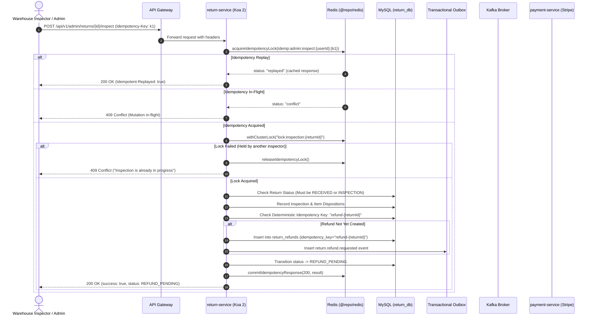

# Return-Service Saga Idempotency & Warehouse Inspection Concurrency Locks

## 1. Executive Summary

In a hyperscale e-commerce marketplace, the return and refund lifecycle involves distributed coordination across customers, warehouse operators, payment gateways (Stripe), and multiple microservices (`payment-service`, `shipping-service`, `inventory-service`, `analytic-service`, and `notification-service`).

During high-volume events (e.g. post-flash-sale returns or automated warehouse barcode scanning), two major race conditions can cause double refunds, inconsistent states, or redundant Kafka events:
1. **Warehouse Inspection Concurrency Collision**:
   Concurrent HTTP requests to `POST /api/v1/admin/returns/:returnId/inspect` (e.g., from dual barcode scans, duplicate network retries, or multiple warehouse inspectors) previously lacked distributed locking. Both requests could enter `recordInspection`, update status, and record multiple inspections.
2. **Non-Deterministic Refund Idempotency Keys**:
   The existing implementation in `AdminReturnService` generated non-deterministic keys using `uuidv4().substring(0, 8)` (`refund-${returnId}-${uuidv4().substring(0, 8)}`). This defeated the `UNIQUE` database constraint on `return_refunds.idempotency_key` and Stripe's idempotency mechanism, resulting in separate refund requests being dispatched to `payment-service` and processed by Stripe.
3. **Missing Distributed Idempotency on State Mutations**:
   Customer return creation (`POST /api/returns/orders/:orderId`) and admin retry operations lacked atomic lease enforcement via Redis `Idempotency-Key` headers, permitting duplicate return submissions on transient network drops.

This document details the architectural solution implementing **Phase 11: `return-service` Concurrency & Saga Hardening**.

---

## 2. Architecture & Data Flow

---

## 3. Concrete Hardening Specifications

### 3.1 Distributed Cluster Locking for Inspection & Retries
- **Lock Key Pattern**: `return:v1:lock:inspection:{returnId}` and `return:v1:lock:refund-retry:{returnId}`.
- **Acquisition Mechanism**: `@repo/redis` `withClusterLock(redis.client, lockKey, workerId, async () => { ... }, { ttlMs: 10000 })`.
- **Conflict Behavior**: If another replica or worker holds the lock, fail-fast with HTTP 409 Conflict (`An inspection is currently in progress for return ${returnId}`).

### 3.2 Deterministic Refund Idempotency Keys
- **Initial Inspection Refund**: `refund-${returnId}`
  - No random UUID suffix.
  - Strict check against `returnRefunds` table via `refundRepository.findByIdempotencyKey(idempotencyKey)`.
  - If a refund record already exists with that key, idempotent return of the existing record without duplicate insertion or redundant Kafka emission.
- **Retry Refund**: `refund-${returnId}-retry-${existingRefunds.length}`
  - Versioned and deterministic based on the count of prior refund attempts.
  - Guarantees each retry creates an explicit, traceable audit record while preventing concurrent duplicate retries for the same attempt.

### 3.3 Koa 2 Distributed Idempotency Middleware
- **Path**: `apps/return-service/src/middleware/idempotency.middleware.ts`
- **Supported Headers**: `Idempotency-Key` or `idempotency-key`.
- **Redis Operations**:
  - `acquireIdempotencyLock`: Atomic `SET NX PX` with 10s strict execution lease.
  - `commitIdempotencyResponse`: Stores `{ statusCode, body }` with 24h retention TTL on 2xx responses.
  - `releaseIdempotencyLock`: Cleans in-progress lease on 4xx/5xx or unhandled exceptions.
  - Transparent Replay: Returns cached payload and sets headers `Idempotent-Replayed: true` and `x-idempotent-replay: true`.
  - Concurrency Conflict: Returns HTTP 409 `{ message: "A mutation with this Idempotency-Key is currently in-flight", statusCode: 409 }`.

### 3.4 CORS & Gateway Alignment
- Update `apps/return-service/src/app.ts` CORS headers to include `Idempotency-Key` and `idempotency-key`.

---

## 4. Verification Plan

1. **Unit & Integration Test Suite (`tests/concurrency-and-saga-idempotency.test.ts`)**:
   - `idempotencyMiddleware` execution:
     - First call acquires lock and commits response.
     - Second identical call replays cached response with `Idempotent-Replayed: true`.
     - In-flight duplicate call yields HTTP 409 conflict.
   - `withClusterLock` inspection concurrency:
     - Inspector worker 1 acquires lock and executes inspection.
     - Simultaneous inspector worker 2 is rejected with conflict.
   - Deterministic refund key verification:
     - Inspecting return generates key `refund-${returnId}`.
     - Re-running does not generate random variations and does not create duplicate `return_refunds` rows.
     - Retrying refund generates versioned `refund-${returnId}-retry-1`.
2. **Monorepo Strict Type Check**:
   - `pnpm check-types` across all 42 workspaces.

