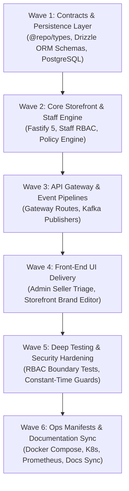

# Marketplace Seller Service Implementation Plan (`seller-service`)

## 1. Executive Summary

The **Marketplace Seller Service** (`apps/seller-service`, Port 8021) is the operational core for merchants in the **Larekmart** multi-vendor marketplace platform.

This document details the end-to-end implementation plan under the **6-Pillar Feature Service Delivery Standard**:

- **Pillar 1**: Front-End Storefront Configuration & Admin Moderation UI (`apps/client`, `apps/admin`).
- **Pillar 2**: Cross-Service & Gateway Integration (`api-gateway`, `@repo/kafka`, `vendor-service`, `catalog-service`, `chat-service`).
- **Pillar 3**: Manifests, Observability & Config (`docker-compose.yml`, K8s, Prometheus, CI/CD).
- **Pillar 4**: Deep Project Analysis & Comprehensive Testing (Staff RBAC, storefront policies, unit & integration test suites).
- **Pillar 5**: Security Audit & Zero-Trust Perimeter Hardening (Staff permissions, constant-time secret validation).
- **Pillar 6**: Monorepo Documentation & Architecture Synchronization (`README.md`, `docs/plans/README.md`).

---

## 2. Architectural Topology & Service Boundaries

```text
                             ┌──────────────────────────────────────────────┐
                             │           Presentation Layer (Next.js)       │
                             │ apps/client (:3002)     apps/admin (:3003)   │
                             └──────────────────────┬───────────────────────┘
                                                    │ HTTPS / REST
                                                    ▼
                             ┌──────────────────────────────────────────────┐
                             │          API Gateway (Fastify, :8080)        │
                             │  - Identity scrubbing & Clerk session verify │
                             │  - Seller claim extraction & secret signing  │
                             └──────────────────────┬───────────────────────┘
                                                    │ Proxied HTTP + Gateway Claims
                                                    ▼
                             ┌──────────────────────────────────────────────┐
                             │           seller-service (:8021)             │
                             │ Fastify 5 + TypeScript + Drizzle ORM         │
                             │ ├─ StorefrontConfigManager (Slugs & Themes)  │
                             │ ├─ StaffPermissionManager (Seller RBAC)      │
                             │ ├─ PolicyManager (Shipping, Return, Warranty)│
                             │ └─ PerformanceTracker (Rating Snapshots)     │
                             └───────┬──────────────────────┬───────────────┘
                                     │                      │
                         Drizzle ORM │                      │ Redis Caches
                                     ▼                      ▼
                           PostgreSQL Database         Redis Instance
                           (larekmart_seller_db)      (ioredis, :6379)
                                     │
                                     │ Asynchronous Kafka Events
                                     ▼
                              Apache Kafka Topics
                              - seller.storefront.updated
                              - seller.staff.updated
                              - seller.status.changed
                                     │
                  ┌──────────────────┼──────────────────┐
                  ▼                  ▼                  ▼
            catalog-service     vendor-service      chat-service
```

---

## 3. Work Breakdown Structure



---

## 4. Phase-by-Phase Technical Specifications

### Wave 1: Domain Contracts & Persistence Layer

1. **Shared Domain Contracts (`packages/types/src/seller.ts`)**:
   - Staff roles: `OWNER`, `MANAGER`, `OPERATOR`, `SUPPORT`.
   - Storefront statuses: `ACTIVE`, `SUSPENDED`, `VACATION`, `PENDING_REVIEW`.
   - Zod schemas for updating storefront brand, adding staff, upserting policies, and updating operational hours.
2. **Relational Database Design (`apps/seller-service/src/db/schema.ts`)**:
   - `seller_storefronts`: Store name, unique URL slug, logo URL, banner URL, description, and status.
   - `seller_staff`: Staff member assignments, user ID references, and role permissions.
   - `seller_policies`: Custom return, shipping, and warranty policies shown to buyers.
   - `seller_metrics`: Cached performance metrics, rating snapshots, and fulfillment fulfillment SLAs.

### Wave 2: Core Storefront Engine & Staff RBAC

1. **Storefront & Slug Management**:
   - Enforces unique URL slug normalization and reserved keyword blocking (e.g., `admin`, `system`, `checkout`).
   - Caches public storefront configurations in Redis with 1-hour TTL and event-driven invalidation.
2. **Staff Permission Layer**:
   - Validates caller permissions before allowing inventory, order, or setting changes.
   - Owners have full authority; operators are restricted from editing financial or staff settings.

### Wave 3: API Gateway & Event Pipelines

1. **API Gateway Routes**:
   - Public storefront discovery: `GET /api/v1/sellers/storefront/:slug` (`public: true`).
   - Seller operational endpoints: `/api/v1/sellers/*` (`requireAuth: true`, `requireSeller: true`).
   - Admin oversight: `/api/v1/admin/sellers/*` (`requireAdmin: true`).
2. **Kafka Event Producers**:
   - Publishes `seller.storefront.updated` to update `catalog-service` storefront listings.
   - Publishes `seller.status.changed` to freeze listings upon merchant suspension.

### Wave 4: Front-End UI Delivery

1. **Storefront Merchant Center (`apps/client/src/app/seller/`)**:
   - Custom branding editor (drag-and-drop banner, logo, brand story).
   - Staff management panel with role assignment and audit log.
2. **Admin Merchant Oversight (`apps/admin/src/app/(dashboard)/sellers/`)**:
   - Seller review, status toggling (`ACTIVE` / `SUSPENDED`), and compliance audits.

### Wave 5: Comprehensive Testing & Security Hardening

1. **RBAC & Boundary Verification**:
   - Validates that non-staff cannot modify merchant settings.
   - Validates that suspended sellers cannot publish products or reply to chats.
2. **Perimeter Hardening**:
   - Zero-trust internal secret checks (`safeTimingCompare`).
   - Identity verification derived solely from Clerk JWT tokens.

### Wave 6: Manifests & Global Architecture Sync

1. **Deployment Manifests**:
   - Containerized in `docker-compose.yml` on port 8021.
   - Registered in `scripts/db-migrate.js`.
   - Prometheus scrape configuration registered in `prometheus.yml`.
