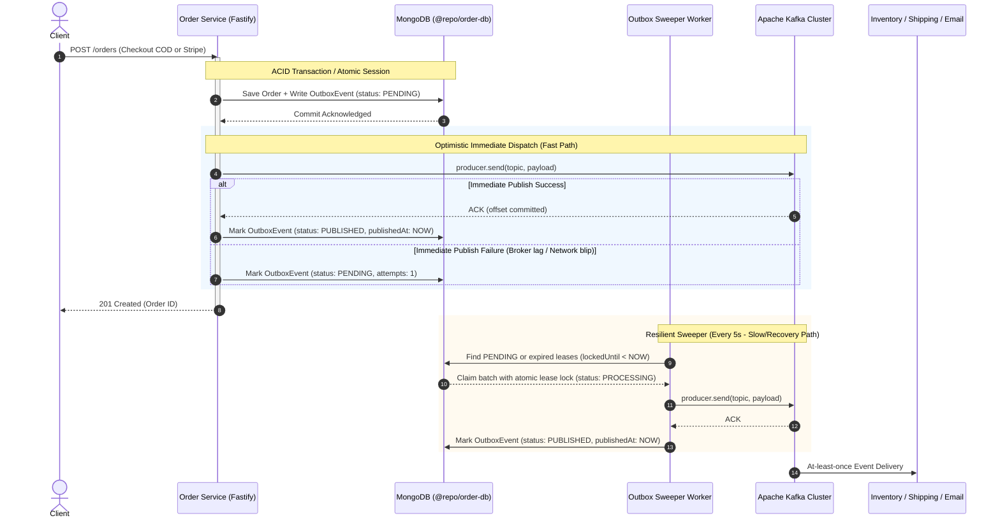

# Architecture Specification: Transactional Outbox Pattern for Order Service

## 1. Executive Summary & Problem Statement

In distributed event-driven microservices, **dual-write inconsistency** is the primary source of silent data corruption:

1. An order is created or updated in MongoDB via `newOrder.save()`.
2. The application subsequently attempts to dispatch a Kafka event (`producer.send("order.created", ...)`).
3. If Kafka is temporarily unreachable, the broker restarts, or the container crashes during this window, the database write succeeds but **the event is permanently lost**.
4. Downstream consumers (`inventory-service`, `shipping-service`, `email-service`, `notification-service`) never receive the notification, resulting in uncommitted reservations, missed order fulfillments, and broken customer workflows.

To eliminate this bottleneck, this plan implements the **Transactional Outbox Pattern** with **Optimistic Immediate Dispatch** and a **Lease-Locked Background Sweeper**.

---

## 2. Architecture & Data Flow



---

## 3. Data Model: `OutboxEvent` Schema (`@repo/order-db`)

```typescript
export interface IOutboxEvent {
  topic: string;
  payload: Record<string, unknown>;
  status: "PENDING" | "PROCESSING" | "PUBLISHED" | "FAILED";
  attempts: number;
  maxAttempts: number;
  lockedUntil?: Date | null;
  lastError?: string | null;
  createdAt: Date;
  updatedAt: Date;
  publishedAt?: Date | null;
}
```

### Key Indexes:

1. **Worker Polling Index**: `{ status: 1, lockedUntil: 1, createdAt: 1 }`
   - Ensures $O(\log N)$ atomic claiming of pending/stale events.
2. **7-Day Retention TTL Index**: `{ publishedAt: 1 }, { expireAfterSeconds: 604800 }`
   - MongoDB natively purges events 7 days after `publishedAt`.
   - Preserves full event history for replayability and support debugging without unbounded disk growth.

---

## 4. Multi-Replica Concurrency & Lease Locking

To prevent duplicate publishes when running multiple `order-service` replicas in Docker or Kubernetes:

- Events are claimed using atomic `findOneAndUpdate`:
  ```typescript
  const event = await OutboxEvent.findOneAndUpdate(
    {
      _id: candidateId,
      status: { $in: ["PENDING", "PROCESSING"] },
      $or: [{ lockedUntil: null }, { lockedUntil: { $lte: new Date() } }],
    },
    {
      $set: {
        status: "PROCESSING",
        lockedUntil: new Date(Date.now() + 30_000), // 30s lease
      },
      $inc: { attempts: 1 },
    },
    { new: true },
  );
  ```
- If the worker crashes mid-publish, the 30-second lease expires and another replica automatically takes over.
- Once published, the event is marked `PUBLISHED` with `publishedAt = new Date()`.

---

## 5. Scope of Events Covered

| Event Topic                       | Trigger                      | Impact of Elimination of Event Loss                           |
| :-------------------------------- | :--------------------------- | :------------------------------------------------------------ |
| `order.created`                   | New checkout (COD / Stripe)  | Guarantees downstream notification, metrics, and stock checks |
| `order.confirmed`                 | Inventory + Tax Dual-ACK     | Guarantees fulfillment label generation in `shipping-service` |
| `order.cancelled`                 | Out of stock or tax mismatch | Guarantees compensation rollback across services              |
| `payment.refund.requested`        | Saga cancellation            | Guarantees Stripe refund execution in `payment-service`       |
| `inventory.reservation.cancelled` | Order cancellation           | Guarantees stock release in PostgreSQL inventory              |

---

## 6. Implementation Architecture

1. **`@repo/order-db`**:
   - `OutboxEvent` schema, model, and TypeScript types.
   - Atomic helper functions: `createOutboxEvent`, `claimPendingOutboxEvents`, `markOutboxPublished`, `markOutboxFailed`.
2. **`apps/order-service` Relay Core**:
   - `src/outbox/outbox-relay.ts` dual-mode dispatcher:
     - `dispatchViaOutbox(topic, payload, session?)`: writes event, then invokes non-blocking immediate dispatch.
     - `startOutboxSweeper()`: starts 5-second resilient background polling loop.
3. **Order Service Handlers**:
   - Direct `producer.send(...)` in `src/routes/order.ts` and `src/utils/order.ts` replaced with `dispatchViaOutbox(...)`.
4. **Lifecycle Integration**:
   - Initialized `startOutboxSweeper()` during Fastify server bootstrap.
   - Gracefully terminates the sweeper loop during `server.close()`.
5. **Verification & Tests**:
   - Automated tests in `apps/order-service/tests/transactional-outbox.test.ts` verifying event recovery and lease locking.
