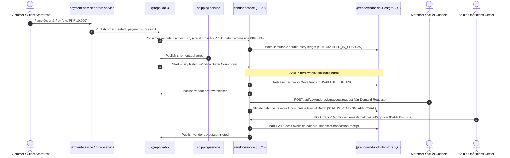

# Multi-Vendor Merchant Escrow & Automated Payout Ledger — Implementation Plan

## 1. Executive Summary & Architecture Overview

The **Multi-Vendor Merchant Escrow & Automated Payout Ledger** establishes an enterprise-grade financial settlement engine for Larekmart (marketplace model akin to Amazon, Daraz, and Alibaba). It safely holds customer payments in escrow, calculates category-tiered platform commissions, manages a 7-day post-delivery dispute/return buffer, and executes automated weekly settlements as well as on-demand payout requests.

---

## 2. 8-Stage 360° Feature Delivery Breakdown

### Stage 1: Domain Contracts & Zod Schemas (`@repo/types`)

- Create `packages/types/src/settlements.ts`:
  - `EscrowStatusEnum` (`HELD_IN_ESCROW`, `RELEASED`, `REFUNDED_RETURN`, `DISPUTE_FROZEN`).
  - `PayoutStatusEnum` (`PENDING_APPROVAL`, `PROCESSING`, `PAID`, `REJECTED`, `FAILED`).
  - `EscrowTransactionSchema`: Line-item breakdown, gross amount, commission rate, net merchant amount, release due date.
  - `VendorBalanceSchema`: Available balance, pending escrow balance, total disbursed.
  - `RequestPayoutSchema`: Minimum payout threshold verification (e.g. PKR 5,000 / $50).
  - `PayoutBatchSchema`: Banking details snapshot (IBAN, bank name, account title), transfer reference.
- Export all schemas and types in `packages/types/src/index.ts`.

### Stage 2: Database Schema & Migration (`@repo/vendor-db`)

- In `packages/vendor-db/prisma/schema.prisma`, add:
  - `VendorCommissionRate`: Category ID, default rate (e.g., Electronics 5%, Apparel 12%), custom vendor override.
  - `VendorEscrowLedger`: Double-entry immutable ledger tracking gross order amount, commission fee, tax withholding, net merchant earnings, order ID, delivery date, release timestamp, and lifecycle state.
  - `VendorBalance`: Authoritative balances (`availableBalance`, `escrowBalance`, `lifetimeEarnings`, `lifetimePaid`).
  - `VendorPayoutRequest`: Merchant on-demand requests, payment method, bank snapshot, audit logs.
  - `VendorPayoutBatch`: Automated weekly batch aggregation and disbursement tracking.
- Run `prisma generate` and create migration scripts.

### Stage 3: Microservice Business Logic (`apps/vendor-service`)

- In `apps/vendor-service`:
  - **Ledger Service**: Implements transactional double-entry accounting (credits must equal debits). Prevents negative balances or double-release.
  - **Commission Service**: Evaluates category hierarchy and applies vendor negotiated overrides.
  - **Escrow Transition Engine**: Background cron worker (or Kafka-triggered sweeper) evaluating `shipment.delivered` timestamps older than 7 days without active return requests (`return.requested`), moving status from `HELD_IN_ESCROW` to `RELEASED`.
  - **Payout Controller**:
    - `GET /api/v1/vendors/:id/balance` — Current balances and escrow releases.
    - `GET /api/v1/vendors/:id/ledger` — Paginated double-entry financial statement.
    - `POST /api/v1/vendors/:id/payouts/request` — On-demand merchant payout request with idempotency.
    - `GET /api/v1/admin/settlements/overview` — Platform financial liabilities, escrow totals, and fees.
    - `POST /api/v1/admin/settlements/batches/generate` — Weekly automated batch generation.
    - `POST /api/v1/admin/settlements/batches/:id/approve` — Payout approval and bank execution.

### Stage 4: Event-Driven Kafka Coordination (`@repo/kafka`)

- Producers in `vendor-service`:
  - `vendor.escrow.credited`: Emitted when new order is credited to merchant escrow.
  - `vendor.escrow.released`: Emitted when cooling-off buffer clears and balance becomes available.
  - `vendor.payout.requested`: Emitted to notify financial compliance.
  - `vendor.payout.completed`: Emitted to trigger customer/merchant notification email & push.
- Consumers in `vendor-service`:
  - `order.created` / `payment.successful`: Create escrow ledger holds.
  - `shipment.delivered`: Stamp delivery timestamp and compute 7-day release maturity date.
  - `return.requested` / `return.approved`: Freeze or reverse escrow before merchant disbursement.

### Stage 5: API Gateway Perimeter & Security (`apps/api-gateway`)

- Register `/api/v1/vendors/:id/payouts` and `/api/v1/vendors/:id/ledger` in `authenticated.routes.ts` with strict merchant IDOR checks.
- Register `/api/v1/admin/settlements/*` in `admin.routes.ts` requiring verified admin role.
- Enforce idempotency on payout requests (`Idempotency-Key` headers via `@repo/redis`).

### Stage 6: Storefront Merchant Console (`apps/client`)

- In `apps/client/src/app/account/seller/payouts/page.tsx` (or dedicated seller finance tab):
  - **Financial Summary Cards**: Available for Payout, Held in Escrow (7-Day Buffer), Total Withdrawn.
  - **Escrow Pipeline**: Active orders with countdown badge (e.g. "Releases in 3 days").
  - **Request Payout Modal**: Threshold validation, verified bank account selection, real-time fee preview.
  - **Statement Export**: Download transaction history and settlement receipts.

### Stage 7: Admin Operations Center (`apps/admin`)

- In `apps/admin/src/app/(dashboard)/settlements/page.tsx`:
  - **Platform Settlement KPI Bar**: Escrow Held Across Platform, Pending Payout Batches, Collected Commission Revenue.
  - **Settlement Batches Table**: Weekly grouped batches with merchant count, gross/net totals, and batch approval trigger.
  - **Dispute Freeze Actions**: Emergency hold toggle on vendor accounts under inspection.

### Stage 8: Testing, Security Audit & Verification

- Unit & integration tests in `apps/vendor-service/tests/settlements.test.ts`:
  - Double-entry balance integrity invariant (Available + Escrow + Paid == Total Credited).
  - Return window buffer calculation test.
  - Negative balance prevention and idempotency replay tests.
  - Zero-trust IDOR test: Merchant A cannot view or request payouts for Merchant B.
- Monorepo quality gates: `pnpm check-types`, `pnpm test`, `pnpm build`, `pnpm lint`, and documentation sync.
