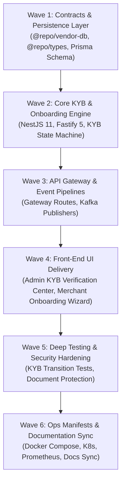

# Vendor Legal Onboarding & KYB Engine Implementation Plan (`vendor-service`)

## 1. Executive Summary

The **Vendor Management Service** (`apps/vendor-service`, Port 8020) is the legal onboarding, corporate verification, and Know Your Business (KYB) compliance microservice for **Larekmart**'s multi-vendor marketplace platform.

This document details the end-to-end implementation plan under the **6-Pillar Feature Service Delivery Standard**:

- **Pillar 1**: Front-End Merchant Onboarding & Admin KYB Review UI (`apps/client`, `apps/admin`).
- **Pillar 2**: Cross-Service & Gateway Integration (`api-gateway`, `@repo/kafka`, `seller-service`, `payout-service`, `media-service`).
- **Pillar 3**: Manifests, Observability & Config (`docker-compose.yml`, K8s, Prometheus, CI/CD).
- **Pillar 4**: Deep Project Analysis & Comprehensive Testing (KYB state transitions, document verification, unit & integration test suites).
- **Pillar 5**: Security Audit & Zero-Trust Perimeter Hardening (Document access isolation, constant-time secret validation).
- **Pillar 6**: Monorepo Documentation & Architecture Synchronization (`README.md`, `docs/plans/README.md`).

---

## 2. Architectural Topology & Service Boundaries

```text
                             ┌──────────────────────────────────────────────┐
                             │           Presentation Layer (Next.js)       │
                             │ apps/client (:3002)     apps/admin (:3003)   │
                             └──────────────────────┬───────────────────────┘
                                                    │ HTTPS / REST
                                                    ▼
                             ┌──────────────────────────────────────────────┐
                             │          API Gateway (Fastify, :8080)        │
                             │  - Identity scrubbing & Clerk session verify │
                             │  - Document upload forwarding & secret sign  │
                             └──────────────────────┬───────────────────────┘
                                                    │ Proxied HTTP + Gateway Claims
                                                    ▼
                             ┌──────────────────────────────────────────────┐
                             │           vendor-service (:8020)             │
                             │ NestJS 11 + Fastify 5 + Prisma ORM           │
                             │ ├─ LegalEntityManager (Company Registrations)│
                             │ ├─ KybWorkflowEngine (Document Verification) │
                             │ ├─ RepresentativeManager (Beneficial Owners) │
                             │ └─ LifecycleStateManager (KYB State Machine) │
                             └───────┬──────────────────────┬───────────────┘
                                     │                      │
                          Prisma ORM │                      │ Redis Leases
                                     ▼                      ▼
                           PostgreSQL Database         Redis Instance
                           (larekmart_vendor_db)      (ioredis, :6379)
                                     │
                                     │ Asynchronous Kafka Events
                                     ▼
                              Apache Kafka Topics
                              - vendor.registered
                              - vendor.kyb.approved
                              - vendor.kyb.rejected
                                     │
                  ┌──────────────────┼──────────────────┐
                  ▼                  ▼                  ▼
            seller-service     payout-service     notification-service
```

---

## 3. Work Breakdown Structure



---

## 4. Phase-by-Phase Technical Specifications

### Wave 1: Domain Contracts & Persistence Layer

1. **Shared Domain Contracts (`packages/types/src/vendor.ts`)**:
   - Legal entity types: `INDIVIDUAL_PROPRIETOR`, `CORPORATION`, `LLC`, `PARTNERSHIP`.
   - KYB statuses: `DRAFT`, `SUBMITTED`, `IN_REVIEW`, `VERIFIED`, `REJECTED`, `ACTION_REQUIRED`.
   - Zod validation schemas for legal registration, document attachments, and verification review notes.
2. **Relational Database Design (`packages/vendor-db/prisma/schema.prisma`)**:
   - `vendors`: Legal business entity name, registration number, tax ID, registration address, and status.
   - `vendor_documents`: Business licenses, tax exemption certificates, and proof of address URLs.
   - `authorized_representatives`: Beneficial owners, identity documents, and signing authorization.
   - `kyb_reviews`: Immutable review logs containing compliance officer decisions, timestamps, and notes.

### Wave 2: Core KYB Engine & State Machine

1. **Strict KYB State Transitions**:
   - Merchants start in `DRAFT` and advance to `SUBMITTED` upon document upload.
   - Transitions to `VERIFIED` unlock seller storefront activation and payout disbursements.
   - Rejection requires structured reason codes (`INVALID_TAX_ID`, `EXPIRED_LICENSE`, `NAME_MISMATCH`).
2. **Document Lifecycle & Media Integration**:
   - Coordinates with `media-service` for secure presigned object storage.
   - Sensitive legal documents are marked restricted and require admin authorization to view.

### Wave 3: API Gateway & Event Pipelines

1. **API Gateway Routes**:
   - Merchant self-registration & document upload: `/api/v1/vendors/*` (`requireAuth: true`).
   - Admin KYB review & approval: `/api/v1/admin/vendors/*` (`requireAdmin: true`).
2. **Kafka Event Producers**:
   - Emits `vendor.kyb.approved` to notify `seller-service` to activate the merchant's store.
   - Emits `vendor.kyb.rejected` to trigger notification emails via `notification-service`.

### Wave 4: Front-End UI Delivery

1. **Storefront Merchant Onboarding Wizard (`apps/client/src/app/seller/onboarding/`)**:
   - Multi-step onboarding form (Company Profile -> Legal Docs -> Bank Details -> Review).
   - Real-time verification status progress tracker.
2. **Admin KYB Compliance Center (`apps/admin/src/app/(dashboard)/vendors/`)**:
   - Compliance review queue with document viewer.
   - Approval/Rejection action drawer with audit rationale input.

### Wave 5: Comprehensive Testing & Security Hardening

1. **State Machine & RBAC Verification**:
   - Tests validating that unverified vendors cannot be approved without attached documents.
   - Tests ensuring only compliance officers with `ADMIN` role can approve KYB dossiers.
2. **Perimeter Hardening**:
   - Zero-trust internal secret checks (`safeTimingCompare`).
   - Strict stripping of untrusted headers at the API Gateway.

### Wave 6: Manifests & Global Architecture Sync

1. **Deployment Manifests**:
   - Containerized in `docker-compose.yml` on port 8020.
   - Database schema generated via `pnpm --filter @repo/vendor-db db:generate`.
   - Prometheus metrics configured at `/metrics`.
