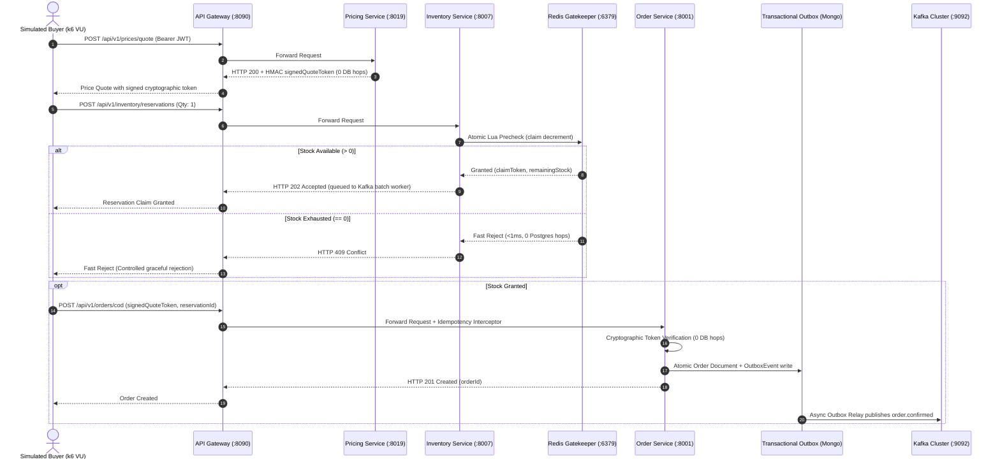

# Larekmart Flash-Sale Load Testing & Saga Benchmark

High-throughput distributed load testing suite designed with [k6](https://k6.io/) to benchmark Larekmart's **50,000+ RPS Flash-Sale Architecture**:
- **Pricing Service**: Zero-DB cryptographic HMAC-signed price quote generation (`/api/v1/prices/quote`).
- **Inventory Service**: Atomic Redis Lua stock gatekeeper & bucket partitioning (`/api/v1/inventory/reservations`).
- **Order Service**: High-concurrency COD checkout, MongoDB write-plane scalability, and transactional outbox relay (`/api/v1/orders/cod`).
- **API Gateway**: Idempotency caching, reverse-proxy circuit breaking, and sub-millisecond route dispatch.

---

## Architecture Tested



---

## SLO Targets & Performance Thresholds

| Metric | Threshold | Architectural Mechanism |
| :--- | :--- | :--- |
| **Stock Fast-Reject Latency** | `p(99) < 10ms` | Redis Lua atomic precheck rejects depleted stock in memory without touching PostgreSQL. |
| **Pricing Quote Latency** | `p(95) < 35ms` | Server-authoritative HMAC SHA-256 quote tokens eliminate round-trips to the catalog database. |
| **Order Commit Latency** | `p(95) < 150ms` | Single-document atomic MongoDB write + local outbox write; Kafka publishing is strictly asynchronous. |
| **Oversell Violations** | **`0` (Strict)** | Distributed atomic Redis counter prevents allocating > initial stock regardless of concurrency. |
| **Duplicate Orders** | **`0` (Strict)** | Distributed Redis `x-idempotency-key` filter returns cached response upon duplicate submission. |

---

## Quick Start

### Prerequisites
Make sure Larekmart core services or the full stack is running:
```bash
docker compose up -d
```

### 1. Seed Flash-Sale Inventory
Initialize 100 units of the hot SKU across Redis gatekeeper buckets:
```bash
chmod +x infrastructure/load-tests/*.sh
./infrastructure/load-tests/seed-flash-sale.sh
```

### 2. Execute the Flash-Sale Benchmark
Run the k6 load test (automatically uses local `k6` or Docker image `grafana/k6:latest`):
```bash
./infrastructure/load-tests/run-flash-sale.sh
```

To customize parameters (target URL, stock amount, duration):
```bash
TARGET_URL="http://localhost:8090" \
ALLOCATED_STOCK=250 \
./infrastructure/load-tests/run-flash-sale.sh
```

---

## Live Monitoring During Flash Sale
Open Grafana (`http://monitoring.localhost` or `http://localhost:3001`):
1. **Inventory Dashboard**: Monitor `inventory_gatekeeper_claims_total` vs `inventory_gatekeeper_fast_rejects_total`.
2. **PgBouncer & PostgreSQL**: Observe active connection count — notice connection count remains flat even when 3,000+ concurrent requests arrive, thanks to transaction pooling and Redis fast-rejects.
3. **Kafka & Outbox Relay**: Observe outbox relay queue depth and Kafka consumer throughput on topic `order.confirmed`.
